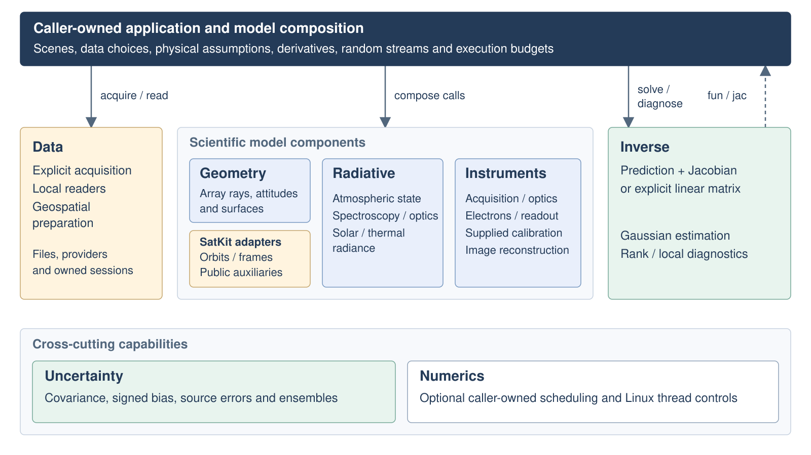

# Orsia

Orsia is a work in progress. It provides reusable scientific Python libraries for remote-sensing observation modelling, instrument simulation, uncertainty propagation and retrieval. Applications can compose atmospheric radiance, observation geometry and detector response, then solve an inverse problem with their own physical model and derivatives.

The repository contains seven separately packaged libraries in a non-package UV workspace, targeting CPython 3.14 free-threaded. Applications and studies own scene and dataset selection, instrument assumptions, model composition and acceptance criteria. Library guides define the implemented contracts and their scientific limits.

## High-level design



Solid arrows show selected application calls; the dashed arrow shows Inverse evaluating caller-supplied prediction and Jacobian functions. The scientific components are independently selectable. Their grouping describes responsibilities, without prescribing an execution sequence or an all-to-all import graph. [Full-size editable SVG](assets/architecture.svg).

- **Application composition:** the caller connects scientific values and operations, defines the forward model, supplies coordinate conventions and controls execution. Inverse accepts prediction/Jacobian callbacks or an explicit linear matrix; it has no Instruments dependency.
- **Resources and calculation:** Data owns explicit scientific-product acquisition, local readers and geospatial preparation. Pure numerical kernels consume materialised values. Geometry also has lazy SatKit orbital/frame adapters that can acquire public auxiliary files and use process-global caches; their resource contract applies when selected.
- **Shared capabilities:** Uncertainty supplies array-based error algebra to callers and consuming libraries. Numerics offers optional application-owned CPU scheduling on supported Linux systems. Scientific calls remain sequential unless the application schedules them.

## Library guides

Each guide introduces its library with an example and links to detailed numerical contracts, ownership rules and evidence limits.

| Library | Responsibility |
| --- | --- |
| [Data](libs/orsia-data/README.md) | Explicit acquisition, local atmosphere/solar/spectroscopy/orbit/product readers and geospatial preparation. |
| [Geometry](libs/orsia-geometry/README.md) | Trajectories, independent attitude laws, ray composition, frame transformations and analytic surface intersections. |
| [Radiative](libs/orsia-radiative/README.md) | Atmospheric state and spectroscopy, optical composition, reflected-solar and non-scattering thermal radiance, physical bands and cubes. |
| [Instruments](libs/orsia-instruments/README.md) | Acquisition, optical response, expected electrons, detector readout, supplied calibration and native-band image reconstruction. |
| [Inverse](libs/orsia-inverse/README.md) | Fixed-covariance nonlinear Gaussian estimation, rank-aware linear inversion and local retrieval diagnostics. |
| [Uncertainty](libs/orsia-uncertainty/README.md) | Covariance factors and transport, signed bias, source cross-covariances and explicit-RNG ensembles. |
| [Numerics](libs/orsia-numerics/README.md) | Caller-owned CPU thread pools with verified Linux affinity and explicit native thread limits. |

The timed [instrument line-of-sight contract](libs/orsia-instruments/docs/line-of-sight.md#time-frames-support-and-ownership) uses elapsed SI seconds from a timezone-aware UTC epoch and positions, velocities and rays in the geocentric celestial reference system (GCRS). Terrestrial inputs require explicit dated frame conversion. Detailed units, shapes, support and mutation rules belong to the linked library references.

## Getting started

Choose a guide for the calculation you need, then run its Python blocks in order with the relevant distribution and dependencies installed. The [development environment](#development-environment) installs the workspace libraries together.

| Start with | What it demonstrates | Inputs and resources |
| --- | --- | --- |
| [Radiative solar example](libs/orsia-radiative/README.md#minimal-solar-example) | A transparent atmosphere and Lambertian reflection. | Synthetic in-memory values. |
| [Instrument image example](libs/orsia-instruments/README.md#minimal-image-example) | A uniform radiance field, optical filter, detector and seeded noisy reads. | Synthetic in-memory values. |
| [Inverse fit](libs/orsia-inverse/README.md#minimal-example) | Caller-defined prediction/Jacobian functions and local posterior diagnostics. | Synthetic observations and covariance. |
| [Geometry ground trace](libs/orsia-geometry/README.md#construct-a-leo-trajectory-and-ground-trace) | A designed orbit, independent attitudes and WGS84 intersections. | SatKit with dated orbital auxiliaries; the guide gives an offline-fixture recipe. |
| [Maintained notebooks](notebooks/README.md) | Five-band radiative comparison and six instrument-response chains. | Prepared local inputs; acquisition and execution are separate documented operations. |

The Data, Uncertainty and Numerics guides provide additional focused examples. The [guide tests](tests/test_library_guides.py) execute dependency-light examples with sockets blocked; the orbital example has a separate native-fixture check. See [documentation checks](DEVELOPMENT.md#documentation-checks) for the commands.

## Development environment

Prerequisite: Devbox with Nix configured. From this repository root, provision the pinned toolchain, interpreter and locked workspace:

```bash
MAKEFLAGS=-j2 CARGO_BUILD_JOBS=2 CMAKE_BUILD_PARALLEL_LEVEL=2 UV_CONCURRENT_BUILDS=2 devbox run -- just setup
```

Setup can download tools and dependencies. For an already provisioned environment, use `UV_NO_SYNC=1` to prevent package synchronization during checks. Common commands are:

```bash
UV_NO_SYNC=1 devbox run -- just lint
MPLBACKEND=Agg UV_NO_SYNC=1 devbox run -- just --justfile tests/justfile pytest tests/test_library_guides.py
MPLBACKEND=Agg UV_NO_SYNC=1 devbox run -- just check
```

`check` runs formatting, lint, typing and the full split-process test/coverage gate. Use focused checks while working, and the full gate for repository-wide validation. [DEVELOPMENT.md](DEVELOPMENT.md) covers environment ownership, optional backends, native builds, platform limits, recipe arguments and coverage policy.

## Scientific maturity and limits

Orsia has executable examples, synthetic regressions and bounded reference comparisons. Their conclusions apply to the tested inputs, observables and numerical settings. Scientific qualification remains case-specific:

- [Radiative transfer](libs/orsia-radiative/docs/transfer.md#evidence-and-limits) includes experimental fixed-order solar scattering and absorption-only LTE thermal transfer. Order, angle, layer and spectral convergence need separate assessment; broad atmospheric accuracy remains unqualified.
- [Data interoperability](libs/orsia-data/README.md#resource-and-evidence-boundaries) depends on the reader and provider. Local synthetic checks leave authentic dataset coverage and live-provider behavior subject to the documented evidence limits.
- [Instrument simulation](libs/orsia-instruments/README.md#physical-conventions-and-limits) and [inverse estimation](libs/orsia-inverse/README.md#fit-and-diagnostic-rules) retain explicit support, calibration, rank and model-validity conditions. Output sampling, physical resolution, identifiability and geophysical retrieval accuracy require distinct evidence.
- [Native execution](libs/orsia-numerics/docs/execution.md) requires explicit resource control and stable inputs. A disabled GIL or successful software gate leaves concurrent native-library safety, scientific accuracy and hardware feasibility unqualified.

The [notebook guide](notebooks/README.md) records the assumptions and unresolved numerical sensitivities of the larger demonstrations. Software coverage policy and contributor guidance are in the [development reference](DEVELOPMENT.md#test-coverage-policy).

## License

Orsia-authored source, tests, synthetic fixtures, documentation, notebooks, diagrams, saved notebook figures and diagram SVG/PNG exports are distributed under Apache-2.0. External inputs used to generate notebook figures retain their provider terms and attribution requirements. See the root [LICENSE](LICENSE), each library's `LICENSE` and the [notebook provenance guide](notebooks/README.md#provenance-and-attribution).
