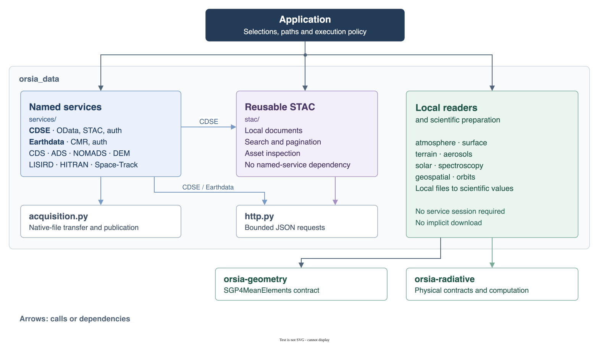

# Orsia Data

`orsia-data` provides explicit scientific acquisition, local product readers and geospatial preparation. Applications choose products and destinations, then pass materialised values to numerical libraries. Imports and local reads never download; some explicit `fetch_*` calls combine acquisition and decoding.

## Architecture



Arrows show selected calls or dependencies. Discovery, transfer and local interpretation remain independently callable. [Full-size SVG](docs/diagrams/architecture.svg) · [Editable Draw.io source](docs/diagrams/architecture.drawio).

## Minimal offline example

Run the example with this distribution and its dependencies installed, or in the [Orsia development environment](../../README.md#development-environment). This example creates temporary synthetic bytes, reads them locally and retains the values after removing the file. It needs no credentials or network.

```python
from pathlib import Path
from tempfile import TemporaryDirectory
from orsia_data.solar.irradiance import read_solar_spectrum_csv

with TemporaryDirectory() as directory:
    path = Path(directory) / "solar.csv"
    path.write_text(
        "wavelength (nm),irradiance (W/m^2/nm)\n500.0,1.8\n501.0,1.9\n",
        encoding="utf-8",
    )
    spectrum = read_solar_spectrum_csv(path)

assert spectrum.wavelengths_nm.tolist() == [500.0, 501.0]
assert spectrum.irradiance_per_nm.flags.writeable
print(spectrum.irradiance_per_nm.tolist())
```

Expected output: `[1.8, 1.9]`, in W m-2 nm-1 at point centres in nm. Reading performs no spectral conversion, resampling, distance scaling or uncertainty inference.

## Choose an entry point

| Need | Guide |
| --- | --- |
| Catalogue search, local STAC example, source ownership and service sessions | [Services and STAC](docs/services.md) |
| Surface, terrain, AOD, raster windows/reprojection and product formats | [Data products](docs/products.md) |
| ERA5/CAMS/GFS and MIPAS profiles; local formats and optional backends | [Atmospheric boundary](docs/atmosphere.md) |
| Solar CSV, grouped HITRAN collections, native laboratory spectra, detailed line/partition tables and MT_CKD water | [Readers and acquisition](docs/readers-and-acquisition.md) |
| Space-Track GP acquisition and scalar SGP4 mean-element reading/selection | [Orbital elements](docs/orbital-elements.md) |

`orsia-data` depends on Geometry for the lightweight immutable `SGP4MeanElements` contract. SatKit 0.24.1 is a required dependency for local GP OMM JSON/TLE parsing and Space-Track payload validation. Its private parser import remains deferred until use. The diagram shows selected dependencies; the orbital contract dependency is described in the [SGP4 guide](docs/orbital-elements.md).

## Resource and evidence boundaries

- Use context managers for owned service sessions and authentication. Mutable clients are synchronous and not thread-safe; callers own scheduling and isolation.
- Downloads publish native bytes without overwriting an existing destination. Timeouts, byte bounds, trusted hosts and failure cleanup depend on the explicit transport contract.
- Readers require supported schemas and physical support. Detailed readers return independent writable arrays; reusable spectroscopy collection references contain independent read-only snapshots. Keep raw files stable during reading.
- The experimental LISIRD adapter has no verified live schema here. HAPI acquisition mutates shared backend state and requires caller-managed serialization or isolation.

From the workspace root, run `devbox run -- just test-data`. Offline synthetic tests establish software contracts; authentic provider coverage and scientific accuracy have separate evidence limits in each guide. Credentials and copyrighted raw products remain outside the repository.
