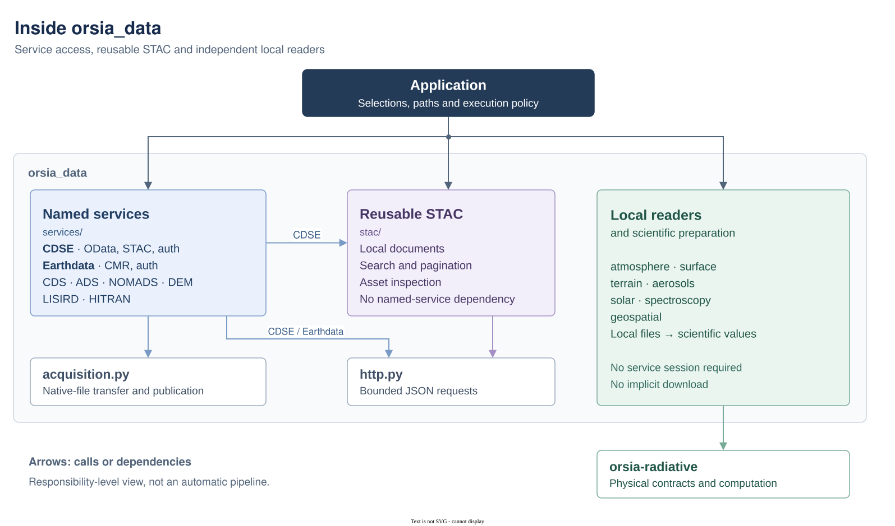

# Inside `orsia_data`

`orsia_data` connects explicitly selected data sources to local scientific readers. It separates **discovery** (find metadata), **acquisition** (transfer native bytes) and **interpretation** (read local files into scientific values). The application chooses products, assets, destinations and processing; importing the package or calling a local reader never starts a download.

This guide explains the implemented source architecture and gives progressive examples. See the [package API reference](../../README.md) for the full inventory and [service contracts](../../../../docs/data-services.md) for authentication, pagination and compatibility details.

## Architecture at a glance

The arrows below mean **calls or depends on**, not automatic execution. The application can enter through any of the three upper boundaries; local reading does not require a service client.



Diagram: [editable Draw.io source](../../docs/diagrams/architecture.drawio) · [PNG export](../../docs/diagrams/architecture.png). The module table below details the responsibilities grouped in the figure.

This is a responsibility-level view, not an exhaustive import graph. CDS/ADS also call an injected retrieval method, HITRAN calls optional HAPI, and legacy LISIRD/HITRAN `fetch_*` adapters explicitly combine acquisition and decoding. MT_CKD acquisition remains in `spectroscopy.continuum`. These exceptions do not make local `read_*` functions depend on service sessions.

A typical application-controlled data flow is:

```text
search -> inspect native metadata -> select a product or asset
       -> download to a chosen path -> extract if needed -> read locally
       -> pass physical values to numerical calculations
```

No step automatically triggers the next. STAC asset resolution produces a URI, not a downloaded file, a trusted credential destination or a scientific scene.

### Where to look

| Source | Responsibility | Important boundary |
| --- | --- | --- |
| `services/cdse/` | `CdseClient`, `CdseAuth`, OData discovery/download and composed STAC access | OData download authentication is not forwarded to STAC assets. |
| `services/earthdata/` | `EarthdataClient`, `EarthdataAuth`, CMR discovery and selected downloads | The caller supplies tokens and explicitly trusted download hosts. |
| `services/cds.py`, `services/ads.py` | ERA5 and CAMS acquisition | Borrow a configured `retrieve` callable; do not construct an SDK client. |
| `services/nomads.py`, `services/copernicus_dem.py` | GFS subsets and public DEM tile acquisition | Caller-selected requests and destinations. |
| `services/lisird.py`, `services/hitran.py` | Existing solar and spectroscopy acquisition adapters | Explicit `fetch_*` operations may also decode; HAPI is optional. |
| `services/mipas.py`, `atmosphere/rfm.py` | Historical MIPAS 2001 reference-file acquisition and separate local RFM decoding | Native levels and concentrations in SI arrays; see the [contract and example](../../../../docs/mipas-reference-atmospheres.md). |
| `services/catalogue.py` | Shared bbox and UTC query conventions | Query preparation, not scientific interpretation. |
| `stac/catalog.py` | Read bounded local STAC JSON documents | Envelope checks, not complete STAC/extension schema validation. |
| `stac/client.py` | `StacClient`, GET/POST search and bounded pagination | Knows no named service; preserves native page dictionaries. |
| `stac/assets.py` | Filter assets and resolve a selected href | Pure inspection; no transfer or automatic band selection. |
| `http.py` | `JsonSession`, bounded JSON transport | Native requests use HTTPS and refuse redirects and environment proxies. |
| `acquisition.py` | Common file transfer, size/digest checks and publication | Does not decode products; existing destinations are not overwritten. |
| `atmosphere/`, `surface/`, `terrain.py`, `aerosols.py` | Local atmospheric, reflective, thermal, elevation and AOD inputs | Supported formats and physical support remain explicit. |
| `solar/`, `spectroscopy/` | Local irradiance, lines, partition tables, continua and cross sections | Scientific arrays/contracts, not catalogue metadata. |
| `geospatial.py` | Local raster IO, windows, sampling, reprojection and mosaics | Explicit grids and validity; no service selection. |
| `providers.py`, domain compatibility exports | Preserve earlier acquisition imports | Prefer the named service imports in new acquisition code. |

`stac/`, `http.py` and `acquisition.py` do not import named services or scientific readers. Scientific readers may construct public `orsia-radiative` contracts; `orsia-radiative` does not import data services or file readers. Pure physical calculation belongs in the numerical libraries, not in service clients.

## Progressive examples

Use an environment with `orsia-data` and its declared dependencies installed; see the [repository setup](../../../../README.md). Each block below is independent. Examples 1 and 2 create temporary synthetic files, need no credentials and make no network requests. Examples 3 to 5 are opt-in network examples: they require caller-selected endpoints or products and are not evidence of live-provider interoperability.

### 1. Inspect a local STAC Item without downloading its assets

**Goal:** distinguish a catalogue document from the data it references. This synthetic Item contains two assets; filtering by role keeps the data asset, then resolving its relative href produces a local URI. The referenced CSV is deliberately not created or opened.

```python
import json
from pathlib import Path
from tempfile import TemporaryDirectory

from orsia_data.stac import asset_href, read_document, select_assets

with TemporaryDirectory() as directory:
    path = Path(directory).resolve() / "item.json"
    path.write_text(
        json.dumps(
            {
                "type": "Feature",
                "stac_version": "1.0.0",
                "id": "teaching-item",
                "geometry": None,
                "properties": {"datetime": "2025-01-01T00:00:00Z"},
                "links": [],
                "assets": {
                    "spectrum": {
                        "href": "./solar.csv",
                        "type": "text/csv",
                        "roles": ["data"],
                    },
                    "preview": {
                        "href": "./preview.png",
                        "type": "image/png",
                        "roles": ["thumbnail"],
                    },
                },
            }
        ),
        encoding="utf-8",
    )

    item = read_document(path)
    candidates = select_assets(item, role="data", media_type="text/csv")
    assert list(candidates) == ["spectrum"]
    href = asset_href(item, "spectrum", document_url=path.as_uri())
    assert href == (path.parent / "solar.csv").as_uri()
    assert not (path.parent / "solar.csv").exists()
    print(list(candidates))  # ['spectrum']
```

`select_assets` returns independent copies of matching metadata; it does not rank alternatives. Always pass the actual source document URI when resolving relative hrefs. `read_document` accepts supported envelopes without claiming that every field satisfies a complete STAC schema.

### 2. Read scientific values from a local file

**Goal:** use a scientific reader independently of discovery, authentication and acquisition. These two CSV samples are invented teaching values, not a measured or calibrated solar spectrum.

```python
from pathlib import Path
from tempfile import TemporaryDirectory

from orsia_data.solar.irradiance import read_solar_spectrum_csv

with TemporaryDirectory() as directory:
    path = Path(directory) / "solar.csv"
    path.write_text(
        "wavelength (nm),irradiance (W/m^2/nm)\n500.0,1.8\n501.0,1.9\n",
        encoding="utf-8",
    )
    spectrum = read_solar_spectrum_csv(path)

# Owned snapshots remain usable after the temporary file is removed.
assert spectrum.wavelengths_nm.tolist() == [500.0, 501.0]
assert spectrum.irradiance_per_nm.tolist() == [1.8, 1.9]
assert spectrum.uncertainty_per_nm is None
assert spectrum.irradiance_per_nm.flags.writeable
print(spectrum.irradiance_per_nm.shape)  # (2,)
```

The returned `SolarIrradianceSpectrum` is an `orsia-radiative` contract. Its independent writable float64 arrays have shape `(n_points,)`; wavelengths are point centres in nm and irradiance is in W m-2 nm-1. Reading does not resample, integrate, infer uncertainty or scale for distance. Optional bandwidth is not sample spacing or instrumental resolution.

### 3. Search a STAC API with a bounded number of pages

**Goal:** discover candidates without coupling the application to a named service. Supply the HTTPS landing-page URL of a public API and a collection identifier accepted by that API. Running this example makes real JSON requests but does not download assets.

```python
from orsia_data.stac import StacClient, select_assets

api_url = input("Public STAC API landing-page URL (HTTPS): ").strip()
collection = input("Collection identifier selected for this API: ").strip()
parameters = {"collections": [collection], "limit": 5}

with StacClient(api_url) as catalogue:
    for page in catalogue.pages(parameters, method="GET", max_pages=2):
        for item in page["features"]:
            candidates = select_assets(item, role="data")
            print(item["id"], list(candidates))
```

The API must advertise a GET search link; the client does not guess `/search`. Use `method="POST"` only when the API advertises that method. `search(...)` returns one page; `pages(...)` follows supported next links lazily, including after an empty page, up to the explicit cap. Two pages do not imply a complete or stable catalogue snapshot, and `limit` is a request parameter, not a client-side total-item bound.

For CDSE-specific discovery, `CdseClient().stac` exposes the same STAC operations; use it inside a `with CdseClient() as client:` block and consume pages before closing the client. An Item ID or asset href is not automatically an OData product UUID.

### 4. Download a deliberately selected CDSE product

**Goal:** make authentication and resource lifetime visible. First select an OData UUID, for example by inspecting the native result of `CdseClient.search_sentinel2_l2a(...)`. The following standalone example prompts for that already selected UUID; it does not choose the first catalogue result for you. Running it logs in and downloads real bytes.

```python
from getpass import getpass
from pathlib import Path

from orsia_data.services.cdse import CdseAuth, CdseClient

username = input("CDSE username: ").strip()
product_id = input("Selected OData product UUID: ").strip()
destination = Path(input("New destination archive path: ").strip())
totp = getpass("2FA code, or Enter if not required: ") or None

with CdseAuth.login(username, getpass("CDSE password: "), totp=totp) as auth:
    with CdseClient(auth=auth) as client:
        archive = client.download(
            product_id,
            destination,
            max_bytes=2 * 1024**3,
        )
        print(archive)
```

The 2 GiB limit is an illustrative application choice, not a product-size guarantee. An existing destination fails instead of being overwritten. The returned `Path` identifies downloaded bytes; archive extraction and calls such as `surface.read_sentinel2_l2a(...)` remain separate, format-specific operations.

`auth` is borrowed by the client, so the outer `with` closes it separately. CDSE authentication reuses tokens and can attempt a bounded expiry-based refresh; it does not silently re-login or retry a failed transfer. An independently retained digest may be supplied as `expected_sha256`; a digest checks byte identity, not scientific validity.

### 5. Keep Earthdata token trust separate from catalogue links

**Goal:** supply an explicit bearer token and a separately established host allowlist. Select a download URL and verify its allowed hostname using your application's trusted configuration; do not derive trust automatically from a link returned by a catalogue. Running this example makes an authenticated download.

```python
from getpass import getpass
from pathlib import Path

from orsia_data.services.earthdata import EarthdataAuth, EarthdataClient

url = input("Selected Earthdata HTTPS download URL: ").strip()
trusted_host = input("Independently verified allowed hostname (no scheme): ").strip()
destination = Path(input("New destination file path: ").strip())

with EarthdataAuth(getpass("Earthdata bearer token: ")) as auth:
    with EarthdataClient(auth=auth, trusted_hosts=(trusted_host,)) as client:
        path = client.download(url, destination, max_bytes=512 * 1024**2)
        print(path)
```

The 512 MiB bound is another illustrative choice. `EarthdataAuth` also accepts a no-argument token-supplier callable; the application then owns renewal and expiry decisions. Orsia does not perform Earthdata password login or invent a generic refresh protocol. Public CMR discovery can use `EarthdataClient()` without authentication.

## Resource and failure rules to remember

- Clients own sessions they create and borrow explicitly supplied sessions/authentication. Prefer nested context managers when your application owns both resources. Constructors do not contact services; explicit login, search and download operations do.
- Calls are synchronous and mutable clients are not thread-safe. Free-threaded Python does not change this contract; scheduling and isolation belong to the application.
- Native JSON transport refuses redirects, implicit credential lookup and environment proxies. Catalogue links never enlarge the set of hosts allowed to receive credentials. Transfer routing has its own [authentication/publication contract](../../../../docs/data-products.md#authentication-and-publication).
- File downloads and JSON pages have separate byte bounds. Injected CDS/ADS retrieval checks size after transfer; the supplied SDK client owns transfer deadlines, retries and credentials. A network timeout is not a total elapsed-time deadline.
- Errors remain errors: rejected links, expired credentials, malformed files and failed transfers are not converted into empty scientific results. An empty catalogue page can nevertheless be a valid response.
- Local formats and optional backends are explicit. Choose the reader for the actual product; a successful download does not establish that a reader supports its edition or layout.

## Further reading

- [Package API and scientific conventions](../../README.md): operations, units, ownership and migration notes.
- [Service sessions and STAC](../../../../docs/data-services.md): detailed lifecycle, security and pagination behavior.
- [Data products and geospatial preparation](../../../../docs/data-products.md): product-specific reader and acquisition contracts.
- [Atmospheric boundary](../../../../docs/atmospheric-data.md): native files versus pure physical materialisation.
- [Solar spectrum usage](../../../../docs/hsrs.md): the path from a local spectrum to radiative inputs.

The offline examples illustrate software contracts with synthetic inputs. They do not qualify authentic provider files, live authenticated access, retrieval accuracy or concurrent native-library safety.
