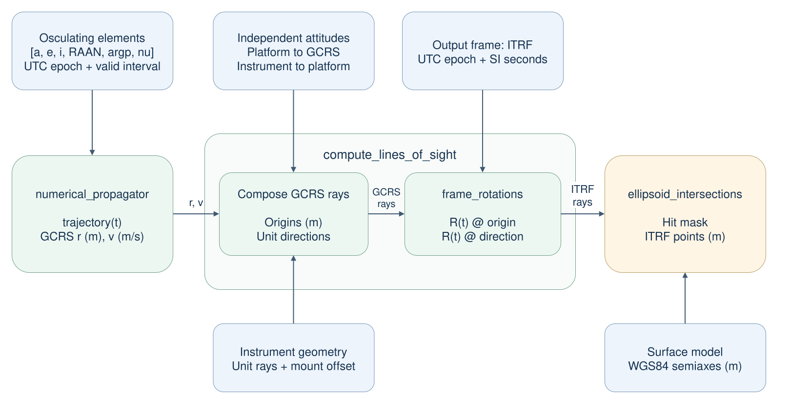

# Orsia Geometry

Construct observation rays from a trajectory and independent platform/instrument attitudes, then intersect the rays with analytic spheres or the fixed WGS84 reference ellipsoid.



The left-to-right path follows the example below. Arrows pass numerical inputs or evaluated arrays; the trajectory stage supplies positions and velocities at the requested times. Independent attitude laws enter `compute_lines_of_sight`, which composes the rays and transforms both arrays into the selected output frame. Surface intersection remains a separate operation; the surface-model node denotes Geometry's fixed WGS84 constants. The diagram shows this usage path, with orbital adapters at construction and inside the ITRF ray computation.

## Construct a LEO trajectory and ground trace

This example defines an illustrative designed low Earth orbit (LEO) from classical osculating elements at `2023-05-16T20:00:00Z`. The semimajor axis is 700 km above the WGS84 equatorial radius, with eccentricity 0.001 and inclination 98 degrees. These chosen elements describe a hypothetical orbit; a real spacecraft calculation needs dated orbit estimates and an appropriate propagation model.

`numerical_propagator` accepts the following element order in GCRS (geocentric celestial reference system):

| Element | Meaning | Unit |
| --- | --- | --- |
| `a` | Semimajor axis | m |
| `e` | Eccentricity | dimensionless |
| `i` | Inclination | rad |
| `RAAN` | Right ascension of ascending node | rad |
| `arg_periapsis` | Argument of periapsis | rad |
| `true_anomaly` | True anomaly at epoch | rad |

The constructor numerically integrates once and returns the `trajectory(times_s)` callback. That callback evaluates retained dense output and returns two independent writable float64 arrays: GCRS positions in metres and velocities in metres per second, each shaped `(times, 3)`. Times are physical elapsed SI seconds from the UTC epoch. The closed `validity_s` interval includes both endpoints; times outside the interval fail.

The example uses the default EGM96 degree 2/order 0 force model and RKV98 integration, with absolute tolerance `1e-4` in state units and relative tolerance `1e-11`. Sun/Moon gravity, tides, relativity, space weather, drag and radiation pressure are disabled. Use `gravity_degree`, `gravity_order`, `sun_gravity` and `moon_gravity` to select the supported force terms. Use `absolute_tolerance` and `relative_tolerance` to refine integration while preserving those terms. Public calls use scalar controls, UTC datetimes and NumPy arrays. See the [orbital adapter contract](docs/geometry.md#orbital-adapters) for supported ranges, fixed native choices and migration from the removed `settings` keyword.

Default `orsia-geometry` installations include the required SatKit 0.24.1 dependency for this example. The [workspace setup](../../README.md#development-environment) supplies the development environment. SatKit can acquire its normal public auxiliary files in process. Earth-orientation parameter (EOP) coverage must include the requested dates and the propagator's padded nodes. Missing or held EOP values fail explicitly.

Run the Python blocks below in order in the same session.

### 1. Define the trajectory and attitudes

```python
from datetime import UTC, datetime

import numpy as np
from orsia_geometry import (
    compute_lines_of_sight,
    ellipsoid_intersections,
    numerical_propagator,
    radial_nadir,
)
from orsia_geometry.constants import WGS84_SEMIMAJOR_AXIS_M

# Osculating [a, e, i, RAAN, arg_periapsis, true_anomaly]; metres and radians.
epoch = datetime(2023, 5, 16, 20, tzinfo=UTC)
validity_s = (0.0, 60.0)
elements = np.array([WGS84_SEMIMAJOR_AXIS_M + 700000.0, 0.001, *np.deg2rad([98.0, 0.0, 0.0, 0.0])])
trajectory = numerical_propagator(elements, epoch=epoch, validity_s=validity_s)


def platform_attitude(times_s):
    return radial_nadir(*trajectory(times_s))


def instrument_attitude(times_s):
    return np.broadcast_to(np.eye(3), (len(times_s), 3, 3))
```

`radial_nadir` points +platform-z toward Earth's centre and sets +x along transverse inertial motion. This is radial nadir; ellipsoid-normal nadir requires another attitude law. The identity instrument attitude fixes the instrument to the platform. Both attitude callbacks return `(times, 3, 3)` column-vector rotations, respectively platform-to-GCRS and instrument-to-platform. Replace either law independently to model tracking or scanning.

### 2. Compute the lines of sight in ITRF

Sample 31 times over the 60-second interval and use the same three instrument directions at each time. `times_s` has shape `(31,)`; `directions_i` has shape `(3, 3)`, with one unit direction per row. `compute_lines_of_sight(..., output_frame="ITRF")` combines the GCRS trajectory and independent attitudes, then rotates both ray origins and directions into ITRF (international terrestrial reference frame). The returned origins are in metres and the directions are unit vectors. Both arrays have shape `(times, rays, coordinates)`, here `(31, 3, 3)`, with final-axis coordinate order x, y, z.

```python
times_s = np.linspace(0.0, 60.0, 31)
# Boresight +instrument-z and two rays about 1 mrad off-axis.
directions_i = np.array(
    [[0.0, 0.0, 1.0], [0.001, 0.0, np.sqrt(1 - 1e-6)], [-0.001, 0.0, np.sqrt(1 - 1e-6)]]
)
ray_origins_itrf_m, ray_directions_itrf = compute_lines_of_sight(
    times_s,
    epoch=epoch,
    validity_s=validity_s,
    trajectory=trajectory,
    platform_attitude=platform_attitude,
    instrument_attitude=instrument_attitude,
    directions_i=directions_i,
    mount_offset_p_m=np.zeros(3),
    output_frame="ITRF",
)
```

The default `output_frame="GCRS"` output computation uses NumPy only and adds no backend imports or auxiliary acquisition. Supplied callbacks retain their own dependencies and effects. `"ITRF"` and `"TEME"` select the existing lazy SatKit adapter. The operation rotates each origin and direction at its requested time; ray coordinates need no velocity-derivative term or shifted dates. Returned arrays own independent writable float64 storage, including empty time/ray axes. Inputs and callback outputs remain unchanged.

Invalid frame names, epochs or time support raise `ValueError` before callbacks or backend use. ITRF/TEME output raises `RuntimeError` when EOP coverage or backend evaluation fails. An `ImportError` indicates that the required SatKit installation cannot load. Callback exceptions propagate unchanged. SatKit can acquire public auxiliary files and populate process-global caches; serialize native evaluation, configuration changes and auxiliary refresh. See the [resource contract](docs/geometry.md#resources-provider-boundary-and-execution).

### 3. Intersect the rays with the fixed WGS84 surface

`ellipsoid_intersections(origins_m, directions)` fixes the WGS84 reference ellipsoid internally at ellipsoidal height zero. Supply Earth-centred ITRF Cartesian x, y, z origins in metres and matching ITRF unit directions. The reference surface excludes terrain and atmospheric ray bending. `orsia_geometry.constants` defines the WGS84 scalars once and derives the immutable `WGS84_SEMIAXES_M` tuple in ITRF x, y, z order. See the [surface contract](docs/geometry.md#analytic-surfaces) for definitions and source references.

`ellipsoid_intersections` selects the nearest forward intersection for each ray. The `hit` mask has shape `(times, rays)`, here `(31, 3)`. The corresponding `ground_points_itrf_m` array has shape `(31, 3, 3)` and contains Earth-centred ITRF Cartesian x, y, z coordinates in metres. Latitude and longitude require a separate geodetic conversion. Misses have a false mask entry and NaN coordinates.

```python
hit, ground_points_itrf_m = ellipsoid_intersections(ray_origins_itrf_m, ray_directions_itrf)
print(f"{hit.sum()} hits; ITRF points shape: {ground_points_itrf_m.shape}")
```

The example produces 93 hits, one for each of three rays at each of 31 times. The README execution test checks array shapes, all-hit status and ellipsoid membership. Those checks establish execution and surface consistency; orbit knowledge, attitude knowledge, terrain and atmospheric ray bending remain application inputs or limitations.

## Use GP OMM or TLE mean elements

For an existing spacecraft's GP OMM or TLE product, use the distinct `sgp4_propagator` route. These products contain SGP4 mean elements and must not be supplied as classical osculating elements to `numerical_propagator`.

Install `orsia-data` and read a local file with Data's `read_orbital_elements(path, format="omm")` or `read_orbital_elements(path, format="tle")`. Import the reader and `select_orbital_elements` from `orsia_data` or `orsia_data.orbits`. Both file formats return a list of Geometry-owned immutable `SGP4MeanElements` records. Use `select_orbital_elements` to select each requested object's latest set within the accepted element-epoch interval, in requested object order. Pass a selected record directly to `sgp4_propagator`. Supply the evaluator's UTC `epoch` and accepted `validity_s` explicitly. The returned callback has the same GCRS position/velocity contract as the example, after SGP4 propagation in TEME and a dated state transformation. The [Data orbital guide](../orsia-data/docs/orbital-elements.md#scalar-records-and-selection) defines the reader and selection contracts. Local files require no provider account; element availability alone establishes no prediction accuracy.

## Responsibilities and dependencies

Geometry requires NumPy and SatKit. Array-only operations use NumPy without loading SatKit. `los.compute_lines_of_sight` checks closed support and composes a supplied GCRS trajectory with independent attitude callbacks. Its default GCRS output stays in the NumPy core; ITRF/TEME output uses the lazy frame adapter internally. `rays.compose_rays` also supports arrays in a caller-named common frame. `attitude` supplies radial nadir, target tracking, scan-axis rotations and sampled angular-speed estimates. `surfaces` owns sphere intersections, fixed-WGS84 intersections and WGS84 target visibility. `surface_visibility(observers_m, targets_m)` requires exterior ITRF observers and matching WGS84 height-zero targets, all in metres.

The `orbits` and `frames` adapters import the required SatKit dependency lazily and use its ordinary in-process auxiliary management. Serialize native operations, backend configuration changes and auxiliary refresh; concurrent native scientific safety remains unqualified. Instruments consumes Geometry for UTC-epoch/GCRS acquisition rays and owns acquisition quadrature. Geometry has no dependency on Instruments, Data or authenticated providers. The [numerical contract](docs/geometry.md) defines axes, time, ownership, singular cases, resource boundaries and qualification limits.

For existing dated rays, `transform_rays` rotates matching `(...,3)` origins and directions with exactly `(...)` elapsed times. `project_local_east_north` projects ITRF points onto an explicit height-zero WGS84 origin's fixed east/north metre chart. `wgs84_surface_projection` composes both operations with WGS84 intersections into a plain GCRS-ray callback. `wgs84_surface_projection_from_ray` selects the chart origin from one explicit `(3,)` GCRS ray and scalar elapsed time; construction uses SatKit and requires EOP coverage. Reuse the same callback for truth and estimated geometry. See the [chart contract](docs/geometry.md#fixed-local-eastnorth-chart) and the executable [fixed-filter camera walkthrough](../orsia-instruments/docs/filter-camera.md#walkthrough-two-strips-over-earth). Continuous visibility and support bounds remain caller responsibilities.

## Run examples and checks

With the existing DE421 and IERS EOP fixtures under `outputs/geometry-auxiliaries`, execute the README Python blocks against actual SatKit from the workspace root. The offline recipe fails if required files are absent:

```bash
devbox run -- just --justfile tests/justfile test-orbital -k readme -s
```

SatKit's normal public auxiliary management remains available outside the fixed local test recipe; offline operation is a test-fixture choice.

`devbox run -- just --justfile tests/justfile pytest libs/orsia-geometry/tests libs/orsia-instruments/tests/test_line_of_sight.py tests/test_core_imports.py` covers array geometry, supplied trajectories and orbital contracts without requiring native orbital resources. The opt-in `test-orbital` scope executes this README and separately exercises native SatKit against bounded ERFA, GMAT and Vallado references. The workspace guide tests retain dependency-light examples and local-link checks. `test` and `check` include Geometry in the aggregate and per-library 90% combined statement-and-branch coverage gates. Software checks establish no mission, orbit-knowledge or engineering qualification. Authenticated Space-Track access belongs to Data and has only mocked/local qualification here.
