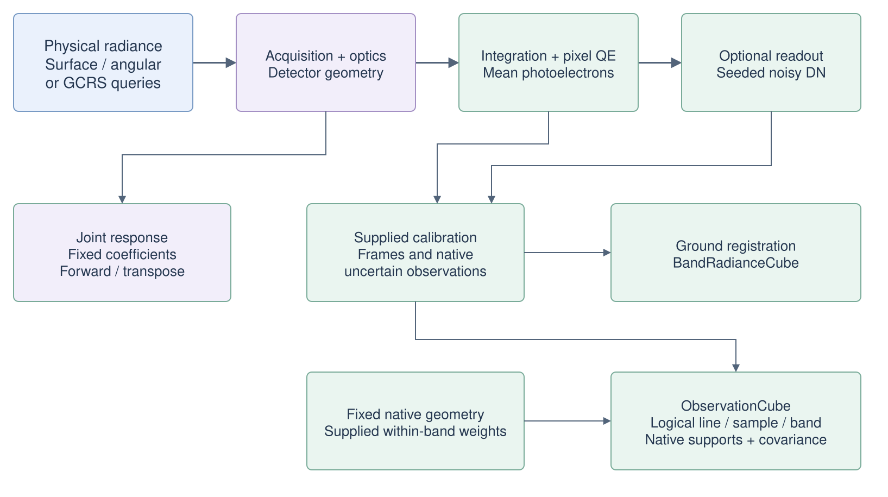

# Orsia Instruments

`orsia-instruments` maps explicitly supported radiance through acquisition geometry, optical response and detector physics to native reads. It supports dense images and GCRS timed lines of sight, finite-pixel filter/dispersive/two-beam/cavity responses, explicit source charge and optional noisy DN. The caller supplies radiance, trajectory assumptions, pointing and accepted support.

## Architecture



Arrows follow the physical measurement chain from radiance to charge and optional noisy digital numbers (DN). Scene input is either a local angular image (`RadianceField`) or GCRS lines of sight; each retains its own geometry and coverage contract. [Full-size SVG](docs/diagrams/architecture.svg) · [Editable Draw.io source](docs/diagrams/architecture.drawio).

The [fixed-filter camera path](docs/filter-camera.md) adds configurable detector strips, physical sizing, an instrument-selected surface grid, native frames, supplied linear calibration and ground-registered band cubes. Its test-local analytic fixtures cover expected charge and explicit seeded noise. The architecture figure shows the shared forward measurement chain; calibration and reconstruction consume the resulting native measurements separately.

The [scanning slit-spectrometer path](docs/slit-spectrometer.md) integrates finite entrance-slit rays through polynomial dispersion and a post-slit Gaussian PSF. It shares native detector readout, supplied calibration and estimated-geometry registration. Every detector pixel retains its achieved photon-weighted band, including row-dependent smile/keystone responses; common-band spectral rectification remains outside native-band registration.

The [detector-owned spectral imager guide](docs/spectral-imagers.md) completes LVF, two-port interferometer and Fabry-Perot chains. All families share `frame_response` and `simulate_frames`. A bounded joint spatial-spectral operator retains actual footprints and separate native port schedules for static piecewise-constant scenes. Inverse owns the covariance-weighted rank-aware solver; Instruments supplies positive physical coefficients.

`wgs84_surface_projection_from_camera` selects a fixed east/north metre chart from the camera's geometric detector centre or a native `(row,column)` pixel centre. It uses the trajectory, both attitude laws, reference time and optional platform-frame mount offset. Reuse one returned surface callback for truth and estimated acquisition grids. The [camera walkthrough](docs/filter-camera.md#walkthrough-two-strips-over-earth) defines reference conventions, orbital auxiliary requirements and continuous-support duties.

## Minimal image example

Run the example with this distribution and its dependencies installed, or in the [Orsia development environment](../../README.md#development-environment). This synthetic uniform field illuminates a 2-by-2 detector through a Gaussian spectral filter. A caller-owned RNG requests two detector realizations.

```python
from functools import partial

import numpy as np
from orsia_instruments import (
    GaussianPSF,
    exposure_sequence,
    filter_imager,
    gaussian_filter,
    regular_detector,
    simulate_images,
    uniform_radiance_field,
)
from orsia_radiative import ObservationGeometry, Radiance, wavenumber_grid

radiance = Radiance(
    wavenumber_grid(np.linspace(4900.0, 5100.0, 65)),
    np.full(65, 1e-3),
    ObservationGeometry(0.0),
)
field = uniform_radiance_field(
    radiance,
    time_bounds_s=(0.0, 0.1),
    u_bounds=(-0.004, 0.004),
    v_bounds=(-0.004, 0.004),
    spectral_bounds_cm1=(4900.0, 5100.0),
)
optics = filter_imager(
    focal_length_m=0.02,
    collecting_area_m2=1e-8,
    spatial=GaussianPSF(30e-6),
    filter=partial(gaussian_filter, centre_m=2e-6, width_m=20e-9),
    throughput=0.8,
)
detector = regular_detector(
    (2, 2),
    pitch_m=30e-6,
    active_size_m=30e-6,
    centre_xy_m=(0, 0),
    quantum_efficiency=0.7,
    dark_electrons_per_s=0,
    read_noise_electrons=0,
    full_well_electrons=1e6,
    electrons_per_dn=1,
    bias_dn=100.0,
    nonlinearity=0,
    adc_bits=16,
)
images = simulate_images(
    field,
    pixel_bounds_m=detector.pixel_bounds_m,
    optics=optics,
    exposures=exposure_sequence(
        start_s=0.0,
        duration_s=0.01,
        direction_bounds_uv=(-0.004, 0.004, -0.004, 0.004),
    ),
    detector=detector,
    rng=np.random.default_rng(71),
    realisations=2,
    angular_order=3,
)
assert np.all(images.photoelectrons > 0)
assert images.dn is not None
print(images.photoelectrons.shape, images.dn.shape)
```

Expected output: `(1, 2, 2) (2, 1, 2, 2)`. Photoelectrons use `(exposure,row,column)`; DN adds a leading realization axis. Omitting `rng` returns expected photoelectrons with `dn=None`.

## Explicit detector API

`DetectorProperties` owns active geometry, pitch, pixel QE and electronics. Its ten fields are required: `pixel_bounds_m`, `pitch_m`, `quantum_efficiency`, `dark_electrons_per_s`, `read_noise_electrons`, `full_well_electrons`, `electrons_per_dn`, `bias_dn`, `nonlinearity` and `adc_bits`. Omitting any field raises `TypeError`. The example's numerical values are illustrative assumptions.

Active bounds have shape `(rows,columns,4)` in `(xmin,xmax,ymin,ymax)` metre order. `shape` is derived from these bounds. `pitch_m` is a positive `(x,y)` pair or explicit `None` for irregular geometry. Columns increase x and rows increase y for regular detectors. Declared pitch must agree with centre spacing on available axes, and active dimensions cannot exceed pitch. Single-row and single-column detectors retain both pitch components.

`regular_detector(shape, pitch_m=..., active_size_m=..., centre_xy_m=..., ...)` builds regular active bounds and requires every geometry and property argument. Pitch and active size accept scalar or `(x,y)` values. `regular_pixel_bounds` remains available from the package root and `orsia_instruments.imaging.acquisition` for lower-level geometry calculations.

Geometry and scalar/map properties become independent read-only copies at detector construction. Property maps must exactly match the derived `(rows,columns)` shape; implicit row/column broadcasting is rejected. Scalars apply to every pixel. Keep retained arrays stable during use. Geometry defines active-gap losses directly, and QE enters once before photon noise.

`filter_camera(detector, strips, ...)`, `dispersive_spectrometer(detector, ...)` and `focal_plane_imager(detector, optics, ...)` retain the supplied detector. Their `pixel_bounds_m` properties delegate to that detector. `frame_response` and `simulate_frames` use the instrument's detector and accept no separate `detector` argument. Calibration requires an explicit independently estimated detector; a separately characterized instrument can supply its response. `frame_response` replaces the previous `camera_response` and `spectrometer_response` names without aliases.

The functional image kernels `image_photoelectrons`, `image_readout` and `simulate_images` keep explicit `detector=` arguments, including expectation-only calls. Optical integration also receives explicit bounds and optics. `calibrate_frames` likewise requires `detector=`. `None` is outside these contracts.

This breaking migration retains the earlier `DetectorMaps` to `DetectorProperties` rename without an alias and adds detector-owned geometry. Move geometry into the detector constructor, attach that detector when building a physical instrument, and remove detector keywords from instrument response and frame simulation calls. Update independently supplied calibration detectors and low-level callers with explicit geometry. Numerical photon and readout calculations retain their existing conventions.

## Physical conventions and limits

- Radiance is unpolarised W m-2 sr-1 per (cm-1); fields use `(time,u,v,spectral)`. Optical callbacks receive wavelengths in metres. Geometry, full exposure and spectral coverage are explicit.
- Optical fractions, projected area, QE, time/solid-angle weights and photon conversion each enter once. A Gaussian filter's `width_m` is its standard deviation.
- Photoelectrons precede dark current and electronics. Inspect full-well and ADC flags with sampled DN; applying the detector transfer to mean charge does not give expected clipped DN.
- Dense integration retains full scene/response arrays. Check spatial/time/spectral quadrature and support independently; the small example's angular order is illustrative.
- Input records usually copy numerical fields; custom callbacks are borrowed and must remain pure and stable. RNGs belong to the caller. Detailed result-container ownership is specified in the references.

## Read next

- [Fixed-filter camera and cubes](docs/filter-camera.md): physical layout, PSF/motion support, supplied calibration, compatible achieved bands and estimated-geometry accumulation.
- [Slit spectrometer and native-band cubes](docs/slit-spectrometer.md): finite slit/pixel integration, scan support, supplied wavelength calibration and sparse pixel-specific band planes.
- [LVF, two-port and cavity chains](docs/spectral-imagers.md): detector-owned instruments, supplied characterization, native bands and bounded joint inversion.
- [Complete-image simulation](docs/imaging.md): two source paths, one detector readout, pixels, QE and common noise.
- [Optical response](docs/optics.md): factories, PSFs, response integration and explicit reuse.
- [Acquisition, readout and tolerances](docs/acquisition-and-detector.md): source ownership, local geometry, charge-only sampling and advanced kernels.
- [GCRS line of sight](docs/line-of-sight.md): a moving pixel observes a varying surface, followed by frame and continuous-support contracts.

Run `devbox run -- just --justfile tests/justfile pytest libs/orsia-instruments/tests tests/test_instrument_examples.py tests/test_lvf_scan.py tests/test_instrument_composition.py` from the workspace root. Bounded synthetic regressions leave realistic internal backgrounds, instrument accuracy, image-scale feasibility and retrieval performance unqualified.
