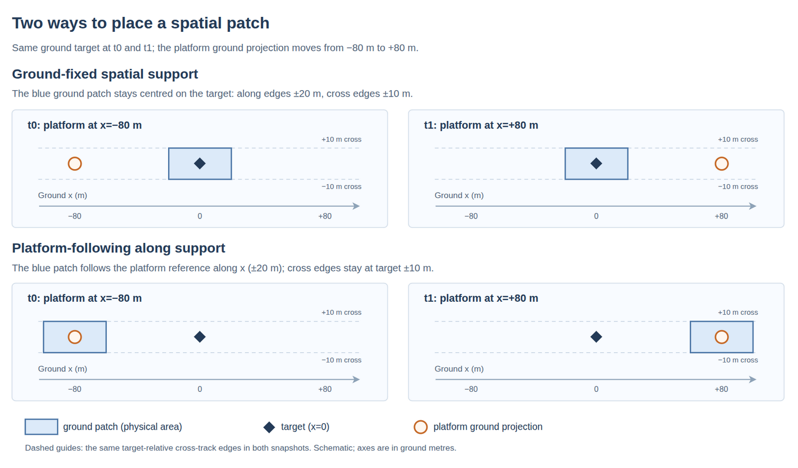

# Orsia Instruments

Start with the [code guide and progressive examples](src/orsia_instruments/README.md). This page retains the image API, advanced kernels and ownership contracts.

The [Earth-frame line-of-sight guide](line-of-sight.md) gives an executable read-to-DN satellite example, its TAI/Earth-frame/FOV conventions, continuous scene-support contract and qualification limits. This path uses `ReadSchedule`, `sample_lines_of_sight`, `line_of_sight_expected_electrons` and `sample_readout`; the local image and ground-scan calculations retain their own angular conventions.

The [dense imaging regression](tests/test_dense_imaging.py) exercises full-grid photon conversion, dense image charge, positive bilinear scene projection and readout; the `acquisition`, `integration` and `imaging.response` modules own the corresponding public contracts.

A bounded scalar instrument simulator from explicitly supported radiance fields to native physical reads. This package owns acquisition discretization, optical response integration and conditional detector noise. The caller supplies trajectory assumptions, pointing, accepted scene support and radiance; `along_track_acquisition` discretizes the supplied local constant-height/speed model. Atmospheric solvers, files, providers, reconstruction and retrieval belong to caller-managed components.

## Module organization

Implementations are grouped by physical responsibility; `orsia_instruments` exports dense numerical functions and complete-image results.

| Module | Responsibility |
| --- | --- |
| `scene` | Radiance fields, uniform-field construction and radiance sampling. |
| `acquisition` | Physical-read identities, sampled geometry, rectangular acquisitions, timed strip reads, raster exposure timing, local linear scans and ground pointing laws. |
| `line_of_sight` | Earth-frame origins and look rays from scheduled reads, platform state and sensor mount; sampled support corners and analytic sphere intersections. |
| `line_of_sight_radiance` | Full-support radiance coverage attestation and Earth-frame sight-line/time/spectral radiance sampling. |
| `quadrature` | Gauss-Legendre interval integration for acquisition and pixels; owns the implementation. |
| `charge` | `ExpectedElectrons` and source-path combination, independent of the radiance integrator. |
| `integration` | Dense photoelectron-response coefficients, local-field and sight-line radiance integration, and the `QuantumEfficiency` callback. |
| `detector` | Homogeneous electronics, per-read operating points, `DetectorMaps`, moments and digitisation. |
| `tolerances` | Native differences, sensitivities, budgets and Monte Carlo transport. |
| `optics.response` | `OpticalResponse`, `ImageResponse`, `ImagingOptics` and common optical assembly. |
| `optics.psfs` | PSF contracts, Gaussian/tabulated densities and spatial interpolation. |
| `optics.pixels` | Finite-pixel acceptance for Gaussian, tabulated and supplied PSFs. |
| `optics.filters` | Spectral profiles, tabulated transmission, LVF centre laws and filter imaging factories. |
| `optics.dispersion` | Centroid maps, dispersive response and imaging factory. |
| `optics.two_beam` | Two-beam port intensities and interferometric imaging factory. |
| `optics.cavities` | Local cavity transmission and imaging factory. |
| `imaging.acquisition` | Exposure sequences, pixel geometry and complete image acquisitions. |
| `imaging.response` | Positive `DetectorResponse` and `InstrumentResponse` from scene radiance to photoelectrons on explicit spatial/spectral grids, bilinear projection and valid translation-invariant correlation. |
| `imaging.charge` | Complete-image optical charge, external charge and source combination. |
| `imaging.readout` | Whole-image detector readout with exposure-specific common noise groups. |
| `imaging.measurements` | Dense measurement arrays and native output axes. |
| `imaging.simulation` | Composition through `simulate_images`. |

For example, `from orsia_instruments.optics.cavities import cavity_transmission, cavity_imager` places the physical law and its imaging factory together; `from orsia_instruments.imaging.readout import image_readout` accepts complete source-resolved charge. The same physical quadrature, units and explicit RNG apply to dense computations.

Compatibility modules `arrays`, `responses`, `imaging_optics`, `psfs`, `tabulations`, `image_charge` and `image_sequence` have been removed. Import from the canonical modules above or from `orsia_instruments`; `imaging` has no compatibility exports. Import charge contracts from `charge`, optical contracts from `optics.response` and numerical differences from `tolerances` rather than their former reexports in `integration`. Interval quadrature now lives in `orsia_instruments.quadrature`: this module owns the implementation, not a facade. `orsia_numerics.quadrature` is removed without an alias, and no root quadrature export is added. At the root, `image_charge` is a function owned by `orsia_instruments.imaging.charge`. The root also exposes `response_electrons` for expected electrons from a constructed response; `image_charge` attaches already integrated image electron means to physical reads. Both functions retain their numerical behaviour.

`quadrature.interval_quadrature(low, high, order)` returns fresh writable Gauss-Legendre nodes and measure weights on a finite positive-width interval. Coordinate units are inherited from the bounds; weights are neither physical response weights nor normalized probabilities. `validate_quadrature_order(order)` rejects nonpositive orders.

`along_track_acquisition(reads, trajectory, *, target_xy_m, pixel_bounds_m, along_edges_m, cross_edges_m, focal_length_m, pointing_law, support_frame="ground", cross_offset_m=None, time_order=3, angular_order=5, cross_order=None)` takes a `ReadSchedule` (identities and finite exposure bounds in seconds) and explicit sampled geometry. `target_xy_m` is (reads, 2) along/cross ground metres, `pixel_bounds_m` is (reads, 4) focal-plane metres, and piecewise support edges are strictly increasing ground metres. For `support_frame="ground"`, along edges stay centred on the ground target; for `"platform"`, along edges translate with the platform ground projection plus the along offset at each exposure centre. Cross edges stay target-relative. The centre offset is `target_x - speed * (exposure_centre - time_origin)`; optional `cross_offset_m` supplies (reads,) local cross ground offsets. Gauss orders apply to exposure time and each ground axis (cross defaults to angular). Inputs are borrowed; the returned `Acquisition` owns its arrays. `along_track_strip_templates(..., trajectory=...)` yields timed `ReadSchedule` and independent (reads, 4) pixel rectangles for local strips. `instrument_response` and `gaussian_along_track_response` accept the same direct geometry, support-frame and quadrature arguments. This breaking API replaces `AlongTrackReadSpecification`, `GroundSpatialSupport` and `AlongTrackIntegrationOrders` with physical reads and direct arguments; `PlatformFollowingAlongTrackSupport` also gives way to `support_frame="platform"`.

The required `pointing_law(read_index, times_s)` returns finite (time_nodes, 2) dimensionless local slopes at temporal quadrature nodes. Image centroids follow `f * (ray_uv - pointing_uv)`; scene directions, physical support and solid-angle-time weights retain their own frame and values. An explicit zero-slope callback, for example `lambda read_index, times_s: np.zeros((len(times_s), 2))`, retains the original image mapping. `ground_fixed_pointing(trajectory, target_xy_m, centre_times_s)` keeps each gaze on a fixed target on the local ground plane; `ground_scroll_pointing(..., ground_rate_m_s=s)` advances that target along track at `s` ground metres per second. With platform speed `v`, `s=0` tracks fixed ground, `0<s<v` scrolls more slowly than the platform, and `s=v` keeps a constant local along slope. Both factories snapshot their input arrays, return per-read slope callbacks and use the platform's per-column cross origin. Support motion and gaze motion remain independent: a stationary ground patch can accompany a scrolling gaze, and a platform-following slit can accompany a fixed ground gaze. The Gaussian helper evaluates the same pointing on its reference line and full cross grid under its stated separability contract.



*Figure: The physical ground patch stays centred on the target with `support_frame="ground"` and translates along track with the platform reference for `support_frame="platform"`; both keep cross-track edges target-relative. The orange marker denotes the platform ground projection, while the optical gaze follows its separate pointing law. [Editable Draw.io source](docs/diagrams/spatial-support-frames.drawio).*

Physical finiteness, range and positivity checks use NumPy directly in their domain functions. The shared `bounded` and `positive` validators and `orsia_numerics.arrays` module have been removed; instrument APIs retain their numerical checks, array-like conversion boundaries and ownership contracts.

## Explicit optical reuse

`sampled_optical_response(acquisition, response, wavelengths_m)` evaluates and snapshots the optical accepted fractions once, returning an ordinary `OpticalResponse` usable in `expected_electrons`. Reuse it for different radiance fields on the same acquisition and exact wavelength grid; changing radiance does not change the retained optics. Preparation preserves joint spatial/spectral/node dependence, arbitrary custom responses and distinct physical reads, without assuming identical scene spectra.

```python
import numpy as np
from orsia_instruments import (
    RadianceField, expected_electrons, sampled_optical_response, rectangular_acquisition,
)
from orsia_radiative import SpectralDomain, SpectralGrid

grid = SpectralGrid("wavenumber_cm1", np.array([4000., 5000.]),
                    SpectralDomain("wavenumber_cm1", ((4000., 5000.),)))
scene = RadianceField(grid, np.array([0., 1.]), np.array([-0.01, 0.01]),
                      np.array([-0.01, 0.01]), np.ones((2, 2, 2, 2)))
other_scene = RadianceField(grid, scene.times_s, scene.u, scene.v, 2 * scene.values)
acquisition = rectangular_acquisition(
    sample_ids=("r",), pixel_ids=("p",), setting_ids=("s",), port_ids=("direct",),
    exposure_bounds_s=np.array([[0., 1.]]), pixel_bounds_m=np.array([[-1., 1., -1., 1.]]),
    direction_bounds_uv=(-0.01, 0.01, -0.01, 0.01),
    pointing=lambda t: np.zeros((len(t), 2)), focal_length_m=1.,
    time_order=1, angular_order=2,
)
def response(read, wavelengths, current):
    return np.full((current.times_s.shape[1], len(wavelengths)), 0.8)

prepared = sampled_optical_response(acquisition, response, 0.01 / scene.grid.points)
counts = expected_electrons(scene, acquisition, prepared, collecting_area_m2=1.)
other_counts = expected_electrons(other_scene, acquisition, prepared, collecting_area_m2=1.)
np.testing.assert_allclose(other_counts.total, 2 * counts.total)
```

The trade is retained float64 storage of `8 * reads * nodes * wavelengths` bytes plus preparation temporaries. Callback work is eliminated on reuse, but radiance interpolation, QE, integration and detector readout are still evaluated independently. Preparation evaluates the complete supplied wavelength grid for each read; evaluation may request any subset or order of prepared wavelengths. The returned callback rejects a different acquisition object or wavelengths absent from its exact prepared support; it does not interpolate, extrapolate or infer equivalent geometries. Reprepare when optics change, and prepare each source path separately unless its accepted fractions truly coincide. Prepared fractions are independent writable copies that callers must not mutate; no mutable global cache or callback is retained. The high-level image function evaluates its optical response once per read over the complete grid. The example above demonstrates reuse across different radiance fields; the one-off optical-reuse timing runner has been retired. This does not add coaddition, alter noise correlations, or bypass individual saturation and quantization. Execution gains depend on optical cost and reuse count; no full-scene performance qualification is implied.

## Physical-description image API

Start with `regular_pixel_bounds`, an optical factory, `DetectorMaps` and `exposure_sequence`, then call `simulate_images`. This is an additive interface: existing acquisition, response and detector calls remain available, with the optical-description replacement restriction described below. No pixel names or setting dictionaries are required. With `filter_imager`, supply the spectral filter separately; there is no need to write a full optical response callback. Labels in the advanced acquisition API remain bookkeeping, not physical parameters.

- `regular_pixel_bounds((rows, columns), pitch_m=..., active_size_m=..., centre_xy_m=...)` generates `(rows,columns,4)` bounds in metres. Pitch and active dimensions are scalar or `(x,y)`, while shape is `(rows,columns)`; columns increase x and rows increase y. The centre is that of the whole array. Active dimensions default to pitch and cannot exceed it. Explicit irregular rectangular bounds can still be supplied instead.
- `filter_imager`, `spatial_filter_imager`, `lvf_imager`, `interferometric_imager`, `cavity_imager` and `dispersive_imager` assemble the physical response kernels. All take `focal_length_m`, projected `collecting_area_m2`, exactly one of `psf=my_psf` or legacy `psf_sigma_m` (scalar or x/y pair), and optional scalar `throughput`. The spatial PSF is independent of the spectral filter shape; `gaussian_psf` and `tabulated_psf` form a callable catalogue without mandatory registration. The [PSF contract](#psf-callback-contract) specifies offsets, field/wavelength/exposure context, density units, table support and normalization. All factories expose `pixel_order` for general PSFs while retaining analytic Gaussian integration where applicable. Optical losses, QE, collecting area, exposure and pixel acceptance each enter once. The [factory example](#interchangeable-factory-example) exercises the supported families.
- `filter_imager(..., filter=spectral_filter)` accepts a wavelength-only function: `spectral_filter(wavelengths_m)` receives the complete 1-D float64 wavelength grid in metres, in the grid's converted order, and returns the same shape with finite dimensionless intensity transmission in [0,1]. Invalid values or shapes raise `ValueError` when evaluated, before pixel acceptance; no clipping or normalisation is applied. The filter is uniform across the detector and identical for all exposures. The callable and captured data are borrowed, must remain pure and stable, and must not mutate the input; they are not copied into `settings`. Bind existing laws with `functools.partial`, for example `partial(gaussian_filter, centre_m=2e-6, width_m=20e-9)` or `partial(tabulated_transmission, nodes_m=..., fractions=...)`. Tabulated support and its explicit `outside` policy are preserved. `filter_imager` is the entry point for a supplied uniform spectral law. Gaussian `width_m` is a wavelength standard deviation, not FWHM or spectral-grid spacing.
- LVF reference/sigma, two-beam base OPD and cavity base spacing accept scalars or vectors with exactly one value per exposure; a length-one vector is not implicitly repeated. Settings stay constant in time during each exposure. `lvf_imager` accepts either the existing Gaussian `sigma_m` or `profile(wavelengths_m, centre_m)`, keeping the polynomial centre law separate. It integrates spatial transmission across the active pixel, not only at its centre, using a detector-plane x/y coordinate relative to `reference_position_m`; its convenience law assumes normal incidence with no thermal shift. For other spatial transmission laws, use `spatial_filter_imager(..., filter=local_filter)`. `cavity_imager` requires explicit scalar or wavelength-callable `order_transmission` and also accepts spectral index, reflectivity and coating phase, with an optional additive `spacing_offset_m(x,y)`. Rebuild the optical factory when changing physical parameters: the model now exposes a read-only derived description, and `dataclasses.replace` of individual optical attributes raises rather than retaining a stale response. The custom `ImagingOptics` constructor and its public read attributes remain available; consistency of a supplied arbitrary closure with its description remains caller-owned.
- `interferometric_imager(..., opd_m=..., port="+")` models two-beam interference with the selected spatial PSF, not arbitrary interferometer architectures. It constructs one physical output per call: `port="+"` and `port="-"` represent separate outputs. Optical path difference is fixed or varies between exposures, remaining constant in time within each exposure; an optional `opd_offset_m(x,y)` adds detector-plane spatial encoding, integrated jointly with the PSF. Phase, visibility and transmission accept scalars or wavelength-only functions. Results retain `port` and the base `settings["opd_m"]`. Simulate both before differencing measured DN; the exposure/OPD axis is not a reconstructed spectral axis. Separate calls do not represent common electronic or scene fluctuations between ports.
- `dispersive_imager` accepts the existing polynomial coefficients or a supplied `image_map(image_xy_m, wavelengths_m)` returning `(nodes,wavelengths,2)` centroids in metres. `transmission` can be scalar or spectral. `polynomial_image_map` exposes the existing mapping law independently of pixel integration.
- `DetectorMaps` accepts a scalar or an exact `(rows,columns)` map for QE, dark electrons/s, read-noise sigma in electrons, full well in electrons, electrons/DN, bias DN and dimensionless nonlinearity; ADC width is scalar. No implicit row/column broadcasting is introduced. A `quantum_efficiency(indices, wavelengths_m)` callback on the image integration functions supplies spectral QE and replaces the simple map, as specified in the [composition guide](composition.md#quantum-efficiency). The maps are fixed across exposures and indexed numerically for all reads. Omission selects the documented idealized defaults of `DetectorMaps`, not a calibrated detector.
- `exposure_sequence(start_s=..., duration_s=..., direction_bounds_uv=...)` accepts scalar or broadcastable 1-D starts/durations and optional `row_delay_s`. Constant `pointing_uv=(u,v)` defaults to `(0,0)`; a time callback is optional. The caller still declares the accepted sky patch and supplies scene coverage over the entire rolling exposure support. The image map remains the bounded paraxial `f*(direction-pointing)` approximation.
- `simulate_images(scene, pixel_bounds_m=..., optics=..., exposures=..., detector=...)` returns `ImageMeasurements.photoelectrons` with axes `(exposure,row,column)`, before dark current. Without `rng`, DN and saturation flags are `None`: this is not mean DN. With an explicit generator, `dn`, `full_well_saturated` and `adc_clipped` have axes `(realisation,exposure,row,column)`. Actual `exposure_bounds_s` has axes `(exposure,row,bound)` including row delay. Arrays returned by dense simulation are independent writable copies; input geometry/maps/settings are copied, while custom callbacks are borrowed and must remain pure and stable.
- A scene may be a resident `RadianceField` or a caller-owned `field(acquisition)` callback. The callback receives the complete image acquisition once and supplies radiance over its full time and direction support. Source QE may instead be supplied as a callback over complete image indices and spectral grid wavelengths.

The high-level functions accept `row_noise_electrons`, `column_noise_electrons` and `exposure_noise_electrons` as Gaussian sigmas. Row/column groups are independent for each exposure and realisation; the frame component is shared by the exposure. The detector kernel groups full-image row, column and exposure identities before sampling, retaining the physical group covariance in the resulting DN. Do not count the same noise component again through low-level group options.

The complete acquisition is evaluated with full-grid NumPy/SciPy contractions. The caller selects `time_order`, `angular_order` and spatial-response `pixel_order`. Scene interpolation, coefficient tensors and sampled readout use dense storage. Spectral sampling, sky-patch truncation and quadrature convergence require separate checks; image-scale performance requires case-specific qualification.

For a custom instrument, `ImagingOptics` accepts `response(exposure_index, local_read_index, wavelengths_m, acquisition)`, returning accepted fractions with axes `(nodes,wavelengths)`. Numeric exposure indices are supplied directly, without decoding labels. Use the advanced kernels for time/ray-dependent LVF physics, arbitrary rolling schedules or cross-port correlations not represented by these convenience factories. Wavelength-dependent QE and multiple source paths are also available through the composable image functions described below.

### Runnable image example

This executable documentation example supplies a synthetic, explicitly uniform scene, a 3-by-4 detector with active dimensions smaller than pitch, one nonuniform QE pixel, two exposures and two noisy realisations. Run the example with installed wheels for an isolated integration check:

```python
from functools import partial
import numpy as np
from orsia_radiative import ObservationGeometry, Radiance, wavenumber_grid
from orsia_instruments import (
    DetectorMaps, exposure_sequence, filter_imager, gaussian_filter,
    regular_pixel_bounds, simulate_images, uniform_radiance_field,
)

radiance = Radiance(wavenumber_grid(np.linspace(4900., 5100., 257)),
                    np.full(257, 1e-3), ObservationGeometry(0.))
scene = uniform_radiance_field(
    radiance, time_bounds_s=(0., 0.1),
    u_bounds=(-0.004, 0.004), v_bounds=(-0.004, 0.004),
    spectral_bounds_cm1=(4900., 5100.),
)
pixels = regular_pixel_bounds((3, 4), pitch_m=30e-6, active_size_m=28e-6)
spectral_filter = partial(gaussian_filter, centre_m=2e-6, width_m=20e-9)
optics = filter_imager(
    focal_length_m=0.02, collecting_area_m2=1e-8,
    psf_sigma_m=30e-6, filter=spectral_filter, throughput=0.8,
)
qe = np.full((3, 4), 0.7)
qe[1, 2] = 0.6
detector = DetectorMaps(
    quantum_efficiency=qe, dark_electrons_per_s=2,
    read_noise_electrons=3, electrons_per_dn=2, bias_dn=100,
)
exposures = exposure_sequence(
    start_s=[0.0, 0.05], duration_s=0.01,
    direction_bounds_uv=(-0.004, 0.004, -0.004, 0.004),
)
images = simulate_images(
    scene, pixel_bounds_m=pixels, optics=optics, exposures=exposures,
    detector=detector, rng=np.random.default_rng(71), realisations=2,
    angular_order=9,
)
assert images.photoelectrons.shape == (2, 3, 4)
assert images.dn is not None and images.dn.shape == (2, 2, 3, 4)
```

For a different uniform filter on each exposure, call `simulate_images` separately with each filter and its corresponding exposure, or supply an exposure-indexed `ImagingOptics.response`. For source-resolved analysis, call `image_photoelectrons` for each optical path, combine the resulting complete charge rasters and call `image_readout` with an explicit RNG.

## Composable charge and readout interfaces

`image_photoelectrons` integrates a complete scene/path into one `ImagePhotoelectrons` object; `image_charge` attaches named complete charge arrays to physical reads; `combine_image_source_paths` joins aligned paths, and `image_readout` applies detector maps and exposure-grouped noise. `simulate_images` composes optical integration and readout. Named source contributions survive in dense outputs. The [composition guide](composition.md) defines alignment, timing, QE replacement and external charge for complete images.

`ReadSchedule` describes ordered sample/pixel/setting/port identities and positive exposure intervals `(reads,2)` in seconds. Pass it directly to `ExpectedElectrons` or `digitize` without optical nodes, directions or weights. `read_schedule(acquisition)` strips geometry explicitly; it returns a `ReadSchedule` input unchanged. `ExpectedElectrons.reads` and `DetectorReadings.reads` expose this minimal description, while `.acquisition` retains the exact supplied `Acquisition` or `ReadSchedule`. Existing acquisition identity assertions continue to hold. `electron_moments`, `electron_covariance`, `sample_readout` and the native tolerance functions work with either representation.

## Contracts and first case

The first case is a synthetic moving heterogeneous scene on a forward direction-cosine patch, two finite pixels and two sequential settings. It is an implementation reference, not a selected mission instrument. The four response families in that first case are dispersive Gaussian redistribution, discrete/LVF Gaussian transmission, balanced two-beam ports and a local Airy cavity with explicit order selection; supplied profiles and mappings extend these choices without changing their integration contracts. Arrays use float64. Input record constructors copy numerical arrays into independent writable storage; numerical functions return fresh writable arrays unless a returned record documents otherwise. Image result records are lightweight containers: dense simulation functions return writable copies, while direct construction borrows the supplied arrays. Image results copy DN and flags into independently writable raster arrays. Callbacks borrow inputs and must be pure and nonmutating. There are no caches, workers or hidden RNGs.

- `RadianceField(grid,times_s,u,v,values)` represents unpolarised W m^-2 sr^-1 per (cm^-1) radiance with shape `(time,u,v,spectral)`. Each spatial/time axis has at least two increasing nodes. Its dimensionless u/v axes use the supplied acquisition's coordinate convention and frame: direction cosines for `rectangular_acquisition`, bounded local paraxial slopes for `along_track_acquisition`; the entire support rectangle satisfies `u**2 + v**2 < 1` in both conventions, and times share the acquisition's epoch. Trilinear interpolation rejects extrapolation, NaNs and missing coverage. One explicit spectral interval, sampled at both endpoints, is required; disconnected bands must be simulated as separate source-path contributions. Grid sampling and effective instrumental resolution are distinct quantities.
- `uniform_radiance_field` explicitly extends an existing directional `orsia_radiative.Radiance` on caller-declared time, direction and spectral support. It does not infer those supports or change the radiative API. The caller asserts a uniform-field approximation and coordinate-frame relationship to the original geometry.
- `Acquisition` describes N physical reads with unique sample IDs and retained pixel, setting and port IDs; exposure bounds `(N,2)` in seconds; times `(N,Q)`; directions and image centroids `(N,Q,2)`; positive-support nonnegative quadrature weights `(N,Q)` in sr s; rectangular active pixel bounds `(N,4)` in metres, ordered xmin,xmax,ymin,ymax; and enclosing direction-support bounds `(N,4)`, ordered umin,umax,vmin,vmax. Coverage checks include entire exposure intervals and direction patches, not just their interior quadrature nodes. Node images are the caller's scene/pointing map. No scene locations or timestamps are inferred from IDs. Generic supplied quadrature is supported; its accuracy and geometric consistency belong to the caller.
- `rectangular_acquisition` provides Gauss-Legendre time/angular nodes with exact forward-hemisphere measure `du dv/sqrt(1-u²-v²)` and the bounded paraxial mapping `f*(direction-pointing)`. This is not a general camera projection, orbit propagator or geolocation API. The caller supplies pointing as a function of time and explicitly selects the sky patch. Neglected light outside that patch must be justified by the case.
- `image_acquisition` builds one dense acquisition for a `(rows,columns,4)` array of finite pixel bounds and `(settings,2)` exposure intervals shifted by caller-supplied row offsets. It emits physical reads in setting/row/column order with stable sample, pixel and setting IDs and `direct` ports; frame order need not be chronological if row offsets overlap. Caller-supplied pointing may contain scan motion and jitter; there is no orbit/geolocation model, pointing interpolation or implicit detector-sky mapping. Arrays are independently owned by the acquisition; the borrowed pointing callback must stay stable during evaluation. A common direction patch, pixel bounds and focal length apply across settings; other geometries can use the lower-level `Acquisition` contract.
- `simulate_images` builds one complete image acquisition, integrates the supplied full-support radiance field, then optionally samples detector readout using the caller's RNG. For manually assembled acquisitions, `expected_electrons` integrates full-grid response coefficients; `sample_readout` applies detector physics. Working storage includes full scene interpolation, full optical coefficients and optional digitised realizations. Physical support, resource costs and quadrature convergence remain case-specific.
- `ExpectedElectrons(acquisition,contributions)` stores named nonnegative `(N,)` source means, before dark/read noise. Its `total` property returns a new sum, not a mutable cache. Distinct internal sources must first traverse their actual remaining optical paths and only then join the contributions. No automatic full external-scene response is applied to internal emission.
- `DetectorElectronics` describes a homogeneous operating point: dark electrons/s, Gaussian read noise sigma in electrons, full well in electrons, electrons/DN, bias DN and ADC bits (1–32). `DetectorReadings` preserves acquisition and immutable `(realisations,N)` integer DN, full-well and ADC flags. There is no L0/L1/L2 class hierarchy, persistence or calibration-estimation contract.

## Optical laws and integration

### Radiance integration execution

Scene interpolation and photoelectron response coefficients cover all supplied read/quadrature nodes and wavelengths; charge contraction uses one dense NumPy einsum. Retained interpolated radiance and physical response each scale as `(N,Q,K)`. Optical-response callbacks retain their per-read contract, with one full-grid evaluation per read.

`expected_electrons(field,acquisition,response,collecting_area_m2=...,throughput=...,quantum_efficiency=...)` calls `response(read_index,wavelengths_m,acquisition)` once for each read over the complete spectral grid. The response returns `(Q,K)` accepted intensity fractions in [0,1], including finite-pixel collection and the family-specific selection/modulation, but not the supplied projected area, common throughput, QE, spectral quadrature, photon conversion or time/solid-angle weights. Common throughput and array QE are scalars or broadcastable to `(N,spectral)`. Alternatively, QE is a pure callback `(local_read_indices, wavelengths_m) -> (reads,wavenumbers)`, evaluated once on the complete acquisition and spectral grid, with exact shape and range checks. Inputs are borrowed arrays that callbacks must not mutate, wavelengths need not increase, and the callback must reject unsupported wavelengths. QE is bounded to [0,1] for this detector model; gain-producing detectors need another model. Throughput/loss factors must each enter once.

The integral uses trapezoidal weights in cm^-1 and photon energy `h*c*100*wavenumber_cm1`. Per-cm^-1 radiance is never relabelled as per-wavelength radiance. Exposure and pixel area are not multiplied again: dOmega dt is already in acquisition weights, and pixel integration already supplies a collected fraction. The spectral domain is finite supplied support, not an assertion of zero radiance or perfect blocking outside it. Every transmitted order and background within the actual case must be included before photon noise.

`gaussian_pixel_fraction` analytically integrates a normalized diagonal 2-D Gaussian over a rectangle, retaining lost tails. `dispersive_response` applies linear/quadratic wavelength dispersion, linear smile and keystone to supplied image centroids before that integration. Width changes redistribute photons at fixed throughput; physical slit changes require a separate declared acceptance coupling. Tilted/correlated profiles can be supplied with `psf=my_psf` (including `tabulated_psf`) in the image factories or through the advanced `tabulated_pixel_response`; coherent propagation and general grating designs remain excluded.

`modulated_pixel_response` integrates a wavelength-independent Gaussian relay against `transmission(x_m,y_m,wavelengths_m)` by finite-pixel quadrature. The callback can depend jointly on per-node angles/times, local position, setting and port; no spectral-spatial separability is imposed. Refine quadrature independently of the scene/spectral sampling; narrow images and local fringes can be missed. Accepted fractions above one trigger an under-resolution error, but fractions below one do not establish convergence.

`gaussian_filter` is peak-normalized transmission with wavelength standard deviation `width_m` in metres; its integrated spectral area varies with width. `lorentzian_filter` and `super_gaussian_filter` use `fwhm_m` (full width at half maximum); `rectangular_filter` includes both wavelength bounds. `longpass_filter` and `shortpass_filter` use a logistic edge with `transition_m` measured from 10% to 90% of the supplied stop/pass levels; `notch_filter` uses `fwhm_m` for the full width at half rejection depth. These laws return dimensionless intensity transmission; the [filter implementations](src/orsia_instruments/optics/filters.py) specify their parameter domains. `lvf_centre` uses a local polynomial coordinate/temperature law and an effective-index angular shift for incidence from air/vacuum. Callers supply coating polarization, leakage, pointing-to-passband shifts and the map from detector/ray coordinates to the filter plane when needed.

### Interchangeable factory example

Each factory below binds a distinct physical selection to the same idealized focal-plane geometry. The returned responses still require an acquisition and wavelength grid for evaluation.

```python
from functools import partial
import numpy as np
from orsia_instruments import (
    cavity_imager, dispersive_imager, filter_imager, gaussian_filter,
    interferometric_imager, lvf_imager, spatial_filter_imager,
)

geometry = dict(focal_length_m=0.02, collecting_area_m2=1e-8, psf_sigma_m=3e-5)
optics_by_name = {
    "filter": filter_imager(**geometry, filter=partial(gaussian_filter, centre_m=2e-6, width_m=2e-8)),
    "spatial": spatial_filter_imager(**geometry, filter=lambda x, y, w: np.full_like(w, 0.5)),
    "lvf": lvf_imager(**geometry, reference_m=2e-6, gradient=0, sigma_m=2e-8),
    "interferometric": interferometric_imager(**geometry, opd_m=0, port="+"),
    "cavity": cavity_imager(**geometry, spacing_m=1e-5, order_transmission=0.7),
    "dispersive": dispersive_imager(**geometry, reference_m=2e-6, dispersion=1, transmission=0.7),
}
assert len(optics_by_name) == 6
```

### PSF callback contract

A supplied PSF receives detector offsets from mapped centroid `(nodes,wavelengths,2)` in metres, wavelength samples `(wavelengths,)` in metres in any order, incident field positions `(nodes,2)` in metres before dispersion and a zero-based global exposure index. It returns finite nonnegative intensity density `(nodes,wavelengths)` in m⁻², normalized over the image plane. `gaussian_psf` accepts positive scalar or `(x,y)` standard deviations via `partial`; `tabulated_psf` interpolates a finite `(x,y)` offset grid, has zero density beyond its support and requires unit integrated mass unless `normalize=True` explicitly normalizes the declared finite-support model. Detector truncation retains lost light; arbitrary callbacks and spatial integration require separate normalization and quadrature checks. The [PSF implementation](src/orsia_instruments/optics/psfs.py) specifies shape validation and ownership.

```python
from functools import partial
import numpy as np
from orsia_instruments import filter_imager, gaussian_psf, tabulated_psf

geometry = dict(focal_length_m=0.02, collecting_area_m2=1e-8)
spectral_filter = lambda w: np.full_like(w, 0.7)
gaussian_optics = filter_imager(
    **geometry, psf=partial(gaussian_psf, sigma_m=(3e-5, 2e-5)), filter=spectral_filter,
)
half_width = 4e-5
tabulated_optics = filter_imager(
    **geometry,
    psf=partial(
        tabulated_psf, x_offsets_m=[-half_width, half_width],
        y_offsets_m=[-half_width, half_width],
        density_per_m2=np.full((2, 2), 1 / (2 * half_width) ** 2),
    ),
    filter=spectral_filter,
)
```

`two_beam_ports` returns both nonnegative physical port intensities with their sum equal to supplied transmission. OPD is optical path difference in metres, not mirror travel. Scanning and static encoding are supplied maps. Signed port differences occur only after separate physical readout; OPD samples are not reconstructed spectral channels.

`cavity_transmission` uses the local equal-mirror Airy law, reflectivity in [0,1), explicit order-sorting transmission, spacing, refractive index, internal angle and coating phase. The coefficient `4R/(1-R)^2` is not finesse. Reducing peak independently is a phenomenological loss test, not an unequal-mirror solution. Wedges use a local-cavity approximation without lateral coherence or beam walk-off. No general Fizeau realism is claimed.

## Detector and perturbations

`electron_moments` returns the hypothetical unclipped analogue-electron mean and variance: scene plus dark mean, and that mean plus read-noise variance. These are not clipped/quantized DN moments, even if full well is finite. `sample_readout` draws Poisson scene+dark charge, clips at full well, adds independent Gaussian read noise, divides by electrons/DN, adds bias, clips to the ADC range and rounds to nearest integer with ties to even. Full-well flags include equality; ADC flags indicate analogue values outside the representable range before rounding. `digitize` applies that deterministic transfer to supplied charge/noise arrays; applying it to mean charge is not the expected value after nonlinear clipping.

The explicit caller-owned NumPy RNG is advanced and must not be shared concurrently. Conditional realisations are independent; reads are independent unless explicit common-noise groups are supplied. Common scene/instrument fluctuations must be supplied separately. No Gaussian fallback replaces large Poisson draws. Negative physical means and invalid support raise rather than being marked saturated or silently dropped. No analysis-rejection flag is invented.

`native_difference` returns signed perturbed-minus-nominal electrons and checks read/source identities. `central_difference` evaluates symmetric deterministic parameter perturbations; step refinement is explicit. Geometry and timing may change intentionally while read identities remain comparable. Recompute all affected mappings, radiance sampling and response laws; the API does not infer which inputs a parameter changes. Detector operating-point changes can be evaluated with `electron_moments`/`digitize` at fixed input means; unsaturated sensitivities do not extend through clipping transitions.

## Supplied responses, detector maps and tolerance budgets

`tabulated_transmission` linearly interpolates supplied bounded spectral transmission, including leaks or order sorting. Outside support it either rejects requests (default) or uses an explicitly selected zero-blocking policy. `tabulated_pixel_response` integrates a nonnegative finite-support spatial density in m^-2 with axes `(x_offset,y_offset)` against local transmission on a finite pixel. Its total tabulated mass must not exceed one; missing tails are not renormalized. Centroids may vary by wavelength. Refine table, pixel quadrature and spectral sampling independently; these supplied profiles do not constitute a coherent optical propagation model.

`combine_source_paths` joins independently integrated source means with unique source names, matching physical-read identities and exposure intervals. Each internal emitter uses its own radiance support and remaining optics before combination; the function does not infer emissivity, temperature, geometry or throughput.

`DetectorOperatingPoints` supplies independently copied per-read dark current, read noise, full well, gain, bias and bounded quadratic charge nonlinearity. Repeat a pixel's values across exposures for fixed-pattern variation. `pixel_quantum_efficiency` provides upstream per-pixel QE: apply it once before photon counting. `sample_readout` optionally draws independent row-, column- and exposure-common Gaussian components using explicit group IDs. One draw per group is shared within each realisation, renewed for each complete call. `electron_covariance` returns the corresponding dense pre-clipping, pre-nonlinearity covariance in electrons squared; storage scales quadratically with read count.

`native_sensitivities` recomputes deterministic native-electron signals at symmetric parameter perturbations. `native_tolerance_budget` reuses `orsia-uncertainty` for signed bias and correlated parameter covariance transport, retaining conditional detector covariance separately. Parameter units and column order are caller-declared; step refinement and linearisation validity remain caller responsibilities. `monte_carlo_native` compares parameter-only empirical moments with that first-order budget. `analogue_dn_budget` scales a strictly unsaturated linear operating point to analogue DN; it rejects nonlinear detector maps and does not predict quantised moments. `monte_carlo_dn` instead samples parameters and conditional physical readout with clipping flags, but does not infer common-noise groups. These dense small-case tools are not image-scale covariance infrastructure, reconstruction, calibration estimation or atmospheric inversion.

The tolerance APIs take NumPy float64 arrays: `parameter_bias` has shape `(p,)`, and `parameter_covariance` is `(p,)` variances or a dense `(p,p)` matrix in `parameter_names` order (mapping insertion order for Monte Carlo). `NativeSignalBudget.signed_bias` is a vector `(reads,)`; `instrument_covariance` and `detector_covariance` are dense matrices `(reads,reads)` in `sample_ids` order, with independent writable storage. Units are implied by the budget's `unit` and the caller's parameter conventions; the uncertainty core checks numerical validity, not physical homogeneity. This is a breaking migration from uncertainty records: pass arrays directly and drop `.values` / `.matrix` when reading budget components. See the [uncertainty migration](../orsia-uncertainty/README.md#breaking-migration).

The extension tests use elementary finite-pixel integrals, independent covariance algebra, homogeneous-map equivalence and seeded ensembles, including a nonlinear case that deliberately violates first-order moment predictions. They establish bounded software/reference behaviour, not realistic internal backgrounds or instrument qualification.

## Runnable advanced-kernel example

```python
import numpy as np
from orsia_radiative import ObservationGeometry, Radiance, wavenumber_grid
from orsia_instruments import (
    DetectorElectronics, expected_electrons, gaussian_filter,
    gaussian_pixel_fraction, rectangular_acquisition, sample_readout,
    uniform_radiance_field,
)

radiance = Radiance(wavenumber_grid(np.linspace(4900., 5100., 257)),
                    np.full(257, 1e-3), ObservationGeometry(0.))
field = uniform_radiance_field(radiance, time_bounds_s=(0., 0.1),
    u_bounds=(-0.004, 0.004), v_bounds=(-0.004, 0.004),
    spectral_bounds_cm1=(4900., 5100.))
acquisition = rectangular_acquisition(
    sample_ids=("read-0",), pixel_ids=("pixel-0",), setting_ids=("band-0",),
    port_ids=("direct",), exposure_bounds_s=np.array([[0., 0.01]]),
    pixel_bounds_m=np.array([[-5e-5, 5e-5, -5e-5, 5e-5]]),
    direction_bounds_uv=(-0.004, 0.004, -0.004, 0.004),
    pointing=lambda t: np.zeros((len(t), 2)), focal_length_m=0.02,
)

def response(i, wavelength, acquisition):
    fraction = gaussian_pixel_fraction(acquisition.pixel_bounds_m[i],
                                       acquisition.image_xy_m[i], 3e-5)
    return fraction[:, None] * gaussian_filter(wavelength, 2e-6, 2e-8)

mean = expected_electrons(field, acquisition, response, collecting_area_m2=1e-8,
                         throughput=0.8, quantum_efficiency=0.7)
readings = sample_readout(mean, DetectorElectronics(bias_dn=100.),
                         np.random.default_rng(71))
assert readings.acquisition.sample_ids == ("read-0",)
assert readings.dn.shape == (1, 1)
```

## Execution and evidence boundary

Run `devbox run -- just --command uv run --locked --all-packages pytest --no-cov libs/orsia-instruments/tests/test_dense_imaging.py` for synthetic dense photon conversion, full-image source combination, detector grouping and response projection. Qualify dense execution separately on case-specific scenes.

The [integrated synthetic cases](../../tests/test_instrument_examples.py) and [LVF scan regression](../../tests/test_lvf_scan.py) exercise the dense API. Historical resource probes measured an earlier partitioned implementation and are outside this candidate.

Scientific acceptance for a specific instrument calls for independent scene support, quadrature and spectral convergence, calibration comparisons and appropriate uncertainty tests. Dense API software regressions assess implemented numerical contracts.
