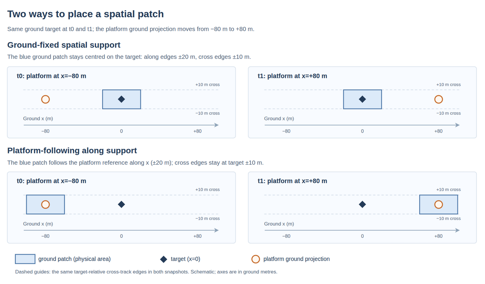

# Acquisition, detector readout and tolerances

This reference specifies local angular acquisition, charge, electronics and small-case tolerance transport. For GCRS timed reads, use the separate [line-of-sight guide](line-of-sight.md).

## Source responsibilities

| Source | Responsibility | Boundary |
| --- | --- | --- |
| `scene.py` | Radiance fields, sampling and the explicit uniform-field adapter | Spatial/time coverage is supplied, never inferred from a directional radiance. |
| `acquisition.py`, `imaging/acquisition.py` | Native reads, pixels, exposures, pointing and quadrature | Geometry is distinct from optical throughput and detector electronics. |
| `los.py` | GCRS sight lines from scheduled trajectory/attitude inputs and full-support radiance sampling | Caller supplies time, attitude and mount conventions; the provider certifies the continuous time/FOV and spectral domain. |
| `quadrature.py` | Gauss-Legendre nodes and interval measure weights for acquisition and pixels | Owns the implementation; weights are not physical response weights or probabilities. |
| `optics/` | PSFs, finite pixels and filter/dispersive/two-beam/cavity responses | Named factories are conveniences within the supported physical contract, not a closed instrument registry. |
| `photoelectrons.py`, `charge.py` | Radiance integration, expected electrons and source-path combination | Optical fractions, area, exposure and QE each enter once. |
| `detector.py` | Detector maps, conditional moments, random readout and digitisation | Expected photoelectrons are not mean DN or a random detector realization. |
| `imaging/photodetection.py`, `imaging/readout.py` | Complete image charge and readout with per-exposure common noise | External photoelectrons join optical charge before sampling. |
| `imaging/measurements.py`, `imaging/simulation.py` | Native measurements and composed image calls | Complete rasters use exposure, row and column axes; selections use a read axis. |
| `tolerances.py` | Native sensitivities, uncertainty budgets and Monte Carlo transport | Perturbations and source laws remain explicit. |

Local angular images and GCRS lines of sight keep separate scene/geometry contracts. Both paths use photon-response and detector kernels; the library depends on public radiative contracts and uncertainty algebra without importing data services. [Line-of-sight usage](line-of-sight.md) specifies time, mount, GCRS rays and continuous coverage.

## Acquisition geometry

`quadrature.interval_quadrature(low, high, order)` returns fresh writable Gauss-Legendre nodes and measure weights on a finite positive-width interval. Coordinate units are inherited from the bounds; weights are neither physical response weights nor normalized probabilities. `validate_quadrature_order(order)` rejects nonpositive orders.

`along_track_acquisition(reads, trajectory, *, target_xy_m, pixel_bounds_m, along_edges_m, cross_edges_m, focal_length_m, pointing_law, support_frame="ground", cross_offset_m=None, time_order=3, angular_order=5, cross_order=None)` takes a `ReadSchedule` (identities and finite exposure bounds in seconds) and explicit sampled geometry. `target_xy_m` is (reads, 2) along/cross ground metres, `pixel_bounds_m` is (reads, 4) focal-plane metres, and piecewise support edges are strictly increasing ground metres. For `support_frame="ground"`, along edges stay centred on the ground target; for `"platform"`, along edges translate with the platform ground projection plus the along offset at each exposure centre. Cross edges stay target-relative. The centre offset is `target_x - speed * (exposure_centre - time_origin)`; optional `cross_offset_m` supplies (reads,) local cross ground offsets. Gauss orders apply to exposure time and each ground axis (cross defaults to angular). Inputs are borrowed; the returned `Acquisition` owns its arrays. `along_track_strip_templates(..., trajectory=...)` yields timed `ReadSchedule` and independent (reads, 4) pixel rectangles for local strips. `instrument_response` and `gaussian_along_track_response` accept the same direct geometry, support-frame and quadrature arguments.

The required `pointing_law(read_index, times_s)` returns finite (time_nodes, 2) dimensionless local slopes at temporal quadrature nodes. Image centroids follow `f * (ray_uv - pointing_uv)`; scene directions, physical support and solid-angle-time weights retain their own frame and values. An explicit zero-slope callback, for example `lambda read_index, times_s: np.zeros((len(times_s), 2))`, retains the original image mapping. `ground_fixed_pointing(trajectory, target_xy_m, centre_times_s)` keeps each gaze on a fixed target on the local ground plane; `ground_scroll_pointing(..., ground_rate_m_s=s)` advances that target along track at `s` ground metres per second. With platform speed `v`, `s=0` tracks fixed ground, `0<s<v` scrolls more slowly than the platform, and `s=v` keeps a constant local along slope. Both factories snapshot their input arrays, return per-read slope callbacks and use the platform's per-column cross origin. Support motion and gaze motion remain independent: a stationary ground patch can accompany a scrolling gaze, and a platform-following slit can accompany a fixed ground gaze. The Gaussian helper evaluates the same pointing on its reference line and full cross grid under its stated separability contract.



*Figure: The physical ground patch stays centred on the target with `support_frame="ground"` and translates along track with the platform reference for `support_frame="platform"`; both keep cross-track edges target-relative. The orange marker denotes the platform ground projection, while the optical gaze follows its separate pointing law. [Editable Draw.io source](diagrams/spatial-support-frames.drawio).*

Physical finiteness, range and positivity checks use NumPy directly in their domain functions. Array ownership and support checks remain explicit at each boundary.

## Contracts and first case

The first case is a synthetic moving heterogeneous scene on a forward direction-cosine patch, two finite pixels and two sequential settings. It is an implementation reference, not a selected mission instrument. The four response families in that first case are dispersive Gaussian redistribution, discrete/LVF Gaussian transmission, balanced two-beam ports and a local Airy cavity with explicit order selection; supplied profiles and mappings extend these choices without changing their integration contracts. Arrays in this case use float64. `ReadSchedule`, `Acquisition` and `RasterReadSchedule` retain immutable numerical snapshots. `ImageMeasurements` copies photoelectrons, DN, flags, settings and contributions into independent writable arrays, including on direct construction; it shares the immutable raster schedule. Numerical functions return fresh writable arrays unless their returned record documents otherwise. Callbacks borrow inputs and must be pure and nonmutating. There are no caches, workers or hidden RNGs.

- `RadianceField(grid,times_s,u,v,values)` represents unpolarised W m^-2 sr^-1 per (cm^-1) radiance with shape `(time,u,v,spectral)`. Each spatial/time axis has at least two increasing nodes. Its dimensionless u/v axes use the supplied acquisition's coordinate convention and frame: direction cosines for `rectangular_acquisition`, bounded local paraxial slopes for `along_track_acquisition`; the entire support rectangle satisfies `u**2 + v**2 < 1` in both conventions, and times share the acquisition's epoch. Trilinear interpolation rejects extrapolation, NaNs and missing coverage. One explicit spectral interval, sampled at both endpoints, is required; disconnected bands must be simulated as separate source-path contributions. Grid sampling and effective instrumental resolution are distinct quantities.
- `uniform_radiance_field` explicitly extends an existing directional `orsia_radiative.Radiance` on caller-declared time, direction and spectral support. It does not infer those supports or change the radiative API. The caller asserts a uniform-field approximation and coordinate-frame relationship to the original geometry.
- `Acquisition` describes N physical reads with unique sample IDs and retained pixel, setting and port IDs; exposure bounds `(N,2)` in seconds; times `(N,Q)`; directions and image centroids `(N,Q,2)`; positive-support nonnegative quadrature weights `(N,Q)` in sr s; rectangular active pixel bounds `(N,4)` in metres, ordered xmin,xmax,ymin,ymax; and enclosing direction-support bounds `(N,4)`, ordered umin,umax,vmin,vmax. Coverage checks include entire exposure intervals and direction patches, not just their interior quadrature nodes. Node images are the caller's scene/pointing map. No scene locations or timestamps are inferred from IDs. Generic supplied quadrature is supported; its accuracy and geometric consistency belong to the caller.
- `rectangular_acquisition` provides Gauss-Legendre time/angular nodes with exact forward-hemisphere measure `du dv/sqrt(1-u²-v²)` and the bounded paraxial mapping `f*(direction-pointing)`. This is not a general camera projection, orbit propagator or geolocation API. The caller supplies pointing as a function of time and explicitly selects the sky patch. Neglected light outside that patch must be justified by the case.
- `image_acquisition` builds one dense acquisition for a `(rows,columns,4)` array of finite pixel bounds and `(settings,2)` exposure intervals shifted by caller-supplied row offsets. It emits physical reads in setting/row/column order with stable sample, pixel and setting IDs and `direct` ports; frame order need not be chronological if row offsets overlap. Caller-supplied pointing may contain scan motion and jitter; there is no orbit/geolocation model, pointing interpolation or implicit detector-sky mapping. Arrays are independently owned by the acquisition; the borrowed pointing callback must stay stable during evaluation. A common direction patch, pixel bounds and focal length apply across settings; other geometries can use the lower-level `Acquisition` contract.
- `simulate_images` builds one complete image acquisition, integrates the supplied full-support radiance field, then optionally samples detector readout using the caller's RNG. For manually assembled acquisitions, `expected_electrons` integrates full-grid response coefficients; `sample_readout` applies detector physics. Working storage includes full scene interpolation, full optical coefficients and optional digitised realizations. Physical support, resource costs and quadrature convergence remain case-specific.
- `ExpectedElectrons(reads,contributions)` stores named nonnegative `(N,)` source means, before dark/read noise. Its `total` property returns a new sum, not a mutable cache. Distinct internal sources must first traverse their actual remaining optical paths and only then join the contributions. No automatic full external-scene response is applied to internal emission.
- `DetectorElectronics` describes a homogeneous operating point: dark electrons/s, Gaussian read noise sigma in electrons, full well in electrons, electrons/DN, bias DN and ADC bits (1–32). `DetectorReadings` retains a `ReadSchedule` and immutable `(realisations,N)` integer DN, full-well and ADC flags. There is no L0/L1/L2 class hierarchy, persistence or calibration-estimation contract.

## Sample already integrated charge

Run this standalone example in the [development environment](../../../README.md#development-environment). A physical read schedule is sufficient when expected charge is already available.

```python
import numpy as np
from orsia_instruments import DetectorElectronics, ExpectedElectrons, ReadSchedule, sample_readout

reads = ReadSchedule(
    sample_ids=("r0",),
    pixel_ids=("p0",),
    setting_ids=("s0",),
    port_ids=("direct",),
    exposure_bounds_s=np.array([[0.0, 0.01]]),
)
charge = ExpectedElectrons(reads, {"external": np.array([100.0])})
readings = sample_readout(charge, DetectorElectronics(bias_dn=100.0), np.random.default_rng(71))
assert readings.reads.sample_ids == ("r0",)
print(readings.dn.shape)
```

Expected output: `(1, 1)`, with axes `(realization,read)`. Charge is a nonnegative mean before dark/read noise; noise is sampled only at readout. Internal emitters must traverse their actual remaining optical paths before charge combination.

## Detector and perturbations

`electron_moments` returns the hypothetical unclipped analogue-electron mean and variance: scene plus dark mean, and that mean plus read-noise variance. These are not clipped/quantized DN moments, even if full well is finite. `sample_readout` draws Poisson scene+dark charge, clips at full well, adds independent Gaussian read noise, divides by electrons/DN, adds bias, clips to the ADC range and rounds to nearest integer with ties to even. Full-well flags include equality; ADC flags indicate analogue values outside the representable range before rounding. `digitize` applies that deterministic transfer to supplied charge/noise arrays; applying it to mean charge is not the expected value after nonlinear clipping.

The explicit caller-owned NumPy RNG is advanced and must not be shared concurrently. Conditional realisations are independent; reads are independent unless explicit common-noise groups are supplied. Common scene/instrument fluctuations must be supplied separately. No Gaussian fallback replaces large Poisson draws. Negative physical means and invalid support raise rather than being marked saturated or silently dropped. No analysis-rejection flag is invented.

`native_difference` returns signed perturbed-minus-nominal electrons and checks read/source identities. `central_difference` evaluates symmetric deterministic parameter perturbations; step refinement is explicit. Geometry and timing may change intentionally while read identities remain comparable. Recompute all affected mappings, radiance sampling and response laws; the API does not infer which inputs a parameter changes. Detector operating-point changes can be evaluated with `electron_moments`/`digitize` at fixed input means; unsaturated sensitivities do not extend through clipping transitions.

## Supplied responses, detector maps and tolerance budgets

`tabulated_transmission` linearly interpolates supplied bounded spectral transmission, including leaks or order sorting. Outside support it either rejects requests (default) or uses an explicitly selected zero-blocking policy. `pixel_acceptance(..., spatial=TabulatedPSF(...))` integrates a nonnegative finite-support spatial density in m^-2 with axes `(x_offset,y_offset)` against local transmission on a finite pixel. Its total tabulated mass must not exceed one; missing tails are not renormalized. Centroids may vary by wavelength. Refine table, pixel quadrature and spectral sampling independently; these supplied profiles do not constitute a coherent optical propagation model.

`combine_source_paths` joins independently integrated source means with unique source names, matching physical-read identities and exposure intervals. Each internal emitter uses its own radiance support and remaining optics before combination; the function does not infer emissivity, temperature, geometry or throughput.

`DetectorOperatingPoints` supplies independently copied per-read dark current, read noise, full well, gain, bias and bounded quadratic charge nonlinearity. Repeat a pixel's values across exposures for fixed-pattern variation. `pixel_quantum_efficiency` provides upstream per-pixel QE: apply it once before photon counting. `sample_readout` optionally draws independent row-, column- and exposure-common Gaussian components using explicit group IDs. One draw per group is shared within each realisation, renewed for each complete call. `electron_covariance` returns the corresponding dense pre-clipping, pre-nonlinearity covariance in electrons squared; storage scales quadratically with read count.

`native_sensitivities` recomputes deterministic native-electron signals at symmetric parameter perturbations. `native_tolerance_budget` reuses `orsia-uncertainty` for signed bias and correlated parameter covariance transport, retaining conditional detector covariance separately. Parameter units and column order are caller-declared; step refinement and linearisation validity remain caller responsibilities. `monte_carlo_native` compares parameter-only empirical moments with that first-order budget. `analogue_dn_budget` scales a strictly unsaturated linear operating point to analogue DN; it rejects nonlinear detector maps and does not predict quantised moments. `monte_carlo_dn` instead samples parameters and conditional physical readout with clipping flags, but does not infer common-noise groups. These dense small-case tools are not image-scale covariance infrastructure, reconstruction, calibration estimation or atmospheric inversion.

The tolerance APIs take NumPy float64 arrays: `parameter_bias` has shape `(p,)`, and `parameter_covariance` is `(p,)` variances or a dense `(p,p)` matrix in `parameter_names` order (mapping insertion order for Monte Carlo). `NativeSignalBudget.signed_bias` is a vector `(reads,)`; `instrument_covariance` and `detector_covariance` are dense matrices `(reads,reads)` in `sample_ids` order, with independent writable storage. Units are implied by the budget's `unit` and the caller's parameter conventions; the uncertainty core checks numerical validity, not physical homogeneity.

The extension tests use elementary finite-pixel integrals, independent covariance algebra, homogeneous-map equivalence and seeded ensembles, including a nonlinear case that deliberately violates first-order moment predictions. They establish bounded software/reference behaviour, not realistic internal backgrounds or instrument qualification.

## Runnable advanced-kernel example

```python
import numpy as np
from orsia_instruments import (
    DetectorElectronics,
    ReadSchedule,
    expected_electrons,
    gaussian_filter,
    gaussian_pixel_fraction,
    rectangular_acquisition,
    sample_readout,
    uniform_radiance_field,
)
from orsia_radiative import ObservationGeometry, Radiance, wavenumber_grid

radiance = Radiance(
    wavenumber_grid(np.linspace(4900.0, 5100.0, 257)), np.full(257, 1e-3), ObservationGeometry(0.0)
)
field = uniform_radiance_field(
    radiance,
    time_bounds_s=(0.0, 0.1),
    u_bounds=(-0.004, 0.004),
    v_bounds=(-0.004, 0.004),
    spectral_bounds_cm1=(4900.0, 5100.0),
)
acquisition = rectangular_acquisition(
    reads=ReadSchedule(
        ("read-0",), ("pixel-0",), ("band-0",), ("direct",), np.array([[0.0, 0.01]])
    ),
    pixel_bounds_m=np.array([[-5e-5, 5e-5, -5e-5, 5e-5]]),
    direction_bounds_uv=(-0.004, 0.004, -0.004, 0.004),
    pointing=lambda t: np.zeros((len(t), 2)),
    focal_length_m=0.02,
)


def response(i, wavelength, acquisition):
    fraction = gaussian_pixel_fraction(
        acquisition.pixel_bounds_m[i], acquisition.image_xy_m[i], 3e-5
    )
    return fraction[:, None] * gaussian_filter(wavelength, 2e-6, 2e-8)


mean = expected_electrons(
    field, acquisition, response, collecting_area_m2=1e-8, throughput=0.8, quantum_efficiency=0.7
)
readings = sample_readout(mean, DetectorElectronics(bias_dn=100.0), np.random.default_rng(71))
assert readings.reads.sample_ids == ("read-0",)
assert readings.dn.shape == (1, 1)
```

## Execution and evidence boundary

Run `devbox run -- just --justfile tests/justfile pytest libs/orsia-instruments/tests/test_dense_imaging.py` for synthetic dense photon conversion, full-image source combination, detector grouping and response projection. The [integrated synthetic cases](../../../tests/test_instrument_examples.py) and [LVF scan regression](../../../tests/test_lvf_scan.py) also exercise the dense API.

The [image-closure regressions](../tests/test_image_closure.py) retain independent static optical/photon references, separate sampling-axis refinement, deliberately undersampled cases, parameter/noise transport and clipping checks. Refinement of a fixed interpolated scene leaves scene interpolation accuracy untested. Analytic pixel integrals have no pixel-quadrature convergence claim. High-finesse resonances and fringes require adequate spectral sampling; no fixed grid is sufficient for arbitrary response parameters. First-order tolerance budgets require step refinement and a local linearity check. Large pointing perturbations and clipping can invalidate linear moment predictions.

The [opt-in characterization tests](../../../tests/test_instrument_characterization.py) retain local small-case resource budgets. Retired partitioned filter-strip timings neither measure dense full-scene throughput nor bound dense output/covariance storage. Representative dimensions, exposure counts and time/memory budgets require case-specific evidence. The historical full reference filter-strip workload was not executed.

Scientific acceptance for a specific instrument requires independent scene support, quadrature and spectral convergence, calibration comparisons and appropriate uncertainty tests. These synthetic cases exclude realistic internal thermal backgrounds and leave Julia parity, broad concurrent-native safety, instrument accuracy and mission feasibility unqualified. Uniform extension of a directional radiance prediction remains a caller approximation.


## Retained native correspondence

`ReadSchedule` owns immutable ordered read identities, pixel/settings/port identities and actual positive exposure intervals. `Acquisition.reads` shares that schedule. `RasterReadSchedule` adds the original complete `(frames,rows,columns)` native shape and immutable `(reads,3)` native indices. Construct it once with `raster_read_schedule` and pass the same correspondence to image acquisition, charge or frame simulation. Selected schedules preserve original IDs and native indices; selected values stay on their read axis. Dense reshaping requires complete C-order coverage.

`detector_operating_points(detector, rows=..., columns=...)` selects electronic maps in the supplied read order. Both readout and linear calibration use this operation. QE is applied upstream once in photon conversion. Calibration compares measured identity/timing against a separately supplied response and selects the independently estimated detector using retained native indices.
