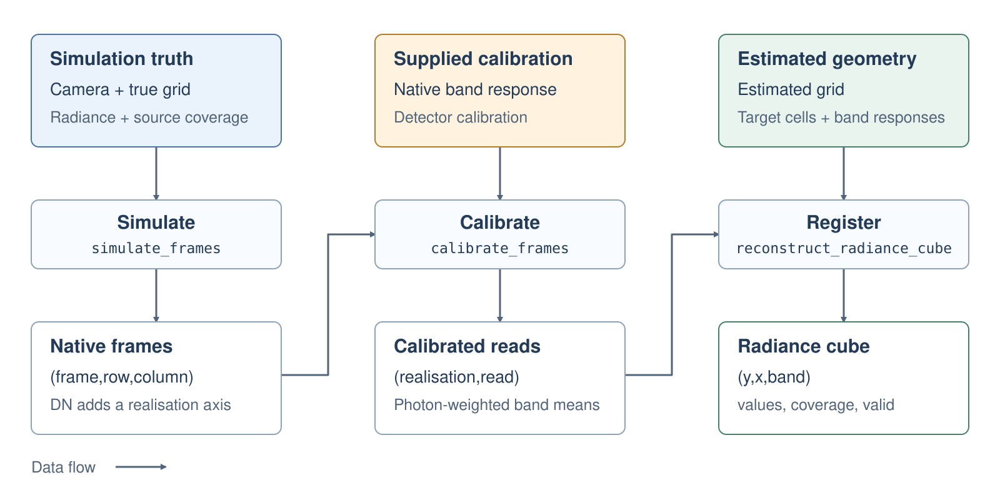
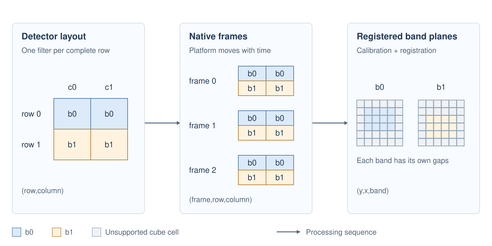

# Use a fixed-filter camera to build a radiance cube

A fixed-filter camera places spectral filters over detector rows. Each exposure records a two-dimensional image, with each row measuring its assigned band. As the platform moves, the rows observe different surface patches. Orsia simulates these native frames, applies supplied calibration, and registers the calibrated reads on a ground grid.

## The mental model

Keep three inputs separate:

- **Simulation truth:** the camera, true trajectory and pointing, surface projection, and radiance determine the native measurements.
- **Supplied calibration:** a response describes how much charge each read collects and which photon-weighted spectral mean it measures.
- **Estimated geometry:** a separately supplied grid places the calibrated reads on the surface. A position or pointing error can move the reconstructed image while the native measurements stay fixed.



Each arrow carries an input or output of the named operation. The reconstruction receives calibrated reads and estimated geometry; the caller chooses whether that geometry matches simulation truth. [Open the full-size diagram](diagrams/filter-camera-flow.svg).

A native frame mixes bands across its rows. A cube groups the registered values into separate band planes, with axes `(y,x,band)`. Some ground cells can have one band and lack another.



The colours identify bands throughout this schematic. The ground planes illustrate partial support; their coloured cells are schematic. [Open the full-size diagram](diagrams/filter-camera-strips.svg).

[Run the walkthrough](#walkthrough-two-strips-over-earth), then use the reference sections for [camera and PSF choices](#camera-and-psf-choices), [continuous support](#continuous-support), [calibration and band compatibility](#calibration-and-band-compatibility), and [cube interpretation](#cube-interpretation-and-limits).

## Walkthrough: two strips over Earth

Run the following Python blocks in order in one session, with the packages installed or in the [Orsia development environment](../../../README.md#development-environment). The example uses NumPy and public Geometry, Instruments and Radiative APIs. Geometry includes the required SatKit backend in default installations. The [Geometry introduction](../../orsia-geometry/README.md#construct-a-leo-trajectory-and-ground-trace) explains the orbital setup and auxiliary requirements.

Use a timezone-aware UTC epoch and Earth-orientation parameter (EOP) coverage for the observation dates and the propagator's padded preparation nodes. Missing or held EOP values fail explicitly. SatKit can acquire public auxiliary files and populate process-global EOP/JPL caches; serialize native evaluation, configuration changes and auxiliary refresh. Concurrent native-library safety remains unqualified. For offline execution, use the existing DE421/EOP fixtures and environment settings described in [Checks and further reading](#checks-and-further-reading).

All dimensions, filters and radiance values are illustrative. A hypothetical 700 km-class orbit observes the WGS84 reference ellipsoid with radial-nadir pointing. A two-row, two-column detector records three exposures over 0.11 s. The source is spatially uniform and has a sloping spectrum, so the two filters produce different calibrated band means. Start with expected photoelectrons to make the result deterministic.

### 1. Assemble the detector and its two filters

The pixel pitch is 20 micrometres. Row 0 carries `b0`; row 1 carries `b1`. A Gaussian point-spread function (PSF) spreads incident light across the detector. Strip row ranges include the start and exclude the stop. Filter callbacks receive wavelengths in metres; `0.01 / wavenumber_cm1` converts a wavenumber to wavelength. Transmission callbacks return same-shaped intensity fractions in `[0,1]`.

`regular_detector` requires explicit geometry and all eight photoelectric/electronic fields, including for expectation-only calculations. The constructor below states this example's idealized detector assumptions. Geometry and property maps are independent read-only copies.

```python
from dataclasses import replace
from datetime import UTC, datetime
from functools import partial

import numpy as np
from orsia_geometry import NumericalPropagator, radial_nadir
from orsia_geometry.constants import WGS84_SEMIMAJOR_AXIS_M
from orsia_instruments import GaussianPSF, calibrate_frames, camera_acquisition_grid, frame_response, filter_camera, filter_strip, frame_exposure_bounds, gaussian_filter, reconstruct_radiance_cube, regular_detector, simulate_frames, wgs84_surface_projection_from_camera
from orsia_radiative import SpectralBand, SpectralDomain, wavenumber_grid

strips = [
    filter_strip(
        row,
        row + 1,
        band=f"b{row}",
        transmission=partial(
            gaussian_filter,
            centre_m=0.01 / centre_cm1,
            width_m=0.0001 / centre_cm1,
            peak=0.8,
        ),
    )
    for row, centre_cm1 in enumerate((4200.0, 4800.0))
]
# Explicit idealized QE and electronics for this expectation-only example.
detector = regular_detector(
    (2, 2),
    pitch_m=20e-6,
    active_size_m=20e-6,
    centre_xy_m=(0, 0),
    quantum_efficiency=1,
    dark_electrons_per_s=0,
    read_noise_electrons=0,
    full_well_electrons=1e6,
    electrons_per_dn=1,
    bias_dn=0,
    nonlinearity=0,
    adc_bits=16,
)
camera = filter_camera(
    detector,
    strips,
    focal_length_m=0.3,
    f_number=4.0,
    spatial=GaussianPSF(4e-6),
    omitted_psf_mass=1e-6,
)
```

### 2. Select the rays and project them onto Earth

`NumericalPropagator` constructs a Geocentric Celestial Reference System (GCRS) trajectory from osculating elements `[a,e,i,RAAN,arg_periapsis,true_anomaly]`, with lengths in metres and angles in radians. Time is elapsed SI seconds from the UTC epoch. The callable object supplies `(times,3)` GCRS positions in metres and velocities in metres per second. The default force model is EGM96 degree 2/order 0 with RKV98 integration; see the [orbital adapter contract](../../orsia-geometry/docs/geometry.md#orbital-adapters) for tolerances and omitted forces.

`radial_nadir` points platform `+z` towards Earth's centre and sets `+x` along transverse inertial motion. The instrument-to-platform rotation is identity. The two attitude callbacks return `(times,3,3)` column-vector rotations. They remain independent inputs to acquisition. The public trajectory evaluator accepts unordered and repeated times, including the repeated exposure nodes generated for different pixels.

```python
epoch = datetime(2023, 5, 16, 20, tzinfo=UTC)
validity_s = (0.0, 1.0)
elements = np.array(
    [
        WGS84_SEMIMAJOR_AXIS_M + 700000.0,
        0.001,
        *np.deg2rad([98.0, 0.0, 0.0, 0.0]),
    ]
)
trajectory = NumericalPropagator(elements, epoch=epoch, validity_s=validity_s)


def platform_attitude(times_s):
    return radial_nadir(*trajectory(times_s))


def instrument_attitude(times_s):
    return np.broadcast_to(np.eye(3), (len(times_s), 3, 3))
```

Use Instruments' `wgs84_surface_projection_from_camera` to select the initial detector-centre ray's WGS84 intercept as the shared chart origin. Supply the camera, trajectory, both attitude laws, UTC epoch and closed time support. The helper uses the camera's physical focal length and detector placement, composes both attitudes and an optional platform-frame mount offset, and constructs one dated GCRS ray through Geometry. Geometry transforms that ray into ITRF (International Terrestrial Reference Frame). Construction raises `ValueError` if the reference ray misses WGS84 or intersects an exact pole.

By default, `reference_time_s=0.0` and `mount_offset_p_m=None` selects zero offset. The geometric detector centre is the midpoint of the overall active-rectangle bounding extent: `((min(xmin)+max(xmax))/2, (min(ymin)+max(ymax))/2)`. The centre can lie between pixels on an even-sized detector. Physical detector offsets remain included. To use one active pixel's centre, pass `reference_pixel=(row, column)` with native zero-based indices; negative and out-of-range indices raise `ValueError`. The forward focal-plane ray is normalized `(x, y, focal_length_m)`, with columns along x and rows along y. Use the same physical mount offset when building acquisition grids.

Chart `x` and `y` are east and north displacement projections onto the origin's fixed ellipsoid tangent plane, in metres. The normal follows the WGS84 ellipsoid gradient. This local orthographic chart discards height; its coordinates represent projected displacements rather than geodesic distances.

```python
surface = wgs84_surface_projection_from_camera(
    camera,
    trajectory=trajectory,
    platform_attitude=platform_attitude,
    instrument_attitude=instrument_attitude,
    epoch=epoch,
    validity_s=validity_s,
)
```

The helper returns a Geometry-owned `WGS84SurfaceProjection` object, shared with the explicit-origin and from-ray constructors. Its `chart_origin_itrf_m` property returns an independent copy for inspection.

Build the exposure schedule and reuse this single `surface` callable object for both truth and estimated acquisition grids. Construction snapshots the chart and time support; the returned callback retains no camera, reference arrays or trajectory/attitude laws. The chart remains fixed when estimated trajectory or pointing changes. Construct `WGS84SurfaceProjection` directly from Geometry when a chart origin is already available in ITRF metres. Geometry's `WGS84SurfaceProjection.from_ray` is available for an explicit dated GCRS ray.

```python
from orsia_instruments import raster_read_schedule

exposures = frame_exposure_bounds(
    start_s=0.0,
    frame_count=3,
    frame_rate_hz=20.0,
    exposure_s=0.01,
)


def acquisition_grid(trajectory_law, platform_law):
    return camera_acquisition_grid(
        camera,
        raster_read_schedule(
            exposures, (camera).pixel_bounds_m.shape[:2], port=(camera).optics.port
        ),
        epoch=epoch,
        validity_s=validity_s,
        trajectory=trajectory_law,
        platform_attitude=platform_law,
        instrument_attitude=instrument_attitude,
        surface=surface,
        motion_bound_m_s=30000.0,
        angular_bound_m=3e6,
        time_order=2,
        angular_order=10,
    )


truth_grid = acquisition_grid(trajectory, platform_attitude)
print("Native shape:", truth_grid.image_shape)
print("Last read (frame,row,column):", truth_grid.native_indices[-1].tolist())
```

Expected output:

```text
Native shape: (3, 2, 2)
Last read (frame,row,column): [2, 1, 1]
```

The callback preserves all leading axes: integration rays have `(reads,nodes,3)` shape, while support-corner rays have `(reads,support_times,4,3)` shape. Their time arrays exactly match the leading axes, with the final coordinate axis omitted. `transform_rays` handles distinct dates, repeated times and axis restoration internally. `ellipsoid_intersections` returns `(hits,points)`; the surface callback returns `(xy_m,view_local,hits)`, with shapes `(...,2)`, `(...,3)` and `(...)`. Outward unit views use fixed chart-origin east/north/up axes after dated GCRS-to-ITRF rotation; the scene shares these Cartesian axes. Missed rays have NaN coordinates and false hits. `project_local_east_north` also exposes the chart operation directly for existing ITRF points. Ray coordinates require rotation only; velocity transformations also need the rotation derivative.

The walkthrough's support bounds are conditional on the [continuous-domain assumptions](#walkthrough-support-bounds).

### 3. Supply radiance on the selected coordinates

The source emits `wavenumber_cm1 * 1e-8` W m^-2 sr^-1 per (cm^-1), independent of position, time and viewing direction. Declare the connected spectral interval explicitly. The coverage callback attests every read under the [walkthrough support assumptions](#walkthrough-support-bounds) because this analytic source exists throughout the local Earth-surface chart, at every time and direction, throughout the declared interval.

```python
spectral = wavenumber_grid(
    np.linspace(3900.0, 5100.0, 65),
    domain=SpectralDomain("wavenumber_cm1", ((3900.0, 5100.0),)),
)


def radiance(xy_m, view_local, times_s, spectral):
    wavenumbers_cm1 = spectral.points
    return np.broadcast_to(
        wavenumbers_cm1 * 1e-8,
        (*times_s.shape, len(wavenumbers_cm1)),
    )


def coverage(grid, spectral_grid):
    # This attestation relies on the analytic source and projection stated above.
    return np.ones(len(grid.read_bands), dtype=bool)


measurements = simulate_frames(
    camera,
    truth_grid,
    spectral,
    radiance,
    coverage,
)
assert measurements.images.dn is None
assert np.all(measurements.images.photoelectrons > 0)
print("Expected electrons:", measurements.images.photoelectrons.shape)
```

Expected output: `Expected electrons: (3, 2, 2)`. Each element is one expected native read. Orsia chooses the surface samples from the camera and exposure; the callback evaluates radiance at those samples.

### 4. Apply supplied calibration and identify the achieved bands

For this ideal example, build an independent calibration detector and calculate its source-independent response with `frame_response`. Supply that response explicitly to calibration. Build the requested bands from its normalized coefficients, which already include photon conversion and spectral quadrature. Real calibration can supply independently measured or perturbed coefficients.

```python
# Separate calibration records use identical estimates for this closure example.
estimated_detector = replace(detector)
calibration_camera = replace(camera, detector=estimated_detector)
supplied_response = frame_response(calibration_camera, truth_grid, spectral)
calibrated = calibrate_frames(
    measurements.images,
    supplied_response,
    detector=estimated_detector,
)

bands = []
for name in ("b0", "b1"):
    first_read = supplied_response.read_bands.index(name)
    coefficients = supplied_response.spectral_coefficients[first_read]
    bands.append(SpectralBand(name, spectral, coefficients / coefficients.sum()))

expected_means = np.array([np.dot(spectral.points * 1e-8, band.weights) for band in bands])
print("Calibrated reads:", calibrated.values.shape)
print("Band means:", [f"{value:.3e}" for value in expected_means])
```

The calibrated shape is `(1, 12)`: one expectation and twelve reads. The means are approximately `4.2e-5` and `4.8e-5` in the source radiance units. The small offset from each filter's nominal centre follows its achieved photon-weighted response.

### 5. Register the reads and inspect the cube

Build the estimated grid separately. The example uses identical simulation and estimated geometry, so it introduces no geometry error. The spatial accumulation still has the discretization and smoothing limits described below. An error experiment can supply a different trajectory or attitude while retaining the same native read identities, exposure timing and sensor quadrature. Keep the chart origin and axes fixed when comparing truth and estimated geometry.

```python
estimated_grid = acquisition_grid(trajectory, platform_attitude)
cube = reconstruct_radiance_cube(
    calibrated,
    estimated_grid,
    x_edges_m=np.linspace(-400.0, 200.0, 7),  # East, 100 m cells.
    y_edges_m=np.linspace(-200.0, 1000.0, 7),  # North, 200 m cells.
    bands=bands,
)

for index, expected in enumerate(expected_means):
    supported = cube.valid[..., index]
    assert supported.any()
    np.testing.assert_allclose(cube.values[..., index][supported], expected, rtol=1e-12)
assert np.isnan(cube.values[~cube.valid]).all()
assert (~cube.valid).any()
print("Cube (y,x,band):", cube.values.shape)
print("Each band has support:", cube.valid.any(axis=(0, 1)).tolist())
print("Cube contains gaps:", bool((~cube.valid).any()))
print("Band means:", [f"{value:.3e}" for value in np.nanmean(cube.values, axis=(0, 1))])
```

Expected output:

```text
Cube (y,x,band): (6, 6, 2)
Each band has support: [True, True]
Cube contains gaps: True
Band means: ['4.201e-05', '4.801e-05']
```

The assertions check every supported cube value against its band's mean. Uniform spatial radiance survives normalized registration; unsupported elements remain NaN. The example checks the API sequence and this bounded invariant. Its illustrative integration orders establish no general convergence or instrument-performance claim.

## Camera and PSF choices

Construct cameras with `filter_camera`. One fixed optical model owns the strip layout, PSF, support and response. `camera.strips`, `camera.optics`, `camera.support_radius_m`, `camera.omitted_psf_mass` and `camera.row_bands` are derived read-only properties. Rebuild with `filter_camera` when those optical inputs change. The former six-field `FilterCamera` constructor and independent optical-property replacement are unsupported and raise `TypeError`.

`dataclasses.replace(camera, detector=estimated_detector)` remains supported when active pixel rectangles are exactly equal, including their ordering. This permits different QE, gain and noise estimates without changing geometry. Changed detector rectangles raise `ValueError`. Custom responses use the generic `FocalPlaneImager` contract and its native channel identities; an already supported response must retain its existing pupil projection and clipping exactly once.

Use these options when adapting the walkthrough:

| Choice | Meaning and constraints |
| --- | --- |
| Detector | `regular_detector` builds regular active bounds; `DetectorProperties(pixel_bounds_m=..., pitch_m=None, ...)` preserves irregular rectangles. Bounds use `(row,column,4)` and `(xmin,xmax,ymin,ymax)` metres. Shape is derived; pitch uses `(x,y)`. Gaps reduce collected light. |
| Reference sizing | `sized_focal_length(ImagerSizing(600000, 20, 10e-6))` gives 0.30 m from `altitude * pitch / ground_sampling`. This reference nadir sizing remains independent of actual motion. |
| Strip layout | One strip gives a uniform camera; multiple strips cover complete active rows. Overlap and out-of-range rows raise `ValueError`. Uncovered rows raise unless `allow_uncovered_rows=True`; permitted dark rows have empty band identities. |
| Pupil | The unobscured circular area is `pi * (focal_length_m / f_number)**2 / 4`. Optional `collecting_area_m2` asserts agreement to relative tolerance `1e-12`. Additional vignetting is outside the model. |
| Gaussian PSF | Set `spatial=GaussianPSF(sigma_m)` with widths in metres. Support expands each active rectangle by `max(sigma_x,sigma_y) * sqrt(-2*log(omitted_psf_mass))`; the radial tail budget is exact for isotropic widths and conservative for anisotropic widths. Gaussian pixel acceptance is analytic. |
| Airy PSF | Set `airy_wavelength_max_m` and an explicit tail budget. The maximum must bound every evaluated wavelength. Long tails can require large support and higher angular and pixel orders. |
| Custom PSF | Supply `psf` as a density in m^-2 and a positive `support_radius_m` conservative over the complete field, exposure and wavelength domain. The caller certifies normalization and omitted tails; `omitted_psf_mass` is recorded as `None`. |

Choose exactly one PSF law. For Airy support, `J0(z)**2 + J1(z)**2 = omitted_psf_mass`, where `z = pi * radius / (maximum_wavelength * f_number)`. `pixel_order` controls finite-pixel integration for Airy and custom laws. See [Optics](optics.md) for PSF and filter callbacks, including `tabulated_psf`.

The support truncates incident centroids outside each expanded pixel rectangle. Retained tails receive no renormalization. The Gaussian/Airy whole-plane radial tail budget bounds omitted PSF mass; charge error also depends on radiance outside retained support. Check truncation and quadrature separately.

Pupil area, throughput, quantum efficiency (QE), time, solid angle and photon conversion each enter the shared photon kernel once. Pupil projection and the focal-plane solid-angle Jacobian give the local cosine-fourth irradiance law. QE acts before photon noise.

## Continuous support

### Geometry and projection

`camera_acquisition_grid` selects a direction-cosine rectangle enclosing each active pixel plus its PSF support. `time_order` and `angular_order` set Gauss sampling over the complete exposure and each direction coordinate. Changing either order requires a new grid and new radiance evaluation.

Supply complete exposure intervals, a timezone-aware UTC epoch, GCRS position/velocity, independent platform-to-GCRS and instrument-to-platform rotations, and a surface callback. Exposure durations are positive; `frame_exposure_bounds` limits them to one frame period. For example, 41 frames at 250 Hz with 0.001 s exposures end at 0.161 s. See the [line-of-sight contract](line-of-sight.md#time-frames-support-and-ownership) for rotations and the forward virtual focal plane. An optional mount offset uses platform-frame metres.

The surface callback supplies the datum, terrestrial transformations and projected chart. The caller certifies continuous visibility and finite projection throughout every complete time/direction rectangle. The camera helper and Geometry's WGS84 projection factories supply sampled intersections and coordinates; the caller retains continuous-support certification. Sampled hits alone cannot establish those properties. Sampled misses or malformed outputs raise `ValueError` in acquisition before radiance evaluation.

Supply global bounds over that complete domain:

- `motion_bound_m_s`: the infinity-norm change of surface coordinates per second at fixed sensor direction.
- `angular_bound_m`: the infinity-norm change of surface coordinates per infinity-norm change in sensor `(u,v)` direction cosines at fixed time.

The grid pads the sampled envelope on each coordinate by `motion_bound_m_s * dt + angular_bound_m * duv`. Here `dt` is half the largest sampled temporal-support gap, including exposure endpoints; `duv` is half the largest direction-rectangle width. Under the adapter's continuity and Lipschitz assumptions, this padding covers interior extrema as well as boundary rays. `ground_integration_bounds(grid)` returns `(xmin,xmax,ymin,ymax)` enclosing all per-read envelopes.

Near-limb rays, terrain discontinuities, arbitrary trajectories and changing visibility need their own justified bounds. The walkthrough's constants depend on its stated continuous-domain assumptions.

### Walkthrough support bounds

The continuous-support argument uses explicit illustrative assumptions over every complete exposure and PSF-expanded direction rectangle. Assume a smooth exterior trajectory and smooth dated rotations. Assume geocentric radius at most `7.1e6 m`, GCRS speed at most `8000 m/s`, GCRS-to-ITRF angular speed at most `8e-5 rad/s`, and combined instrument-to-ITRF angular speed at most `0.002 rad/s`. Assume every ray has a forward WGS84 intersection within `800000 m` and satisfies `abs(n dot d) >= 0.99`. Here `n` is the intersection's unit ellipsoid normal and `d` is the ray direction. These assumptions keep all rays far from the limb and the local chart regular. The camera's full retained support has `abs(u), abs(v) < 1.5e-4`, including PSF expansion.

For an intersection `p = o + distance*d`, implicit surface differentiation bounds displacement by `(1 + 1/abs(n dot d)) * (norm(do) + distance*norm(dd))`. The orthonormal chart projection cannot increase that Euclidean norm. The assumptions give an ITRF origin speed at most `8568 m/s` and a ground speed below `21000 m/s`; `motion_bound_m_s=30000` leaves margin. The sensor-direction map has Euclidean change below `1.415` times the infinity-norm change in `(u,v)` over this field. The resulting angular bound is below `2.3e6 m`, enclosed by `angular_bound_m=3e6`.

These bounds are conditional on the stated continuous-domain assumptions. The snippets check evaluated intersections; they supply no global orbit, EOP-smoothness or visibility certificate. Backend time quantization and floating-point error remain numerical limitations. A different orbit, attitude, chart or field needs a new support argument.

### Source coverage and callback shapes

Declare a connected positive cm^-1 interval with `SpectralDomain`. `simulate_frames` calls `coverage` before evaluating radiance. The Boolean `(reads,)` result attests the complete continuous time, direction, surface and spectral support, including endpoints and spectral edges. Any false entry raises `ValueError`. A finite source can inspect conservative ground bounds and ray directions to establish this attestation.

| Callback | Borrowed arguments | Returned values |
| --- | --- | --- |
| `surface` | GCRS origins and instrument-to-scene unit directions `(...,3)`; elapsed times `(...)` | Metre-chart coordinates `(...,2)`, chart-local outward unit views `(...,3)`, and Boolean hits `(...)` |
| `radiance` | Surface coordinates `(N,2)`; chart-local surface-to-sensor unit views `(N,3)`; elapsed times `(N,)`; cm^-1 nodes `(K,)` | Finite nonnegative `(N,K)` radiance, W m^-2 sr^-1 per (cm^-1) |
| `coverage` | Whole `SurfaceAcquisitionGrid` and `SpectralGrid` | Boolean `(reads,)` full-support attestation |

Geometry preparation owns dated frame and sign conversion. `simulate_frames` flattens reads then nodes in C order, calls radiance, and restores its `(reads,nodes,spectral)` integration axes. `SurfaceAcquisitionGrid.view_local` is required; there is no identity-frame default. Keep callbacks pure, stable and pointwise across read batches. `read_batch_size` limits temporary dense integration storage while preserving physical read order and the RNG stream.

## Calibration and band compatibility

For spatially uniform spectral radiance `L`, each read produces the dot product of its physical spectral coefficients with `L` in electrons. Dense `NativeBandResponse.spectral_coefficients` has shape `(reads,spectral)` and includes all physical factors and quadrature. Dividing the coefficients by their sum gives the achieved photon-weighted spectral response. Characterized [shared tables](observation-cubes.md#shared-spectral-response-tables) use `(responses,spectral)` coefficients with an explicit read mapping and optional absolute per-read sensitivity. `response.sensitivity` works with both representations; `coefficients_for_reads(indices)` explicitly expands selected physical rows when needed.

`calibrate_frames` divides corrected electrons by the supplied integrated sensitivity. Expected photoelectrons precede dark current and electronics, so they need no pedestal or dark subtraction. With DN available, calibration uses DN by default; `use_expectation=True` explicitly selects expected photoelectrons instead.

A scalar sensitivity cannot generally turn an achieved photon-weighted mean into a different requested energy-response mean. Use normalized coefficients directly with `SpectralBand`, as in the walkthrough. Use `spectral_band` when starting from a sampled response density; it adds trapezoidal quadrature before normalization. Import `SpectralBand` and `spectral_band` from `orsia_radiative`, and `BandRadianceCube` from `orsia_instruments`.

For each requested band, reconstruction checks the selected responsive reads against the requested weights and the first achieved response. The maximum L1 distance is `response_tolerance`, default `1e-8`. Incompatible spectral nodes or responses raise `ValueError`, including incompatible responses sharing one band identity. Supported cube bands retain the first compatible achieved response. A wholly missing band retains the requested response and is invalid everywhere.

### Add detector noise when needed

`FilterCamera.detector` supplies QE to `frame_response` and QE/electronics to `simulate_frames`. Both functions use the attached detector. `calibrate_frames` requires an explicit independently estimated `detector=`, including expectation-only calibration. Add a caller-owned `numpy.random.Generator` to `simulate_frames` to request noisy digital numbers (DN). For complete C-order rasters, DN and separate full-well/ADC flags have axes `(realisation,frame,row,column)`; expected photoelectrons use `(frame,row,column)`. Partial or permuted selections use `(reads,)` expected photoelectrons and `(realisation,reads)` DN/flags. Omitting the RNG returns expectations with no DN or flags. Optional shared row, column and frame noise follows the [detector model](acquisition-and-detector.md).

The linear DN calibration rejects full-well/ADC flags and nonzero detector nonlinearity by default. With `mask_flagged=True`, a read flagged in any realization is excluded from every realization. Excluded and zero-sensitivity reads have false validity and NaN values. Signed radiance after noise correction remains valid. Nonlinear calibration estimation and inversion are outside this path.

The detector owns independent read-only geometry and property arrays. Camera factories retain that detector; `camera.pixel_bounds_m` delegates to its active bounds. Response arrays remain writable, and canonical spectral coordinates are immutable. Keep returned arrays, shared schedules and borrowed callbacks stable during use.

## Cube interpretation and limits

Reconstruction uses calibrated values and a separately supplied `estimated_grid`. Native identities, exposure intervals, sensor quadrature and filter identities must match calibration. The reconstruction function obtains no truth coordinates from measurements.

Each native value contributes through normalized `spatial_weights` of shape `(reads,nodes)` at the estimated surface samples. These weights sum to one for responsive reads and zero for zero-response reads. They are the flat-spectrum spatial marginal of the physical response. Reconstruction divides accumulated weighted values by accumulated weights separately for each band.

| Cube field | Interpretation |
| --- | --- |
| `values` | Radiance means in W m^-2 sr^-1 per (cm^-1), axes `(y,x,band)`; NaN where invalid. |
| `x_m`, `y_m` | Cell centres in the caller's surface metre chart. Supply finite increasing cell edges to reconstruction. Cells are half-open, with the final upper edge inclusive. Samples outside the grid are discarded without extrapolation. |
| `coverage` | Dimensionless accumulated normalized response weight. This quantity measures neither physical covered area nor independent-read count. |
| `valid` | True where accumulated weight strictly exceeds `minimum_coverage` (default zero), after calibration validity and optional Boolean `(reads,)` `read_valid` masking. |

This adjoint spatial accumulation registers and smooths the measurements. It performs no spatial deconvolution or spectral super-resolution. Combined exposures assume static common-view band radiance. For wavelength-dependent PSFs, the flat-spectrum spatial marginal approximates spectral/spatial coupling on heterogeneous sources. Assess view changes, scene evolution, unresolved structure, truncation and finite quadrature for the intended application.

## Checks and further reading

The [camera regressions](../tests/test_filter_camera.py) exercise detector-centre and selected-pixel chart references, off-axis detector placement, both attitudes, mount offset, reference time and fixed-chart ownership. They also exercise photon accounting, QE/area/time scaling, off-axis response, continuous-envelope containment, seeded detector noise, supplied calibration and estimated-geometry shifts. A four-strip, 41-frame case checks distinct band means without network access. The [Radiative band tests](../../orsia-radiative/tests/test_bands.py) check normalization, axes, ownership and NaN validity.

For this walkthrough's offline orbital calls, reuse the local fixtures selected by [Geometry's native checks](../../orsia-geometry/README.md#run-examples-and-checks). Before starting Python from the Orsia workspace, export `SATKIT_DATA="$PWD/outputs/geometry-auxiliaries"`, then export `SATKIT_JPLEPHEM_FILE="$SATKIT_DATA/lnxp1900p2053.421"` and `SATKIT_OFFLINE=1`. Both the DE421 file and `finals2000A.all` must already exist. Missing resources are a setup failure; this walkthrough performs no explicit download. SatKit's process-global EOP cache exposes coverage status without proving the absolute loaded-file identity. When free-threaded execution matters, inspect the GIL state after native imports and calls. A disabled GIL alone leaves concurrent scientific safety unqualified.

From the Orsia workspace, run `devbox run -- just --justfile tests/justfile pytest libs/orsia-instruments/tests tests/test_instrument_examples.py tests/test_lvf_scan.py tests/test_instrument_composition.py` for the Instruments regression set. `devbox run -- just check` runs the broader formatting, lint, typing and test gates. Limit numerical-library threads to one and native build jobs to two or fewer.

These checks provide bounded local software and numerical evidence. Instrument engineering feasibility, retrieval accuracy, calibration estimation, arbitrary surface support and general orbital accuracy require separate assessment. See [Geometry evidence and limits](../../orsia-geometry/docs/geometry.md#bounded-numerical-evidence) for the orbital adapter's scope, or [complete-image simulation](imaging.md) for the shared image and detector path.


`camera_acquisition_grid(camera, schedule, ...)` consumes a caller-created `RasterReadSchedule`, including rolling row intervals and selected native reads. Share the schedule between independently estimated geometry models when physical read identity and timing are unchanged. `FrameMeasurements.images.schedule` and `FrameMeasurements.response.schedule` retain this correspondence through calibration.
