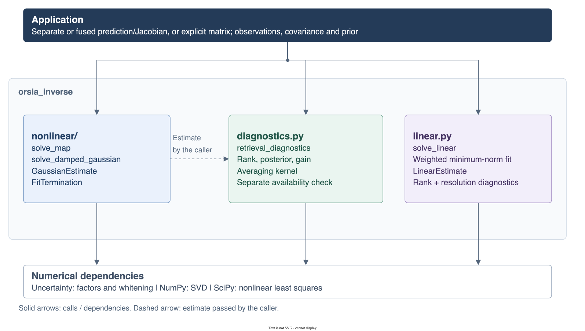

# Orsia Inverse

`orsia-inverse` fits caller-defined nonlinear predictions with fixed Gaussian covariance and optional priors and bounds. A separate diagnostic call computes local ranks, posterior covariance, gain and averaging kernel. `solve_linear` provides a bounded covariance-weighted minimum-norm inverse for explicit matrices, including rank-deficient systems. The package depends on NumPy, SciPy and Orsia Uncertainty; physical models stay with callers.

`solve_map` and `solve_damped_gaussian` accept either separate prediction/Jacobian callbacks or a fused `evaluate(q)` returning both. Both methods return an immutable `GaussianEstimate` with a nested `FitTermination`. Callers with explicit tangents can implement `jac(q)` as `orsia_numerics.tangents.jacobian(tangent, q, block_size=...)[1]`; the solver expects the derivative array alone. Numerics is an optional caller dependency for this composition. See the [tangent callback contract](../orsia-numerics/docs/tangents.md#python-contract) and the [fit rules](#fit-and-diagnostic-rules) for shapes, ownership and numerical limits.

## Architecture



Solid arrows show selected calls or numerical dependencies; the dashed arrow shows the nonlinear estimate passed by the caller to separate diagnostics. The independent `orsia_inverse.linear` path returns its rank and resolution diagnostics with the estimate. [Full-size SVG](docs/diagrams/architecture.svg) · [Editable Draw.io source](docs/diagrams/architecture.drawio).

## Minimal example

Run the example with this distribution and its dependencies installed, or in the [Orsia development environment](../../README.md#development-environment). Fit a dimensionless log-amplitude to two synthetic DN observations with unit diagonal variances.

```python
import numpy as np
from orsia_inverse import retrieval_diagnostics, solve_map
from orsia_uncertainty import factor_covariance


def fun(q):
    return np.array([np.exp(q[0]), 2.0 * np.exp(q[0])])


def jac(q):
    return fun(q)[:, None]  # (observations, state)


estimate = solve_map(
    fun,
    jac,
    np.array([2.0, 4.0]),
    np.zeros(1),
    observation_factor=factor_covariance(np.ones(2), method="cholesky"),
)
assert estimate.termination.success
np.testing.assert_allclose(estimate.state, [np.log(2.0)])
diagnostics = retrieval_diagnostics(estimate)
assert diagnostics.available, diagnostics.reason
np.testing.assert_allclose(diagnostics.posterior_covariance, [[0.05]])
print(round(estimate.state.item(), 6), round(diagnostics.posterior_covariance.item(), 6))
```

Expected output: `0.693147 0.05`. The variance is the local Gauss-Newton approximation in the fitted log coordinate.

## Fit and diagnostic rules

- `fun(q)` returns model values `(m,)`; `jac(q)` returns `dF/dq` `(m,n)`. Supply derivatives, priors and bounds in the actual fitted coordinates. Residual sign is `F(q)-y`.
- Numerical arrays are finite float64. Prepare observation weighting with `orsia_uncertainty.factor_covariance`. Supply an optional `QuadraticPrior(mean, precision_root)`, `prior_from_covariance(mean, factor)` or `prior_from_precision(mean, precision)`. Rectangular or rank-deficient roots provide partial regularization. Coordinates and units remain caller-owned.
- Callables must be deterministic and non-mutating; keep outputs stable during return/snapshot. Model exceptions propagate. Only `TrialDomainError` rejects a known unsupported trial in the damped method; malformed outputs raise `ValueError`. All initial-state errors propagate.
- Check `estimate.termination.success` separately from diagnostic `available` and `reason`. Failed termination, backend-active bounds or deficient augmented rank prevent a posterior; no truncated inverse is supplied.

## Rank-aware linear estimation

`solve_linear(matrix, observations, covariance=..., valid=..., rcond=..., max_bytes=...)` accepts a finite `(read,state)` model and supplied variances or full covariance. Missing observations can be excluded with a Boolean mask; correlations among retained observations are preserved. Covariance whitening uses Orsia Uncertainty. The explicit memory budget is checked before dense factorization.

The returned `LinearEstimate` contains the minimum-norm state, estimator sampling covariance, signed resolution matrix, gain, singular values, rank, condition, usable-read mask and coordinate identifiability. Rank-deficient systems have infinite condition. Null-space components follow the minimum-norm convention, and their true uncertainty is unconstrained. Zero sampling covariance in those directions describes the estimator convention rather than knowledge of the true state. The physical model and state scaling remain caller responsibilities. See the [joint instrument example](../orsia-instruments/docs/spectral-imagers.md#two-beam-separate-detectors-and-a-joint-inverse) for supplied electron covariance and retained native port order.

## Mean-normalized channel contrasts

`orsia_inverse.contrast.helmert_basis(channel_count)` returns a writable float64 `(channel, channel-1)` orthonormal zero-mean basis for at least three channels. Column `k-1` has `k` entries `1/sqrt(k*(k+1))`, followed by `-k/sqrt(k*(k+1))` and zeros. `normalized_contrast(signal, covariance=None)` returns contrasts of `signal / mean(signal)`, their derivative with respect to the original signal and optional first-order covariance transport. The signal must be a finite vector with positive mean. A supplied covariance must use the same channel order and squared signal units. The contrasts are dimensionless; the derivative has inverse signal units. Returned arrays are independent writable float64 buffers. The caller keeps borrowed inputs stable during each call.

Mean normalization removes common amplitude within this observable. The covariance transport describes its local linearization. The application retains its parameterization, damping, stopping rules and calibration procedure when using these contrasts in an estimator.

## Read next

- [Estimation and diagnostics reference](docs/estimation.md): module ownership, derivative checks, conditioning, bounds and uncertainty transport.

Run `devbox run -- just --justfile tests/justfile pytest libs/orsia-inverse/tests` from the workspace root. Numerical success and synthetic regressions leave physical model validity, nonlinear statistical coverage and atmospheric retrieval performance unqualified.

## Damped, spatial and design methods

[`solve_damped_gaussian`](src/orsia_inverse/nonlinear/damped.py) uses the common Gaussian objective and prior, with diagonal damping, trial rejection and stationary-step checks. It supports unbounded states. `solve_map` retains explicit TRF or LM selection and its method-specific bounds rules. Both methods use the half-squared objective and share `retrieval_diagnostics`. [`shared_offset`](src/orsia_inverse/shared_offset.py) exposes `estimate_shared_contrast_offset` and `SharedContrastOffset` for a normalized-spectrum additive correction with common covariance; the application owns selection, two-pass processing and variance bookkeeping.

[`solve_correlated_field`](src/orsia_inverse/spatial.py) receives selected scalar coordinates, a covariance action and diagonal, and a sparse regularization operator. `masked_second_difference_operator` constructs unscaled mask-contained second differences separately. The method uses checked nested preconditioned conjugate gradients; failed inner solves raise an error, while outer exhaustion returns nonconvergence. Physical-coordinate conversion, masks and prior strength remain caller choices.

[`design`](src/orsia_inverse/design.py) supplies `linear_target_uncertainty` for an explicit target vector and deterministic constrained channel exchanges returning `ChannelSearchResult`. Its rank policy comes from `local_gaussian_information`. [`detection`](src/orsia_inverse/detection.py) supplies `scan_compensated_apertures` with a caller-defined field-covariance quadratic form, zero-based C-order best coordinates, repeated maps through `aperture_scorer` and independent-null order-statistic calibration. Optional variance contributions can retain signed cross terms. Callers retain objectives, false-alarm targets, calibration/validation population separation and campaign reporting. These modules depend on numerical inputs and Uncertainty, without a physical-model or Instruments import.
