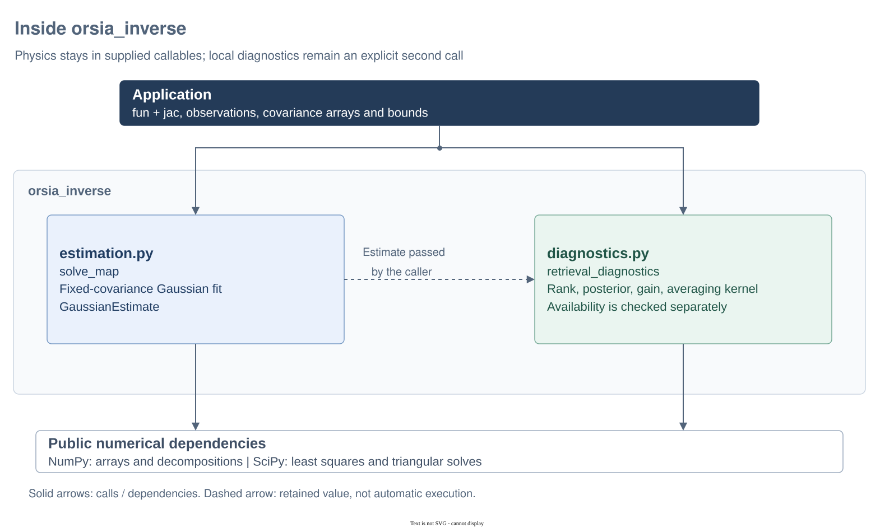

# Inside `orsia_inverse`

`orsia_inverse` fits a caller-defined prediction to observations with fixed Gaussian covariance, then computes optional local diagnostics. Physics stays in the supplied callables: the package does not import radiative solvers, instruments, files or providers. See the [API reference](../../README.md) for the full numerical contract.

## Architecture at a glance



Diagram: [editable Draw.io source](../../docs/diagrams/architecture.drawio) · [PNG export](../../docs/diagrams/architecture.png). Solid arrows show selected calls or dependencies; the dashed arrow shows the estimate explicitly passed by the caller. `diagnostics.py` consumes an estimate; `solve_map` does not automatically run diagnostics or choose a physical forward model.

### Where to look

| Source | Responsibility | Boundary |
| --- | --- | --- |
| `estimation.py` | `solve_map`, callable adaptation and `GaussianEstimate` | Fixed observation/prior covariance, explicit bounds and deterministic prediction/Jacobian callables. |
| `diagnostics.py` | `retrieval_diagnostics` and `RetrievalDiagnostics` | Local undamped Gauss-Newton information; no second fit or constrained posterior. |
| `weighting.py` | Validate array covariances, factorise and whiten | Shared by estimation and diagnostics; diagonal variances stay compact. |
| NumPy and SciPy | Arrays, decompositions, triangular solves and least squares | No dependency on other Orsia libraries, physics or file handling. |

## Progressive examples

Run the blocks **in order in one Python session** with `orsia-inverse` installed. This scalar synthetic problem has an analytic answer; it is not an atmospheric retrieval.

### 1. Supply a prediction and its derivative in the fitted coordinates

**Goal:** fit a dimensionless log-amplitude `q`, for which two predicted DN reads are `[exp(q), 2*exp(q)]`.

```python
import numpy as np
from orsia_inverse import solve_map


def fun(q):
    return np.array([np.exp(q[0]), 2.0 * np.exp(q[0])])


def jac(q):
    return fun(q)[:, None]  # (reads, parameters)


estimate = solve_map(
    fun,
    jac,
    np.array([2.0, 4.0]),
    np.zeros(1),
    observation_covariance=np.ones(2),  # variances in DN^2, not standard deviations
)
assert estimate.success
np.testing.assert_allclose(estimate.state, [np.log(2.0)])
np.testing.assert_allclose(estimate.prediction, [2.0, 4.0])
```

`fun` returns model values, not residuals, and `jac` returns only their derivative with respect to `q`, not amplitude. `solve_map` subtracts the observations and applies covariance weighting internally. Both the prior and bounds, if supplied, must use the same coordinates. Derivative correctness remains the caller's responsibility. No prior was supplied here; covariance stays fixed throughout the solve.

### 2. Ask separately for local information

**Goal:** distinguish numerical termination from posterior availability and sensitivity.

```python
from orsia_inverse import retrieval_diagnostics

diagnostics = retrieval_diagnostics(
    estimate,
    include_gain=True,
    include_averaging_kernel=True,
)
assert diagnostics.available, diagnostics.reason
np.testing.assert_allclose(diagnostics.posterior_covariance, [[0.05]])
np.testing.assert_allclose(diagnostics.averaging_kernel, [[1.0]])
np.testing.assert_allclose(diagnostics.gain, [[0.1, 0.2]])
```

At the solution, the Jacobian is `[2, 4]ᵀ`, giving local variance `1/(2²+4²)=0.05` in `q`. This is the assumed Gauss-Newton posterior, not an exact posterior in amplitude. Failed termination, active bounds or deficient augmented rank make the posterior unavailable; inspect `available` and `reason` instead of assuming success means usable uncertainty.

### 3. Propagate an actual error law without refitting

**Goal:** keep assumed weighting and actual measurement error distinct.

```python
actual_variances = np.full(2, 4.0)  # DN^2, in the same read order
propagated = (diagnostics.gain * actual_variances) @ diagnostics.gain.T
shift = diagnostics.gain @ np.array([0.1, -0.2])  # signed measurement bias in DN
np.testing.assert_allclose(propagated, [[0.2]])
np.testing.assert_allclose(shift, [-0.03])
```

Changing the error law used for this diagnostic does not change the fit or its assumed posterior. The signed shift follows the supplied measurement perturbation; it is not a random variance. All results remain local to the retained solution and linearization.

## Limits and further reading

Callables must be deterministic, non-mutating and stable during a solve; exceptions propagate rather than becoming artificial residual penalties. The library supplies no automatic differentiation, covariance fitting, silent regularisation or physical-coordinate inference. Read the [numerical contract](../../README.md#numerical-contract), [diagnostic availability rules](../../README.md#local-diagnostics-and-source-transport) and [uncertainty guide](../../../orsia-uncertainty/src/orsia_uncertainty/README.md) before applying these operations to a scientific model.
