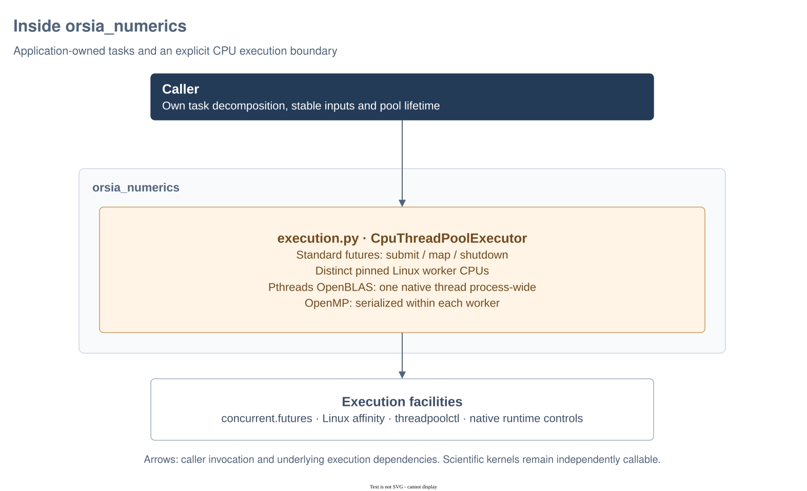

# Orsia Numerics

`orsia-numerics` provides an application-owned CPU thread pool for independent numerical calls on CPython 3.14 free-threaded. It combines standard futures, pinned Linux workers and explicit native thread limits. Scientific kernels remain sequential unless the application schedules them.

## Architecture



Arrows show invocation and execution dependencies; the application owns task decomposition and pool lifetime. [Full-size SVG](docs/diagrams/architecture.svg) · [Editable Draw.io source](docs/diagrams/architecture.drawio).

## Minimal example

Run the example with this distribution and its dependencies installed, or in the [Orsia development environment](../../README.md#development-environment). The executor requires Linux CPU affinity and the supported native runtimes. This example uses one worker and bounded submission; other platforms report the missing affinity API.

```python
import os
import numpy as np
from orsia_numerics.execution import CpuThreadPoolExecutor


def sum_squares(values):
    return float(values @ values)


blocks = [np.array([1.0, 2.0]), np.array([3.0, 4.0])]
if hasattr(os, "sched_getaffinity"):
    with CpuThreadPoolExecutor(max_workers=1) as executor:
        parts = list(executor.map(sum_squares, blocks, buffersize=2))
    assert parts == [5.0, 25.0]
    print(parts)
else:
    print("Linux CPU affinity is required.")
```

Expected output on supported Linux: `[5.0, 25.0]`. This tiny calculation demonstrates ownership and result ordering; performance depends on task granularity.

## Execution rules

- Select `max_workers` explicitly to leave capacity for other work. The default uses all selected logical CPUs; separate pools do not reserve CPUs.
- Load native dependencies before constructing the pool. Supported pthreads OpenBLAS is limited process-wide; supported OpenMP is serialized inside each worker.
- Keep borrowed inputs stable and writable outputs disjoint. Tasks, initializers and callbacks must preserve affinity and native limits and avoid nested parallel execution.
- Own shutdown explicitly, preferably with `with`. Unsupported controls/runtimes fail during construction; the [executor contract](docs/execution.md) defines worker and cleanup failures.

## Read next

- [Executor contract](docs/execution.md): source ownership, independent array snapshots, CPU selection, native limits and lifecycle.

Run `devbox run -- just test-numerics` from the workspace root. Affinity and a disabled GIL alone do not establish backend thread safety, scientific correctness or speedup.
