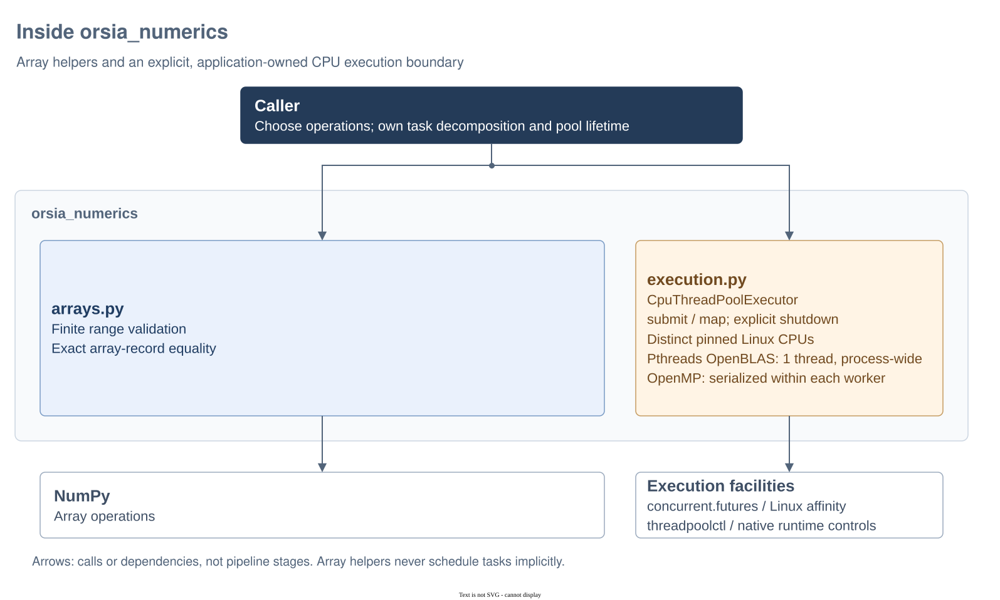

# Inside `orsia_numerics`

`orsia_numerics` supplies an explicit CPU executor. Array copying and domain validation use NumPy directly in the scientific packages. Start here to distinguish storage ownership and execution policy; see the [API reference](../../README.md) for the complete contracts.

## Architecture at a glance



Historical diagram: [editable Draw.io source](../../docs/diagrams/architecture.drawio) · [PNG export](../../docs/diagrams/architecture.png). The array-helper branch predates removal of `arrays.py` and is no longer an implemented entry point. The current package provides the CPU execution boundary below; applications own task decomposition and pool lifetime, while scientific functions use NumPy directly without scheduling work implicitly.

### Where to look

| Source | Responsibility | Boundary |
| --- | --- | --- |
| `execution.py` | Standard futures, mandatory worker affinity, process-wide OpenBLAS limits and worker-local OpenMP controls | Applications own the pool; kernels never schedule work implicitly. |

## CPU execution boundary

`CpuThreadPoolExecutor` is an application-owned resource. Import it from `orsia_numerics.execution` and share one pool between operations that organize batches. It composes a standard `ThreadPoolExecutor` and exposes standard futures through `submit` and ordered results through `map`; it does not partition arrays or copy task arguments.

- **Worker placement:** Linux CPU affinity is mandatory. Each worker is pinned to a distinct selected logical CPU before the user initializer runs. By default, the pool selects the constructing thread's allowed CPUs; `cpus` supplies an explicit ordered subset and `max_workers` limits how many are used. CPUs are not reserved across independent pools.
- **OpenBLAS:** supported pthreads OpenBLAS libraries are limited to one native thread process-wide. Overlapping Orsia pools share the limit; original counts are restored only after the last pool's workers and their callbacks have finished, including after `shutdown(wait=False)`.
- **OpenMP:** at most one detected runtime is accepted, with the required serialization controls. Each worker applies and verifies `omp_set_num_threads(1)` and `omp_set_max_active_levels(0)` before the user initializer and before every callable. These settings serialize ordinary, explicitly sized and nested CPU parallel regions without changing the constructing thread's or unrelated threads' OpenMP settings. Only callbacks executed by a pool worker inherit its controls.
- **Explicit failures:** missing controls, multiple detected OpenMP runtimes, MKL, BLIS, FlexiBLAS and OpenMP-backed OpenBLAS are rejected during construction. Failure to enforce limits during worker initialization breaks the pool; failure before a later callable reaches its `Future` without running that callable.

Load native dependencies before constructing the pool. This is a cooperative contract: tasks, initializers and callbacks must not change affinity or native settings, load native backends, or create another parallel execution layer. Unknown libraries, GPU/offload work and independently created pools are not controlled. OpenMP controls are reapplied between calls, not continuously enforced inside user code. Callers still own input stability, disjoint writable buffers, explicit RNGs and task granularity.

Use a context manager or explicit shutdown to own the lifecycle. A finite `map(..., buffersize=...)` bounds submission; its default `None` is unbounded, and `chunksize` does not partition work in this thread pool. See the [complete executor contract](../../README.md#explicit-cpu-execution) for constructor defaults, errors, lifecycle details and native-runtime restrictions.

## Progressive examples

Each Python block is standalone and uses synthetic inputs. Run them in the [Orsia development environment](../../../../README.md#development-environment), or with this distribution and its dependencies installed.

### 1. Own a snapshot, not a read-only view

**Goal:** retain values independently of a caller's writable array.

```python
import numpy as np

original = np.array([1, 2, 3], dtype=np.int64)
retained = np.copy(original)
original[0] = 99
np.testing.assert_array_equal(retained, [1, 2, 3])
assert retained.dtype == np.int64
assert retained.flags.writeable
assert not np.shares_memory(original, retained)

floating = np.copy([1.0, 2.0, 3.0])
assert floating.dtype == np.float64
assert floating.flags.writeable
```

`np.copy` returns writable independent numerical arrays, preserving dtype and shape without imposing float64 conversion or finite-value validation. Domain callers use NumPy predicates and comparisons directly for numerical validation; passing validation does not confer ownership. Array-like conversions remain explicit where calculations need them, while scalars can be validated directly; see the [migration notes](../../README.md#migration-boundary).

### 2. Schedule independent array calculations with an explicit pool

**Goal:** schedule independent calculations on stable snapshots without changing the calculation itself.

```python
import numpy as np
from orsia_numerics.execution import CpuThreadPoolExecutor

blocks = [np.copy([1.0, 2.0]), np.copy([3.0, 4.0])]


def sum_squares(values):
    return values @ values


with CpuThreadPoolExecutor(max_workers=1) as executor:
    parts = list(executor.map(sum_squares, blocks, buffersize=2))
np.testing.assert_allclose(parts, [5.0, 25.0])
np.testing.assert_allclose(parts, [sum_squares(block) for block in blocks])
```

The caller partitions the inputs; each task borrows a snapshot that the caller keeps stable and returns a scalar. One worker keeps the example usable with a single allowed CPU; choose more workers only within the allowed CPU selection. The example checks result agreement and explicit pool ownership, not a speedup for such small tasks. For larger collections, the caller can group work with `itertools.batched` or explicit slices. Interval quadrature belongs to [Orsia Instruments](../../../orsia-instruments/README.md#module-organization), not this package.

### 3. Use SciPy directly for interpolation

**Goal:** make axis order and the outside-support rule visible without an Orsia interpolation wrapper.

```python
import numpy as np
from scipy.interpolate import RegularGridInterpolator

x = np.array([0.0, 1.0])
y = np.array([0.0, 2.0])
table = x[:, None] + 2.0 * y[None, :]  # axes: (x, y)
interpolator = RegularGridInterpolator(
    (x, y), table, method="linear", bounds_error=False, fill_value=0.0
)
values = interpolator(np.array([[0.5, 1.0], [1.0, 2.0], [1.5, 1.0]]))
np.testing.assert_allclose(values, [2.5, 5.0, 0.0])
assert values.flags.writeable
```

The boundary point is included, while `x=1.5` returns zero rather than a linearly extrapolated value. This calls SciPy directly, not an `orsia_numerics` API. Instrument callers retain their finite, strictly increasing-axis and physical-density checks, including normalization; interpolation does not choose those physical policies.

## Limits and further reading

Kernel inputs are borrowed without mutation during calls and must remain stable. There is no file access, provider selection or cache. These examples check numerical mechanics and executor usage, not scientific models, native-library thread safety or parallel performance. The native OpenMP regression described in the [package reference](../../README.md) exercises the local GNU runtime, not every OpenMP implementation. See the [API and ownership contracts](../../README.md#modules-and-contracts) and the [uncertainty guide](../../../orsia-uncertainty/src/orsia_uncertainty/README.md) for numerical ownership examples.
