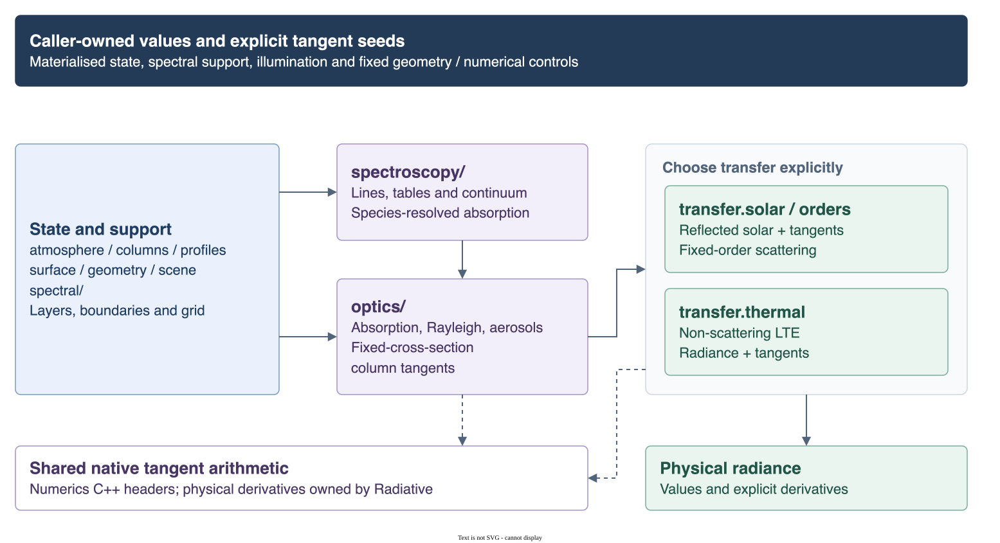

# Orsia Radiative

`orsia-radiative` composes materialised atmospheric state, spectroscopy and optical properties into reflected-solar or non-scattering LTE thermal radiance. It provides isolated Lorentz/Voigt lines, fixed cross sections, water continuum, explicit Rayleigh/Henyey-Greenstein aerosol roles and experimental fixed-order solar scattering. Numerical calls use in-memory inputs without files or providers.

## Architecture



Arrows show selected value flow. The caller chooses the transfer family; scene construction does not run it. [Full-size SVG](docs/diagrams/architecture.svg) · [Editable Draw.io source](docs/diagrams/architecture.drawio).

## Minimal solar example

Run the example with this distribution and its dependencies installed, or in the [Orsia development environment](../../README.md#development-environment). A synthetic transparent layer and normal illumination recover Lambertian reflection on a two-point grid.

```python
import numpy as np
from orsia_radiative import (
    Atmosphere,
    ObservationGeometry,
    RadiativeScene,
    SpectralIrradiance,
    SurfaceState,
    atmospheric_optics,
    solar_source,
    wavenumber_grid,
)
from orsia_radiative.transfer import solar

grid = wavenumber_grid(np.array([800.0, 1000.0]))  # cm-1 point samples
atmosphere = Atmosphere(
    np.array([0.0, 1000.0]),
    np.array([100000.0, 90000.0]),
    np.array([95000.0]),
    np.array([285.0]),
    np.array([2.0e29]),
    np.array([1.9e29]),
    np.array([1.0e28]),
)
surface = SurfaceState(grid, reflectance=np.array([0.1, 0.2]))
scene = RadiativeScene(atmosphere, surface, ObservationGeometry(0.0))
source = solar_source(SpectralIrradiance(grid, np.array([1.0, 2.0])), direction=(0.0, 0.0))
optics = atmospheric_optics(atmosphere, grid)
result = solar.reflected_radiance(
    scene,
    source=source,
    optics=optics,
    max_order=0,
    delta_m_moments=None,
)
np.testing.assert_allclose(result.values, surface.reflectance * source.irradiance.values / np.pi)
print(np.round(result.values, 6).tolist())
```

Expected output: `[0.031831, 0.127324]`, in W m-2 sr-1 per (cm-1). The two samples illustrate the analytic limit; they do not resolve a real spectrum.

## Physical conventions and limits

- Spectral points are positive, increasing float64 wavenumbers in cm-1. Coverage domains, coordinate conversion and spectral-density Jacobians are explicit. Grid spacing and instrumental resolution are distinct.
- Atmospheric layers run bottom to top: height boundaries [m], pressure [Pa], temperature [K] and molecular columns [molecules/m2]. Optical depths have axes `(layer, point)`.
- Evaluated physical fields own writable copies; reusable line/laboratory references and spectral coordinates own read-only snapshots. Keep shared inputs stable during calls and recompute affected spectroscopy after state changes. Freshness checks require separately retained evaluation atmospheres.
- Solar geometry is local plane-parallel. Relative azimuth uses incoming photon propagation to outgoing view; use the [angular contract](docs/transfer.md#angular-contract-and-outward-ray-conversion) when adapting outward rays.
- Solar scattering requires separate order, angular and vertical convergence checks. LTE thermal transfer rejects nonzero scattering. Clouds, ice and a combined solar/thermal call are outside scope.

## Read next

- [Physical bands and cubes](docs/bands-and-cubes.md): normalized spectral responses, ground `(y,x,band)` products, coverage and NaN validity.
- [Physical state and spectra](docs/state-and-spectra.md): source responsibilities, density conversion, support, ownership and freshness.
- [Atmospheric columns](docs/columns.md): hydrostatic construction and native-profile composition.
- [Spectroscopy and optics](docs/spectroscopy.md): reusable line/laboratory references, explicit evaluation, detailed tables and continuum.
- [Transfer reference](docs/transfer.md): solar/LTE APIs, executable examples, Delta-M and evidence limits.
- [Native execution](docs/native-execution.md): implementation details and precision contracts.

Run `devbox run -- just --justfile tests/justfile pytest libs/orsia-radiative/tests` or `devbox run -- just --justfile tests/justfile pytest libs/orsia-radiative/tests/test_thermal.py libs/orsia-radiative/tests/test_radiometry.py` from the workspace root. Synthetic numerical agreement leaves broad atmospheric accuracy, external-solver parity, instrument response and retrieval performance unqualified.
