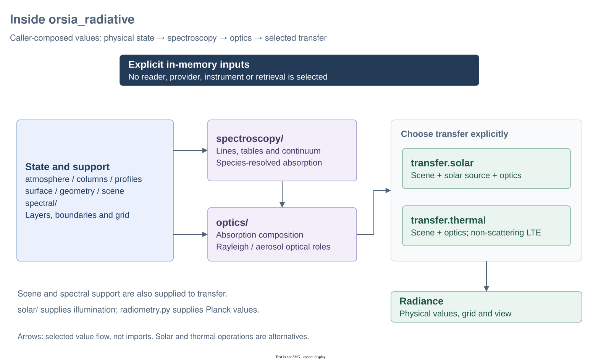

# Inside `orsia_radiative`

`orsia_radiative` separates physical state, spectroscopy, atmospheric optics and transfer. Numerical functions consume explicit in-memory values; file readers and provider access belong to `orsia-data`. This guide explains the implemented composition, not every capability proposed in the parent design. The [API reference](../../README.md) owns detailed contracts and scientific limits.

## Architecture at a glance



Diagram: [editable Draw.io source](../../docs/diagrams/architecture.drawio) · [PNG export](../../docs/diagrams/architecture.png). Arrows show caller-composed value flow, not Python imports or automatic execution. Solar and thermal transfer are separate alternatives; a scene does not choose between them.

### Where to look

| Source | Responsibility | Boundary |
| --- | --- | --- |
| `atmosphere/models.py`, `atmosphere/layers.py`, `atmosphere/hydrostatic.py`, `profiles.py` | Atmospheric column records, layer coordinates/remapping, hydrostatic construction and profile perturbations | Explicit in-memory inputs; layers are bottom to top. |
| `surface.py`, `geometry.py`, `scene.py` | Surface properties, outgoing view and assembled physical state | Illumination and transfer approximation are not scene fields. |
| `spectral/` | Point grids, optional coverage domains, coordinate/density conversion and interpolation | Grid spacing is not instrumental resolution. |
| `solar/`, `radiance.py`, `radiometry.py` | Solar spectrum/source, physical spectral values and Planck radiometry | Solar irradiance and thermal emission are not interchangeable sources. |
| `spectroscopy/` | Line/table/continuum evaluation and species-resolved contributions | Pure numerical evaluation, not native-file reading or downloading. |
| `optics/` | Absorption composition, phase laws and Rayleigh/aerosol optical roles | Physical optical values remain independent of the selected transfer method. |
| `transfer/solar.py`, `transfer/orders.py` | Solar radiance assembly and experimental fixed-order SOS with analytic direct initialization | Refine the retained order count for the observable and scene. |
| `transfer/thermal.py`, `transfer/formal.py` | Non-scattering LTE transfer and source-independent transport kernels | Thermal transfer rejects nonzero atmospheric scattering. |

Shared storage comes from `orsia-numerics`; no provider, instrument or inverse dependency is introduced. `Radiance` retains physical values and support, not provenance, solver identity or numerical decompositions.

## Progressive examples

Run the three blocks **in order in one Python session** with `orsia-radiative` installed. The deliberately tiny, invented atmosphere and two-point spectra illustrate contracts and analytic limits; they do not resolve a real spectrum.

### 1. Define physical state and explicit spectral support

**Goal:** distinguish the point grid, layer state and boundary conditions.

```python
import numpy as np
from orsia_radiative import (
    Absorption,
    Atmosphere,
    ObservationGeometry,
    RadiativeScene,
    SpectralIrradiance,
    SurfaceState,
    atmospheric_optics,
    solar_source,
    wavenumber_grid,
)

grid = wavenumber_grid(np.array([800.0, 1000.0]))  # cm-1
atmosphere = Atmosphere(
    np.array([0.0, 1000.0]),  # height boundaries, m
    np.array([100000.0, 90000.0]),  # pressure boundaries, Pa
    np.array([95000.0]),
    np.array([285.0]),
    np.array([2.0e29]),
    np.array([1.9e29]),
    np.array([1.0e28]),
)
surface = SurfaceState(
    grid,
    reflectance=np.array([0.1, 0.2]),
    emissivity=np.array([0.9, 0.8]),
    temperature_k=300.0,
)
scene = RadiativeScene(atmosphere, surface, ObservationGeometry(0.0))
assert scene.atmosphere.temperature_k.shape == (1,)
assert grid.points.shape == (2,)
```

Layer temperature is in K; the three column arrays are total air, dry air and water in molecules m⁻². Reflectance plus emissivity equals one for the opaque surface. The grid gives point samples, not bin widths or a declaration of continuous coverage. Constructors own writable numerical copies; physical consistency after changing state remains the caller's responsibility.

### 2. Select solar reflection explicitly

**Goal:** recover the transparent-atmosphere Lambertian limit, then add synthetic absorption.

```python
from orsia_radiative.transfer import solar

source = solar_source(
    SpectralIrradiance(grid, np.array([1.0, 2.0])),
    direction=(0.0, 0.0),
)
transparent = atmospheric_optics(atmosphere, grid)
reflected = solar.reflected_radiance(
    scene, source=source, optics=transparent, max_order=0, delta_m_moments=None
)
np.testing.assert_allclose(
    reflected.values,
    surface.reflectance * source.irradiance.values / np.pi,
)

absorption = Absorption(grid, np.array([[0.1, 0.5]]))
optics = atmospheric_optics(atmosphere, grid, absorption=absorption)
attenuated = solar.reflected_radiance(
    scene, source=source, optics=optics, max_order=0, delta_m_moments=None
)
np.testing.assert_allclose(
    attenuated.values, reflected.values * np.exp(-2 * absorption.optical_depth[0])
)
```

Normal incidence and viewing give two vertical passes, hence `exp(-2*tau)`. Irradiance is W m⁻² per (cm⁻¹), and radiance is W m⁻² sr⁻¹ per (cm⁻¹). The absorption has shape `(layers, points)` and is dimensionless vertical optical depth. In a real calculation, evaluate spectroscopy and compose its contributions upstream rather than treating this invented depth as measured data.

### 3. Select thermal emission without a fictitious Sun

**Goal:** use the same physical state with the separate non-scattering LTE operation and inspect its additive terms.

```python
from orsia_radiative.radiometry import planck_wavenumber
from orsia_radiative.transfer import thermal

emitted = thermal.schwarzschild_radiance(scene, optics=optics)
terms = thermal.schwarzschild_terms(scene, optics=optics)
np.testing.assert_allclose(sum(terms.values()), emitted.values)
assert set(terms) == {
    "surface_emission",
    "atmospheric_emission",
    "reflected_atmospheric_emission",
}
vacuum = thermal.schwarzschild_radiance(scene, optics=transparent)
np.testing.assert_allclose(
    vacuum.values,
    surface.emissivity * planck_wavenumber(grid.points, 300.0),
)
```

Thermal transfer includes surface emission, layer emission and reflected downwelling atmospheric emission, with zero incident radiance at the top. It uses layer temperatures and rejects nonzero scattering. The solar object from example 2 is not passed or consulted; no combined solar/thermal solver is implied.

## Reuse, limits and further reading

For repeated solar evaluations, call `solar.reflected_radiance(scene, source=source, optics=current_optics, **controls)` with the current physical inputs. Each complete call owns its geometry and native scratch and returns independent radiance values. Keep input arrays stable during each call; concurrent calls use separate internal storage. The [repeated solar contract](../../README.md#repeated-solar-evaluations) gives ownership, compatibility and migration details.

Retain provenance and evaluation atmospheres separately when needed, and use explicit freshness checks before reusing optical values after a physical change. Same shape or grid does not prove that a previously evaluated optical depth is still physically valid. Clouds and ice are outside scope; scalar solar scattering and non-scattering LTE thermal transport are bounded models, not generally qualified solvers.

See [spectral support and ownership](../../README.md#spectral-domain-and-point-grid), [transfer contracts](../../README.md#transfer-boundary), [LTE thermal details](../../README.md#lte-thermal-transfer) and the complete [synthetic file-to-radiance example](../../../../docs/atmosphere-to-radiance.md). The [instrument guide](../../../orsia-instruments/src/orsia_instruments/README.md) explains why a directional radiance alone does not define an image.
