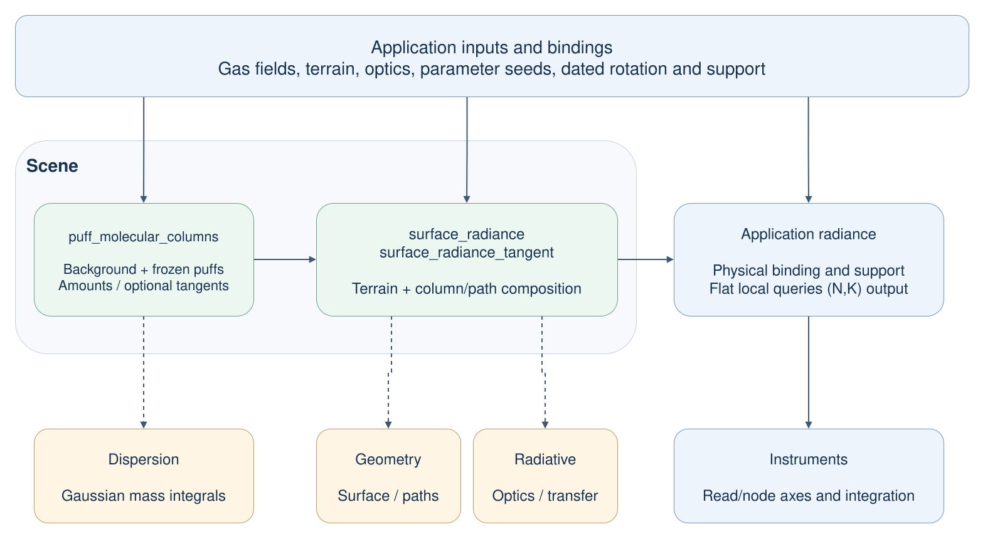

# Scene

`orsia-scene` composes supplied spatial gas fields, height-field terrain and optical inputs into direct reflected radiance and explicit sensitivities. Its public functions support independent vertical columns, separate heterogeneous solar/viewing paths, and flat local surface queries. The package is independently installable with its declared Geometry, Dispersion and Radiative dependencies.

## Architecture



Solid arrows show selected data flow; dashed arrows show calls to owning libraries. Applications bind physical fields and support to `surface_radiance` or `surface_radiance_tangent`. The direct API accepts an amounts-only column callback and computes no tangents. Geometry preparation supplies chart-local outward views; Instruments owns flattening and response integration. Scene has no Instruments dependency. [Full-size SVG](docs/diagrams/architecture.svg) · [Editable Draw.io source](docs/diagrams/architecture.drawio).

## Minimal example

This synthetic two-species example calculates a homogeneous atmosphere above a horizontal surface. The direct call supplies molecular amounts only. The tangent call adds explicit sensitivity directions. Applications select spectroscopy, species ordering, terrain, reflectance, illumination and parameter meaning.

```python
import numpy as np
from orsia_scene import puff_molecular_columns, surface_radiance, surface_radiance_tangent

edges = np.array([0.0, 1000.0])
background = np.array([[1e24, 2e23]])  # molecules/m2, layer then species


def columns(starts, ends, layers):
    density = background / np.diff(edges)[:, None]
    return density[layers] * np.linalg.norm(ends - starts, axis=1)[:, None]


def columns_with_tangent(starts, ends, layers):
    return puff_molecular_columns(
        starts, ends, layers,
        height_edges_m=edges,
        background_columns_molecules_m2=background,
        plumes=(),
        species_indices=np.empty(0, dtype=np.int64),
        molar_masses_kg_mol=np.empty(0),
        scales=np.empty(0),
        scale_tangent=np.empty((0, 1)),
    )


xy = np.array([[0.0, 0.0]])
view = np.array([[0.0, 0.0, 1.0]])
physical = dict(
    height_m=250.0, slopes=np.zeros(2), height_edges_m=edges,
    solar_direction=np.array([0.0, 0.0, 1.0]),
    cross_sections_m2=np.array([[[1e-25, 2e-25], [3e-25, 1e-25]]]),
    reflectance=np.full((1, 2), 0.25),
    beam_normal_irradiance=np.full((1, 2), 0.02),
    mode="heterogeneous_direct_solar", minimum_upward_cosine=0.2,
    horizontal_bounds_m=(-100.0, 100.0, -100.0, 100.0),
)
radiance = surface_radiance(xy, view, columns=columns, **physical)
assert radiance.shape == (1, 2)

value, derivative = surface_radiance_tangent(
    xy, view, columns=columns_with_tangent,
    reflectance_tangent=np.ones((1, 2, 1)), **physical,
)
np.testing.assert_array_equal(value, radiance)
assert derivative.shape == (1, 2, 1)
np.testing.assert_allclose(derivative[..., 0], radiance / 0.25)
```

## Callable terrain and visibility

For generic terrain, replace `height_m` and `slopes` with `height(xy_m)` and `gradient(xy_m)`. The callables return `(queries,)` heights in metres and `(queries,2)` dimensionless derivatives `(dz/dx,dz/dy)`. Geometry computes one upward unit normal per surface point. Scene uses each normal for local solar incidence and surface-facing checks. The [Geometry terrain guide](../orsia-geometry/docs/terrain.md) supplies runnable SciPy interpolation adapters and the bounded ray-intersection contract.

Callable terrain requires an explicit `visibility` policy. A callback receives `(points_m, outward_directions)`, both shaped `(queries,3)`, separately for solar and viewing rays. Return a Boolean `(queries,)` mask that certifies each complete ray is clear toward the Sun or sensor. The callback owns its support, terrain data and occlusion method, including terrain beyond the atmospheric top. Any false entry raises `ValueError` before molecular-column evaluation. The API rejects shadowed, back-facing or occluded samples; it supplies no radiance model for those samples. Local incidence and atmospheric rectangle checks alone do not establish terrain visibility.

Use `visibility="assume_clear"` only when the application accepts responsibility for clear full rays. Omitting the policy remains supported for affine terrain, where outward surface-facing rays cannot re-intersect the plane. The tangent API holds terrain, illumination and visibility fixed. Callable terrain requires `mode="heterogeneous_direct_solar"`; `independent_column` retains its horizontal-affine contract.

This continuation of the minimal example uses a synthetic parabola. Both rays are vertical, so each ray keeps fixed horizontal coordinates and cannot re-intersect this single-valued terrain. The explicit assumption is justified for these rays.

```python
terrain_xy = np.array([[0.0, 0.0], [20.0, 0.0]])
terrain_view = np.tile([0.0, 0.0, 1.0], (2, 1))
terrain_physical = {
    key: value for key, value in physical.items()
    if key not in ("height_m", "slopes")
}
terrain_physical.update(
    height=lambda xy_m: 250.0 + 0.002 * xy_m[:, 0]**2,
    gradient=lambda xy_m: np.column_stack((0.004 * xy_m[:, 0], np.zeros(len(xy_m)))),
    visibility="assume_clear",
    reflectance=np.full((2, 2), 0.25),
    beam_normal_irradiance=np.full((2, 2), 0.02),
)
terrain_radiance = surface_radiance(
    terrain_xy, terrain_view, columns=columns, **terrain_physical,
)
terrain_value, terrain_derivative = surface_radiance_tangent(
    terrain_xy, terrain_view, columns=columns_with_tangent,
    reflectance_tangent=np.ones((2, 2, 1)), **terrain_physical,
)
np.testing.assert_array_equal(terrain_value, terrain_radiance)
assert terrain_derivative.shape == (2, 2, 1)
```

## Public contracts

Full argument, return and error contracts are in [composition.py](src/orsia_scene/radiance.py).

- `puff_molecular_columns` combines constant-within-layer background molecular density with any number of frozen `GaussianPuffField` values with explicit reflection boundary and optional compact cutoff. Each plume has an explicit species index, molar mass in kg/mol, nonnegative scale and signed scale directions. Multiple plumes can share a species. The function converts Dispersion's kg/m2 integrals to molecules/m2 and adds each excess once. With `scale_tangent=None` (the default), it returns only `(segments,species)` amounts without computing tangents. Supplying signed `(plumes,k)` directions returns amounts and `(segments,species,k)` tangents, preserving the explicit tangent contract.
- `surface_radiance` constructs full or partial layer paths above affine or callable terrain and composes Radiative's direct optical-depth and transfer operations. Its `columns(starts_m, ends_m, layer_indices)` callback returns only finite nonnegative molecular amounts `(segments,species)` in molecules/m2. Cross sections have axes `(layers,species,spectral)` in m2/molecule and remain constant within each layer. Reflectance and beam-normal irradiance have axes `(queries,spectral)`; irradiance is W m-2 per (cm-1). The function returns only `(queries,spectral)` radiance in W m-2 sr-1 per (cm-1), without sensitivity inputs.
- `surface_radiance_tangent` shares the direct API's geometry, physical validation and transfer modes. Its column callback returns both molecular amounts and signed `(segments,species,k)` seeds. It also accepts `(queries,spectral,k)` reflectance seeds and returns radiance plus `(queries,spectral,k)` sensitivities in radiance units per parameter. `puff_molecular_columns` supplies this tuple-returning contract when `scale_tangent` is supplied.

All positions share one Cartesian metre frame and vertical datum. Heights increase bottom to top, and terrain must lie within `[bottom,top)`. Both solar and viewing rays must point upward, illuminate or see the local surface, and satisfy the supplied minimum vertical cosine. Sensors are assumed to lie beyond the model top. The closed horizontal rectangle bounds complete sampled atmospheric straight paths; endpoint checks suffice for this convex domain. Full-ray terrain visibility uses the separate policy described above.

`independent_column` requires horizontal affine terrain. It samples a vertical gas column at each surface point and applies solar and viewing secants. `heterogeneous_direct_solar` samples separate displaced paths. Both modes use absorption-only direct Lambertian transfer. Geometry, illumination, cross sections, support and visibility are fixed during differentiation; gas and reflectance seeds share an arbitrary final parameter axis, including length zero.

Inputs and callback state are borrowed and must remain stable during use. Results have fresh writable float64 storage. The functions perform no I/O, random draws, transport advancement, caching or concurrency scheduling. Concurrent callers must supply thread-safe callbacks and stable arrays. Invalid numerical shapes, physical bounds or sampled support raise `ValueError`; supplied callback errors propagate.

## Flat callback migration

Application-bound radiance and Instruments share `radiance(xy_m, view_local, times_s, spectral)`: `(N,2)`, `(N,3)`, `(N,)` inputs and a `SpectralGrid` with K points and `(N,K)` radiance output. Views point from the surface toward the sensor in the chart-fixed Cartesian frame shared by terrain, atmosphere and illumination. The application binds time-dependent fields, spectral data and their sampled support. Physical Scene functions retain spatial, visibility and numerical validation; acquisition retains continuous coverage enforcement.

This is a breaking migration: `radiance_for_observation` and `orsia_scene.observation` are removed. Surface projection callbacks now return `(xy_m, view_local, hits)`, and `SurfaceAcquisitionGrid.view_local` is required. Geometry owns frame/sign conversion; WGS84 uses dated GCRS-to-ITRF rotation followed by fixed chart-origin ENU. Instruments flattens read/node arrays in C order before radiance evaluation and restores them for integration. Manual tangent integration must flatten the same queries and reshape `(N,K,P)` tangents to `(reads,nodes,K,P)` before contraction. `simulate_frames(camera, grid, spectral, radiance, coverage, ...)` keeps its argument order. The separate line-of-sight radiance API is unchanged.

All maintained Orsia consumers use the new contract. Independently pinned consumers adopt changes through their own explicit source refresh, consumer migration and installed-package checks.

## Ownership and limits

Geometry owns height-field surfaces and path segmentation. Dispersion owns prescribed Gaussian fields and their integrals. Radiative owns gas optical-depth reduction and direct transfer. Scene composes these operations. Instruments owns acquisition, continuous-read coverage enforcement, physical response and detector sampling; Scene has no Instruments dependency.

The [connected example](../../notebooks/support/spatial_scene.py) retains synthetic spectroscopy, spectral selections, reflectance law, chart rotation, scenario parameters and its camera-specific coverage certificate. The [example guide](../../docs/spatial-scenes.md) describes that bounded fixture and electron Jacobians. Sampled query checks do not certify continuous exposures or footprints.

The supported modes exclude diffuse radiation, heterogeneous scattering, terrain-aware transport, mass renormalization, curved rays, real orbital/provider integration and retrieval. Plume mass outside retained atmospheric support remains excluded. State-dependent spectroscopy must be supplied consistently with the physical state; this API holds supplied cross sections fixed. Geometry, plume-shape, illumination and response derivatives require separate contracts.

## Checks

Run `devbox run -- just --justfile tests/justfile pytest libs/orsia-scene/tests tests/test_spatial_scene.py` from the Orsia root. Library tests exercise radiance-only callbacks, direct/tangent value agreement, multispecies composition, arbitrary signed directions, partial layers, both transfer modes, flat queries, support failures and array ownership. Connected tests check electron finite differences and response integration. `devbox run -- just python scripts/validate_scene_distribution.py` builds source archives and wheels, installs them without workspace source resolution and checks both example modes and native-import GIL status. These checks provide software and bounded numerical evidence; scientific and engineering qualification remain case-specific.

## Exact level-grid extinction scenes

[`SpatialOpticalDepth`](src/orsia_scene/optical_depth.py) owns species-generic terrain-column preparation on a shared `LayeredCells` support and `SpectralGrid`. Inputs are separate `LevelAtmosphere`, `LayerCrossSections` and optional `WaterContinuumCoefficients` values. Additional extinction uses nonnegative amplitude fields and spectral shapes, without regional, industrial or band-name conventions. `at_pixel(pixel, species=None)` evaluates total depth or a named species; `spectral_block(start, stop, species=None)` produces a bounded slab. `column_mixing_ratio(species)` returns the dry-air column ratio, with ppm conversion left to the caller. CO2 is optional.

[`DirectSolarScene`](src/orsia_scene/radiance.py) owns physical cell-scene preparation. It retains the optical-depth preparation, two surface-reflectance anchors, beam-normal irradiance, solar direction, UTC epoch and an explicit frozen interval. `radiance(xy_m, view_local, times_s, spectral)` returns physical spectral radiance; `spectral` is a `SpectralGrid` with exact prepared samples. The constructor requires a layer-centroid or independent-column method, finite or infinite-uniform continuation, and an explicit clear-path visibility assertion. It receives no detector response, MTF, exposure grouping or product mask. The [physical scene guide](docs/direct-solar.md) defines reconstruction, signs, derivatives and acquisition responsibilities.

[`gas_layer_columns`](src/orsia_scene/gas.py) converts Dispersion's `LayerMassMoments` using an explicit species and molar mass in kg/mol. `GasLayerColumns` owns immutable molecular columns in molecules/m2 and absolute-altitude centroids on `(*pixels,layer)` axes. It retains the exact `LayeredCells` owner, including horizontal bounds, frame, interfaces and terrain. The physical cell scene derives its cells, spacing and terrain from `SpatialOpticalDepth.support`, which must be a regular tiled support. `scene.with_gas((gas, ...))` returns an independent binding that shares unchanged preparation. It rejects gas records with translated, resized, reordered or differently framed cells even when shapes agree. Empty-layer centroids are zero. Integration excludes mass outside the finite support without renormalization; archived column/weight inputs require an explicit importer and unit conversion.

**Spatial preparation:** the objective is repeated depth evaluation without a full spatial-by-spectrum cube. Inputs are the declared level state, coefficient tables, cell terrain and optional extinction amplitude/shape pairs. Outputs are the prepared depth evaluator and retained dry-air columns. For every cell, reconstruct vertical material with `integrate_atmospheric_columns`. Store nonnegative active-layer amounts as coefficient fields and their cross sections as spectral bases. Unchanged upper layers form the reference. Query depth is `reference[k] + sum_t(coefficient[cell,t] * basis[t,k])`, with no spectral compression or subtraction of nearly equal full columns. Species queries select that species' terms; H2O also includes supplied continuum. Physical masks reject individual masked queries and mark masked slab values with NaN. Explicit executor work writes disjoint preparation slices and is settled before returning on failure.

Nonzero excess H2O with prepared continuum requires an explicit update of continuum density products and is rejected by the physical scene. Historical fixture coefficients have no recovered evaluation-condition provenance; their tests use clearly marked synthetic condition declarations for numerical parity only.

The [common field guide](../orsia-dispersion/docs/fields-and-layers.md) demonstrates the supported dispersion models. Each physical binding asserts one frozen snapshot over its closed time interval. Successive bindings can share stable preparation with different gas snapshots. Time-dependent transport remains an explicit upstream operation. Centroid projection approximates within-cell spatial structure.

The mixed `SceneRadiance`, `RenderedScene` and `orsia_scene.extinction` production interfaces are removed. Instruments owns [`apply_spatial_response` and `spatial_response_support`](../orsia-instruments/src/orsia_instruments/response/spatial.py). Historical log-tangent band output remains a labelled [test-only numerical reference](tests/reference_log_tangent.py) beside its unchanged fixture. The physical scene evaluates each supplied direction separately; tests compare this law with independent transfer formulas. The instrument surface callback now consumes `SpectralGrid` directly. A cm-1-prepared `DirectSolarScene.radiance` can be passed to `simulate_frames`; `frame_electron_tangents` accepts its bound tangent method. The full acquisition coverage certificate remains caller-owned.


### Explicit centroid continuation

[`project_layer_columns_by_centroid`](src/orsia_scene/projection.py) accepts nonnegative columns and centroid heights above terrain with `(y,x,layer)` axes. Slopes and spacing use `(y,x)` component order. `continuation="finite"` keeps finite-grid loss for every input, including uniform fields. `continuation="infinite_uniform"` requires constant column amounts and constant active centroid height within each layer. Invalid declarations raise `ValueError`. The physical scene selects this boundary law once at construction and validates each subsequent gas binding.

**Objective:** deposit each layer at its projected centroid. **Inputs:** source amount `A[y,x,l]`, height `H[y,x,l]`, slopes `(s_y,s_x)` and positive spacings `(d_y,d_x)`. **Outputs:** projected columns `P[y,x,l]`, initially zero. **Processing:** calculate `u=y+H*s_y/d_y`, `v=x+H*s_x/d_x`, integer lower neighbors `(i,j)=floor(u,v)` and fractions `(f,g)=(u-i,v-j)`. Add `A` times `(1-f)*(1-g)`, `(1-f)*g`, `f*(1-g)` and `f*g` to neighbors `(i,j)`, `(i,j+1)`, `(i+1,j)` and `(i+1,j+1)`. Discard out-of-grid terms without renormalization. Traverse layers and the four neighbors in this order. Infinite-uniform continuation returns an independent copy after validating the declaration. Empty layer axes are valid; invalid physical values, nonfinite projected positions and accumulation overflow fail.

The former `project_plume_layers` name and `(layer,y,x)` input order are removed. Convert those axes explicitly with `moveaxis` when reading historical arrays. Tests retain the original fixture values for nonuniform finite scenes and independently check uniform finite loss, constant infinite sheets and continuity under small perturbations.
