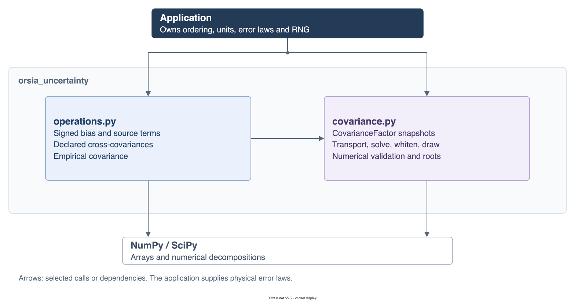

# Orsia Uncertainty

`orsia-uncertainty` provides covariance algebra, signed-bias transport, explicit source cross-covariances and Gaussian ensembles. Dense arrays and source-projection records carry the values; callers define coordinates, units, physical error laws and random streams.

## Architecture



Arrows show calls or dependencies. Each computational module can be used directly. [Full-size SVG](docs/diagrams/architecture.svg) · [Editable Draw.io source](docs/diagrams/architecture.drawio).

## Minimal example

Run the example with this distribution and its dependencies installed, or in the [Orsia development environment](../../README.md#development-environment). Two synthetic DN reads have correlated random errors and a separate signed bias. Their average uses a `(target, source)` Jacobian.

```python
import numpy as np
from orsia_uncertainty import propagate_bias, propagate_covariance

covariance = np.array([[4.0, 1.0], [1.0, 9.0]])  # DN^2
bias = np.array([1.0, -0.5])  # DN
jacobian = np.array([[0.5, 0.5]])
variance = propagate_covariance(covariance, jacobian)
shift = propagate_bias(bias, jacobian)
np.testing.assert_allclose(variance, [[3.75]])
np.testing.assert_allclose(shift, [0.25])
print(variance.item(), shift.item())
```

Expected output: `3.75 0.25`. The output variance is in DN²; the signed shift is in DN. For nonlinear models, transport is local and first order.

## Source-projected covariance

[`ProjectedCovariance`](docs/source-projection.md) retains diagonal/dense source covariance and dense/CSR projection maps. Products, transport, selection and marginals avoid observation-square storage. Distinct source blocks explicitly declare zero cross-covariance; correlated sources use a joint block. Dense materialization requires a byte budget. A specialized positive-diagonal-plus-low-rank solve complements the existing dense factors, with explicit failure on unsupported numerical support.

The [worked source example](docs/source-projection.md#independent-reads-and-a-common-gain-mode) separates independent noise from a common gain mode. The [native DN example](../orsia-instruments/docs/observation-cubes.md) computes physical calibration derivatives and preserves shifted band supports through accumulation.

## Numerical conventions

- Dense API inputs are float64 arrays. A covariance is a variance vector `(n,)` or a dense matrix `(n,n)`; vector entries are variances. Both covariance axes follow the same caller-defined order.
- Inputs remain unchanged; outputs are independent writable arrays. Reusable `CovarianceFactor` objects own immutable snapshots and require rebuilding after covariance changes.
- Singular positive-semidefinite covariance supports transport and sampling. Solving and whitening require an eigenvalue ratio strictly greater than `1e-12`; no regularisation or pseudoinverse is implicit.
- Source sums require one explicit cross-covariance per source pair. Sampling requires a caller-owned NumPy generator.

## Read next

- [Source-projected covariance](docs/source-projection.md): sparse maps, joint source semantics, budgets and specialized solves.
- [Covariance and ensemble reference](docs/covariance.md): module ownership, prepared-factor reuse, shapes, tolerances and source sums.
- [Orsia Inverse](../orsia-inverse/README.md): fixed-covariance estimation using this package's factors.

Run `devbox run -- just --justfile tests/justfile pytest libs/orsia-uncertainty/tests` from the workspace root. Synthetic algebra checks leave physical error laws, population coverage and image-scale resource costs application-specific.

## Sparse field covariance and explicit temporal draws

[`sparse_row_product`](src/orsia_uncertainty/sparse.py) compacts the used source-column domain before multiplying local sparse rows. Sparse covariance validation uses bounded dense work for at most 64 coordinates and sparse extreme-eigenvalue checks for larger non-diagonally-dominant matrices. [`covariance_from_marginals`](src/orsia_uncertainty/spatial.py) combines sparse detector covariance, common modes and the remaining independent marginal variance without double counting.

[`sample_linear_process`](src/orsia_uncertainty/temporal.py) receives transition and covariance roots explicitly. It advances a caller-owned generator in chronological order, preserving the selected factorization and draw dimensions. [`statistics`](src/orsia_uncertainty/statistics.py) provides projected Gaussian sample summaries, Wilson binomial intervals, first half-probability crossing brackets and finite-interval metric sensitivities. Acceptance thresholds, physical error laws and campaign decisions remain caller responsibilities.
