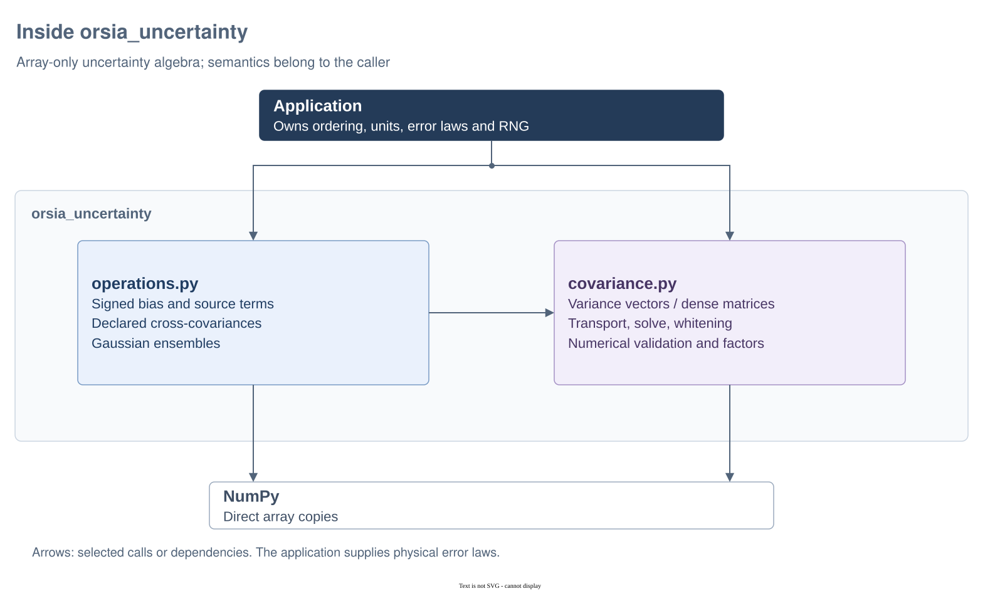

# Inside `orsia_uncertainty`

`orsia_uncertainty` computes with NumPy covariance arrays and signed vectors through caller-supplied linear maps. Coordinate ordering, units, support and physical homogeneity belong to the caller, not this package. The [API reference](../../README.md) describes numerical conditioning, ownership and migration.

## Architecture at a glance



Diagram: [editable Draw.io source](../../docs/diagrams/architecture.drawio) · [PNG export](../../docs/diagrams/architecture.png). Arrows mean calls or dependencies, not a mandatory pipeline. Applications may call either computational module directly.

| Source | Responsibility | Boundary |
| --- | --- | --- |
| `covariance.py` | Numerical validation, covariance application/transport, solves and whitening | Variance vectors or dense matrices; singular PSD is allowed except for solving/whitening. |
| `operations.py` | Signed-vector transport, source sums, cross terms and Gaussian ensembles | Arrays and ordinary mappings; no source-metadata records or physical laws. |
| NumPy / SciPy | Arrays, linear algebra and explicit numerical factors | Inputs remain unchanged; prepared factors are independent snapshots. |

## Progressive examples

Run the three blocks in order in one Python session with this distribution installed. They describe two synthetic DN reads and their average; no physical noise law is inferred.

### 1. Supply a covariance array

```python
import numpy as np

covariance = np.array([[4.0, 1.0], [1.0, 9.0]])  # DN², read order chosen here
variances = np.array([4.0, 9.0])  # diagonal alternative, no cross term
```

The diagonal entries are variances, not standard deviations. The off-diagonal entry specifies correlation. Both axes must follow the same read order; the numerical core cannot detect a mislabeled or permuted input. Functions validate numerical covariance properties themselves, without requiring a wrapper constructor.

### 2. Transport random uncertainty and signed bias separately

```python
from orsia_uncertainty import propagate_bias, propagate_covariance

jacobian = np.array([[0.5, 0.5]])  # (target, source), average of the two reads
bias = np.array([1.0, -0.5])  # signed DN shifts in the same read order
transported = propagate_covariance(covariance, jacobian)
transported_bias = propagate_bias(bias, jacobian)
np.testing.assert_allclose(transported, [[3.75]])
np.testing.assert_allclose(transported_bias, [0.25])
```

The variance is `(4 + 9 + 2*1)/4 = 3.75 DN²`; dropping correlation would give `3.25 DN²`. Bias retains its sign and is not added to covariance. For a nonlinear map this is local first-order transport, not a guarantee about its full output distribution. The caller checks the units and physical applicability of the Jacobian.

### 3. Prepare repeated operations and own the random stream

```python
from orsia_uncertainty import gaussian_sampler, covariance_solver, whitener

vector = np.array([2.0, -1.0])
solve = covariance_solver(covariance)
whiten = whitener(covariance)
np.testing.assert_allclose(covariance @ solve(vector), vector)
np.testing.assert_allclose(whiten(vector) @ whiten(vector), vector @ solve(vector))

draw = gaussian_sampler(covariance)
samples = draw(np.random.default_rng(42), 8)
replay = draw(np.random.default_rng(42), 8)
assert samples.shape == (8, 2)  # (realisation, read)
np.testing.assert_array_equal(samples, replay)
```

Preparing factors consumes no RNG; sampling does. The equality checks seeded replay, not whether eight samples estimate covariance accurately. Prepared operations snapshot values and must be rebuilt to incorporate covariance changes. A singular covariance can define valid Gaussian draws but cannot be silently regularised for solving or whitening.

## Source attribution and limits

For several sources, supply a mapping from source identifiers to covariance arrays and one explicit cross-covariance per unordered source pair, oriented by mapping insertion order. Keep physical identities, correlation scope and attribution in the application; the numerical sum returns only a matrix. See the [source sum contract](../../README.md#source-sums-without-source-records).

The separate [inverse guide](../../../orsia-inverse/src/orsia_inverse/README.md) also uses NumPy arrays directly. These small synthetic examples do not qualify population coverage, full-image resource use or concurrent native execution.
